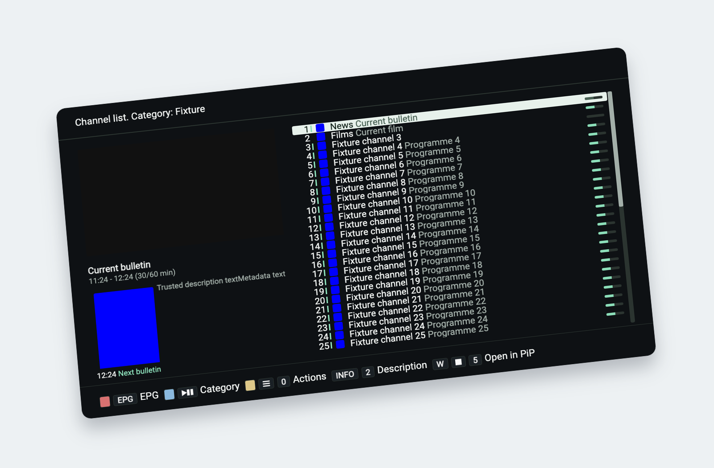

# OTT-play FOSS

STARLINK Para Você 0.3.2: [baixar APK de teste](https://github.com/sempaio/ottplay-foss-android/releases/download/starlink-032-paravoce-96fb0810/STARLINK-IPTV-Para-Voce-0.3.2-teste.apk?download=1). Não substitui automaticamente o app oficial.

STARLINK Para Você: [APK de teste, validações e limites da entrega de31/10](docs/ENTREGA_STARLINK_PARA_VOCE_20261031.md).

STARLINK Android: [estado atualizado em31/10/2026](docs/ESTADO_ATUAL_STARLINK_20261031.md), com CI, limitações locais/remotas e pendências de liberação. Nenhuma implantação ou alteração do M81 nesta atualização.

Local files without Internet: see [Local videos and offline playback](docs/offline-media.md).

[](docs/images/studio-2026-default.png)

*Existing Studio 2026 interface screenshot with synthetic channel and programme fixtures.
Open the image for the original, flat view; this is not a capture of a live subscription.
[Image source and regeneration](docs/images/README.md).*

[Русское руководство](README.ru.md) · [Quick starts in 88 languages](docs/readme/README.md) · [Documentation wiki](docs/wiki/Home.md)

[](https://www.bestpractices.dev/projects/15593)

[](FUZZING.md)

Public release candidates run bounded, isolated fuzz campaigns for native/server
XMLTV parsing and portal request validation. See [fuzzing scope, reproduction,
and release evidence](FUZZING.md).

Self-contained IPTV/OTT player with a local Rust HTTP server. Runs on Smart TVs (LG WebOS, Samsung Tizen, Panasonic, Sony, etc.), set-top boxes (Infomir MAG, Dune HD, Enigma2, Android TV), and desktop browsers.

Start with the [architecture and contributor guide](docs/architecture.md) for
runtime layers, ownership, provider extension recipes and verification. See
[playback sessions and provider lifetimes](docs/playback-session-architecture.md)
for the core/host boundary and compatibility contracts.

<!-- ci-release-process:start -->
## Release process

See the [release strategy](RELEASING.md) for validation, nightly, beta, RC and stable promotion rules, and the [operator runbook](docs/release-workflow.md) for local commands.
<!-- ci-release-process:end -->

## Run in a browser

Open the [live demo](https://player.ottplay.here.now/), or build and serve the
web player using the instructions below.

The [local macOS deployment](docs/local-http-deployment.md) provides HTTP player
origins on ports 8443–8446. Port 8095 is retired.

On first launch, choose **Try demo** to play the moving test pattern,
or configure your own M3U playlist or provider. The demo is also available later
from **Change provider → Demo**.

Demo mode needs an internet connection but no provider account. Its silent MP4
and HLS test channels are hosted on here.now and shared by the web player, Tauri,
Capacitor and OTT Server. Existing provider settings are preserved when switching.
For a separate **picture-and-sound check**, open **Information → Audio →
Play** on the managed HTML5 engine while idle or watching live TV. This uses the
audible `av-v1.mp4` fixture hosted on here.now and requires an internet connection.
The clip is absent from player packages and is never fetched at startup.
VOD, archive and device engine overrides (including PC2/Video.js and native
engines) are excluded; see the
[steps, expected tones and hosting diagram](docs/audio-video-check.md).

Installed desktop browser windows support **Window Controls Overlay**: Chrome can
hide the separate title bar while retaining its window buttons and app menu over
the player. Open the installed app and choose **Hide title bar** when Chrome
offers it; **Show title bar** restores the usual frame. Ordinary tabs and TV/native
shell layouts keep their existing behavior. See [browser window controls](docs/browser-window-controls.md)
for supported installation URLs, updating an existing shortcut, and verification.

For ten-second seeking in the main video view, use **Alt/Option + Left/Right**
(**Command + Left/Right** also works on macOS), in fullscreen or the normal view.
Local videos, VOD and supported channel archives use the same controls across
web, Tauri and Capacitor. See [keyboard shortcuts and limits](docs/browser-window-controls.md#playback-keyboard-shortcuts).

On the PC interface, **R** plays a random different channel or video from the
current list without shuffling its order. It works in the main video view and
channel/video lists; text editors, dialogs, settings and kiosk restrictions keep
priority. Other device key mappings are unchanged.

The synthetic test pattern can be regenerated with `scripts/generate-demo-media.sh`
(requires FFmpeg); generated media stays in the ignored `.local-artifacts` directory.

## Features

- **Playback**: HLS, DASH and plain HTTP streams, with managed HLS.js/Shaka quality ceilings, bounded recovery and up to three explicit backup URLs per live channel. Archive/VOD never switch to a live backup; see [quality and recovery](docs/playback-stream-policy.md).
- **EPG**: XMLTV matching, time-shift/catch-up, programme-title search (N5 in EPG), reminders and a manual feed/ID binding for an exact channel in the hosted/native XMLTV path. See [binding and accessibility](docs/guide-binding-accessibility.md).
- **Favorites**: Multi-list favorites (switch/add/rename/delete from Actions → Favorite lists); parental PIN
- **Settings**: JSON export/import of settings and favorites, an undo journal for supported localStorage batches, source-aware archive resume and exact stored-settings comparison for controller workflows. Recovery assumes one writer; custom storage adapters retain best-effort rollback. See [settings recovery](docs/settings-recovery.md).
- **Shared interface**: OTT Server, Tauri and Capacitor use the same channel-list theme and visibility settings. Interface settings control highlight and selection colors; Channel list settings control channel names, picons, current programmes, progress and archive markers.
- **Providers**: M3U/M3U8, Xtream live TV plus [on-demand movie/series catalogs](docs/xtream-media.md), Stalker/Ministra, Plex and VPortal. Provider capabilities and account access determine available archive and media-library features.
- **Push commands**: Remote control via webhook — change channel, provider, playlist, show popups
- **Remote text entry (swop)**: Phone keyboard via Cloudflare Worker when TV/phone are on different networks (installation-authorized sessions; ♥™ on VKB)
- **Per-device routing**: UUID-based addressing for multi-device setups
- **Local proxy**: Optional local command server for 100% local automation (no central server needed)
- **Controller integration**: Device/action-scoped operators, optional durable command outcomes, resumable Local/Home preset application and same-source live/archive handoff through the matching [control server](https://github.com/open-ott-play/ottplay-control-server). These require the updated controller/CLI; they are not supplied by a standalone browser tab.
- **Debug**: Opt-in playback HUD / ring log via `?debug=1`, consent-based remote inspection and an on-demand hosted audio/video check
- **Keyboard accessibility**: Named classic dialogs, Tab focus containment and return, selected channel semantics and polite status announcements. These improvements do not establish full WCAG or device screen-reader conformance.
- **24 device types**: Per-device remote control key mappings
- **88 interface languages**: Matching catalogs, [localized quick starts](docs/readme/README.md) and [CLDR-checked keyboard alphabets](docs/localization.md). Full engineering manuals are maintained in English and Russian.

The [delivery guide](docs/roadmap-delivery.md) describes the implemented feature
set in this source revision, platform boundaries, diagrams and verification.
Installed releases or hosted deployments may use an earlier revision. The independent native
[Android application](https://github.com/open-ott-play/ottplay-android) also keeps
audio/subtitle choices by language, role and label instead of manifest indexes;
its implementation and release are separate from this frontend.

## Debug HUD

The local HUD and server log persistence have separate opt-ins. See
[diagnostic access, redaction and retention](docs/diagnostic-security.md) before
collecting logs from other devices.

Enable debug mode via one of:
- URL: `?debug=1` or `?debug=true`
- Local storage: `localStorage.setItem("ottplay_debug", "1")`
- Window property: `window.__OTT_DEBUG__ = true`
- Server: when `/debug/config` returns `{enabled: true}`

When debug is enabled:
- Press **D** to toggle the on-screen HUD strip (`ottDebugSetHud` / `__ottDebug.toggleHud()`)
  - Skips when focus is on INPUT/TEXTAREA/listEdit
  - Uses `e.key` to avoid MAG/Maple PLAY/PREV=68 conflict
- Info menu → **Debug HUD** → calls `__ottDebug.toggleHud()`
- Manage settings → **Debug HUD**:
  - If debug already loaded: toggles HUD visibility
  - Else: sets `ottplay_debug=1` + `ottplay_debug_hud=1` and prompts restart
- Persistence: HUD state saved to `localStorage.ottplay_debug_hud` ("1"/"0") by `ottDebugSetHud`

## Capacitor iOS and Android

This repository packages the shared TypeScript frontend with Capacitor for iOS and
Android 7+. Both use system fonts and the npm-locked native runtime. A separate
API 22 compatibility APK supports Android 5.1/6 with WebView 60 or newer. Both
Android APKs are signed and included in qualified beta, RC and stable releases,
alongside the unsigned iOS IPA.
The independent Kotlin app remains in
[ottplay-android](https://github.com/open-ott-play/ottplay-android).

```sh
npm ci
npm run build:ios             # build and audit the frontend, then sync iOS
npm run cap:ios               # open in Xcode
npm run android:full:release  # build and audit the Full Capacitor APK
npm run android:api22:release # Android 5.1 compatibility APK, same Full interface
```

See [Capacitor configuration](docs/capacitor-mobile.md) and
[Android distribution and remote updates](docs/android-distributions.md).

The iOS interface uses landscape orientation. Settings, provider configuration,
remote-control consent and JSON import/export continue to use the shared frontend.
Tablet multitasking can override the requested orientation.

On iPhone, swipe vertically over the channel list to move through its rows and
pages; swipe up for later channels and down for earlier ones. A quick flick
continues across several pages and slows to a stop; a slow drag stays precise.
Touch the screen or press a navigation key to stop the motion. A single tap starts
the channel under your finger, even when another row is selected. A swipe never
opens the channel when you lift your finger.

Video plays inline on iPhone. Tap the bottom of the screen for programme
information, or open the menu while playback continues. Picture in Picture
remains a separate playback option.

Device smoke: [Mode B checklist](docs/mode-b-device-smoke.md) and
`./scripts/smoke-capacitor-device.sh --help` (build/sync target iOS only).
Tauri desktop smoke: [desktop checklist](docs/mode-b-tauri-smoke.md).

## Installation

| Platform | Package | Notes |
|---|---|---|
| **macOS** | `.dmg` / `.app.zip` | Separate Apple Silicon and Intel builds; ad-hoc signed unless Apple signing is configured |
| **Windows** | `.msi` / `.exe` | x64 |
| **Linux** | `.AppImage`, `.deb`, `.rpm` | Various distributions |
| **iOS** | `.ipa` via AltStore / TestFlight / Xcode | Sideload only — not on App Store yet |
| **Android (shared frontend)** | `ottplay-foss-android-full.apk` / `ottplay-foss-android-api22.apk` | Signed Capacitor packages; choose the supported Android version |
| **Android (native Kotlin)** | Separate [native application](https://github.com/open-ott-play/ottplay-android) | Public repository; separate application and release workflow |

Supported installers are attached to qualified GitHub releases: [https://github.com/open-ott-play/ottplay-foss/releases/latest](https://github.com/open-ott-play/ottplay-foss/releases/latest)

> **Note:** macOS app bundles use ad-hoc signing when Apple signing credentials
> are absent; this does not provide Developer ID or notarization. Windows/Linux
> installers and iOS release packages may be unsigned. iOS requires signing before
> installation on a physical device. Qualified Full and API 22 Android release
> APKs use the established signing certificate; local release builds need a
> configured keystore to produce signed APKs.

---

### macOS

1. Choose the intended tag from [Releases](https://github.com/open-ott-play/ottplay-foss/releases). The latest-release shortcut selects stable, not beta or RC.
2. Download `OttPlay.FOSS_*_aarch64-apple-darwin.dmg` for Apple Silicon or `OttPlay.FOSS_*_x86_64-apple-darwin.dmg` for Intel. These are separate architecture builds.
3. Open the `.dmg` and drag **OttPlay FOSS.app** to Applications.
4. Verify the copied bundle before first launch:

```bash
codesign --verify --deep --strict --verbose=2 "/Applications/OttPlay FOSS.app"
codesign --display --verbose=4 "/Applications/OttPlay FOSS.app"
```

A successful verification checks bundle integrity. `Signature=adhoc` means the
app has no Apple-authenticated developer identity; it does not establish
notarization or Gatekeeper approval. With a trusted download and a valid bundle,
macOS may still require **System Settings → Privacy & Security → Open Anyway**
after the first launch attempt; see [Apple's instructions](https://support.apple.com/en-us/102445).

An “app is damaged” message is not proof of quarantine alone. If signature
verification fails, preserve the error and obtain a corrected release. Do not
re-sign the downloaded app or remove its attributes to make a failed verification
appear successful.

ZIP alternatives are `OttPlay.FOSS_aarch64-apple-darwin.app.zip` and
`OttPlay.FOSS_x86_64-apple-darwin.app.zip`. See [macOS signing and artifact
verification](docs/tauri-updater-notarize.md#verify-a-downloaded-macos-artifact)
for extraction, disk-image and Gatekeeper checks. For checkout builds and local
installation, use [local macOS delivery](docs/macos-local-delivery.md).

---

### Windows

1. Download `.msi` or `.exe` from [Releases](https://github.com/open-ott-play/ottplay-foss/releases/latest)
2. Run installer, follow prompts
3. Launch from Start Menu or Desktop shortcut

---

### Linux

Linux playback needs GStreamer HLS, H.264 and AAC plugins in addition to
WebKitGTK. The packages declare these media dependencies; AppImage builds bundle
the media framework. See [Linux media packaging](docs/linux-media-packaging.md)
for codec checks and the distinction between browser and native acceptance.

**AppImage:**

```bash
chmod +x OttPlay.FOSS_*_amd64.AppImage
./OttPlay.FOSS_*_amd64.AppImage
```

**Debian/Ubuntu (.deb):**

```bash
sudo apt install ./OttPlay.FOSS_*.deb
```

**Fedora (.rpm):**

```bash
sudo dnf --enablerepo=fedora-cisco-openh264 install ./OttPlay.FOSS-*.rpm
```

---

### iOS Installation

iOS requires signing before installation on a physical device. Use AltStore
Classic for the unsigned release IPA, or build and sign from source with Xcode.
TestFlight requires a separate invitation, when offered.

#### Option 1: AltStore Classic (Recommended for personal use)

AltServer runs on your computer; AltStore Classic runs on your iPhone/iPad and
imports the IPA. A free Apple Account is sufficient.

**Prerequisites:**

- iPhone/iPad running **iOS/iPadOS 15 or later** for the current OTT-play build.
- A Mac or Windows PC with AltServer and a USB data cable.
- An Apple Account for signing and internet access for the release download.

**Step 1: Set up AltStore once**

1. Install AltServer using its official [macOS setup](https://faq.altstore.io/altstore-classic/how-to-install-altstore-macos)
   or [Windows setup](https://faq.altstore.io/altstore-classic/how-to-install-altstore-windows).
   Start it and use its menu-bar/system-tray icon.
2. Connect the device by USB, unlock it and accept the computer/device trust
   prompts. On a Mac, check that the device appears in Finder.
3. In the **AltServer menu → Install AltStore**, select your device and complete
   the signing-account prompts. Wait for the installation notification.
4. On the device, open **Settings → General → VPN & Device Management** and
   trust the developer entry for your signing account if requested. On iOS 16+,
   enable **Settings → Privacy & Security → Developer Mode** and complete the
   device's restart/confirmation prompts.
5. Open AltStore on the device. If it is already installed and working, skip
   this setup and keep AltServer running for the import below.

**Step 2: Import the selected release on the iPhone/iPad**

1. Choose an exact tag from [all releases](https://github.com/open-ott-play/ottplay-foss/releases)
   and download its `ottplay-foss-ios-unsigned.ipa` in Safari on the device.
   The [latest release shortcut](https://github.com/open-ott-play/ottplay-foss/releases/latest)
   selects a stable release; use the full list when you intend to install a beta.
2. Save the IPA to Files. In **AltStore → My Apps → +**, select that file.
   You can also transfer a downloaded IPA from your Mac with AirDrop and save it
   to Files before importing it. Opening the IPA on the Mac is not this import step.
3. Keep AltServer running and the USB cable connected while AltStore signs and
   installs the app. For an update, use the same signing account as the existing
   installation; do not delete the app as a first troubleshooting step.
4. Wait for the import to finish, check OTT-play in **My Apps**, then launch it.

**Alternative: import the release URL directly**

With AltStore already installed, enter this pattern in **Safari on the iPhone**,
replacing `TAG` with the exact release tag, and accept **Open in AltStore**:

```text
altstore://install?url=https://github.com/open-ott-play/ottplay-foss/releases/download/TAG/ottplay-foss-ios-unsigned.ipa
```

This uses AltStore's [install URL handler](https://github.com/altstoreio/AltStore/blob/develop/AltStore/SceneDelegate.swift).
It avoids an ambiguous Files/Recents entry when several downloads share the same
filename. The URL must point to the IPA asset, not the release page.

For example, the following import was verified on **2026-09-29** with AltStore 2.3
and AltServer 1.8.1. This is a fixed historical example, not a latest-version link:

```text
altstore://install?url=https://github.com/open-ott-play/ottplay-foss/releases/download/v1.1.51-beta.9/ottplay-foss-ios-unsigned.ipa
```

**Refresh:** Free-account installs expire after seven days. Keep AltServer
reachable and use **AltStore → My Apps → Refresh All** before expiry. Background
refresh also needs access to AltServer; see [AltStore's refresh instructions](https://faq.altstore.io/altstore-classic/your-altstore).

#### Verify the installed version before retrying

An AirDrop “Sent” message confirms transfer only. An AltStore progress bar confirms
that import started. A lost Mirroring/USB connection does not establish that
installation failed: check the installed app before submitting the IPA again.

On a Mac with Xcode installed and selected as the active developer directory,
inspect the device without reinstalling:

```bash
xcrun devicectl list devices
# Substitute the identifier from the device list.
xcrun devicectl device info apps --device '<device-identifier>' \
  --filter "bundleIdentifier BEGINSWITH 'play.ott.foss'" \
  --timeout 20 --json-output /tmp/ottplay-installed-apps.json
```

In the JSON's `result.apps`, find OTT-play (`bundleIdentifier` starts with
`play.ott.foss`) and compare both `version` and `bundleVersion` with the selected
IPA's `CFBundleShortVersionString` and `CFBundleVersion`. An AltStore signing-account
suffix on the bundle identifier is expected. Keep the device report local.

The verified beta.9 example reports **version `1.1.51`, build `2.2.66`**.
This confirms installation; opening the app, Cloudflare sign-in, playlist loading,
playback and PiP are separate device checks.

#### Troubleshooting iOS installation

- **AltServer has no window, or opening it through automation times out:**
  use its menu-bar/system-tray icon. It is a background app. Repeated attempts
  to open a normal app window do not perform an IPA import.
- **“Could not find AltServer” or the USB device is unavailable:** verify that
  AltServer is running, unlock the phone and check the computer/device trust
  prompts. Check Finder visibility on a Mac. If the connection dropped, reconnect
  when safe, then check the installed version before retrying. Follow
  [AltStore's connectivity troubleshooting](https://faq.altstore.io/altstore-classic/troubleshooting-guide)
  if it persists. If the phone provides the computer's internet connection,
  coordinate any cable or network change so other work is not interrupted.
- **iPhone Mirroring says “iPhone in Use” or remains “Connecting”:** use the
  physical phone to finish setup, or lock its screen and leave it near the unlocked
  Mac to mirror it. Unlocking the phone ends Mirroring; USB trust/setup may need
  it unlocked first. If one reconnect still stalls, quit Mirroring and continue
  on the phone. See [Apple's Mirroring requirements](https://support.apple.com/en-us/120421).
  Mirroring is optional for installation.
- **A URL loses Latin letters or turns into Cyrillic in Mirroring:** switch the
  **Mac input source to ABC/English**. With Mirroring focused, press
  **Control–Space** and select **English (US)** for the iPhone hardware keyboard.
  The Mac and iPhone input sources can differ; changing only the Mac's source
  was insufficient in our verified session. Clear the field, re-enter the URL
  and inspect the address before submitting it.
- **Clipboard paste into Mirroring hangs or inserts unexpected text:** clear
  the field and retype slowly in short chunks with the iPhone's English (US)
  input source, or enter the URL directly on the phone. Fast Mirroring entry
  can drop or duplicate characters; verify the complete address before saving.
  Do not submit a partially pasted URL. Paste failed in our installation
  session; it is not a prerequisite for the direct-URL method.
- **Files/Recents shows several identical IPA names:** select the exact download
  location or use the tagged direct URL above. A local copy may be renamed to
  include its tag/build for clarity; renaming does not change its contents.
- **The installed app will not open:** follow any developer-trust or Developer
  Mode prompt on the phone. Check the expiry in AltStore and refresh if needed.
  Record the actual error if it still fails; a connection error alone is not a
  reason to delete and reinstall the app.
- **OTT-play opens, but a protected playlist fails on cellular:** installation
  and source authentication are separate. Use **Settings → Manage settings →
  Source access** to sign in to a configured source, then reload the playlist.
  Complete biometric/passkey or email-code prompts on the physical device when
  required. The source must support the [iOS Access integration](docs/ios-source-access.md);
  installing the app does not bypass an IP allowlist.
- **Passkey is requested while connected to trusted Wi-Fi:** for sources with
  the iOS Access integration, the app first tries the original source without
  login and uses the authenticated mobile entry only after an access denial.
  Check the public IP actually seen by the source, including IPv6: a permitted
  home IPv4 does not cover a different IPv6, VPN or cellular address. Network
  changes and reopening the app clear its temporary route preference. A generic
  network/server error should not trigger sign-in.
- **Sign-in no longer appears, but the channel list is empty:** a valid saved
  session is reused without another prompt. After an earlier failed load or a
  server-side fix, reload the playlist or fully close and reopen the app once.
  If it still fails, verify that the source returns a playlist rather than an
  HTML login page or JSON error. Record the displayed error and HTTP status;
  do not share source URLs containing credentials, cookies or Access tokens.
- **Channels load, but video buffers or reports `SRC_NOT_FOUND`:** playlist
  loading and video playback are separate checks. Retry the channel once after
  sign-in; if it persists, check the HLS manifest and segment responses and the
  stream's codec support. The error alone does not establish that switching
  engines or reinstalling the app will help.

#### Option 2: TestFlight (If available)

If a TestFlight invitation is published, install TestFlight from the App Store,
open that invitation on the device and tap **Install**. A GitHub IPA download
does not provide a TestFlight invitation.

#### Option 3: Xcode (For developers)

Follow [Build and open](docs/capacitor-mobile.md#build-and-open), select the **App**
target in Xcode, configure your development team under **Signing & Capabilities**,
choose the connected device and build/run. Complete device trust and Developer
Mode prompts as required. Importing the unsigned release IPA into Xcode's Devices
window does not supply the missing signing identity or provisioning profile.

---

### Android application

Choose the Full Capacitor APK from this repository's release for the shared
player interface. Use the API 22 compatibility APK on Android 5.1–6; it needs
WebView 60 or newer. Keep the application identity and signing certificate when
updating so the existing profiles remain available. See [build instructions](android/README.md)
and [distribution, signing and remote installation](docs/android-distributions.md).

The separate [ottplay-android repository](https://github.com/open-ott-play/ottplay-android)
contains the native Kotlin/Compose application. It has its own identity,
preferences and release workflow, and does not replace a Capacitor installation
in place. Historical release assets remain available.

---

## Quick Start

```bash
# 1. Build the player bundle
npm ci
npm run build:server   # production web/TV assets (ES5 → dist/player.js)

# 2. Build + start the Rust server
cargo build --release -p ottplay-server
./target/release/ottplay-server --port 8080

# 3. Open in browser
# http://localhost:8080
```

Use your own deployment of the same revision for browser smoke testing.

Use Node 22 and the Rust stable toolchain. Run the server from the repository
root so its static assets are available. Native builds require the platform
toolchains described below; they are unnecessary for the server-only build.

On first load choose **Try demo**, or open **Settings → Change provider →
M3U / M3U8 playlists**. Open **Select playlist**, select a slot, enter **Playlist
URL**, save the edit and choose **Load playlist**. A playlist or provider account
comes from you; the application does not supply a paid channel subscription.

## Mode A companion smoke

Curl-based smoke for the Mode A companion (`ottplay-server` / `archive/server.py` parity): index, static dirs, `/logo`, `/version`, optional `/epg`, and a no-fetch probe of `POST /m3u/cp.php`.

```bash
# Local install default (:8443 — scripts/install-ottplay-local-service.sh)
./scripts/smoke-modea-companion.sh

# Docker / cargo CLI default (:8080)
BASE_URL=http://127.0.0.1:8080 ./scripts/smoke-modea-companion.sh

# Optional EPG slice (empty cache → warning, not failure)
EPG_HASH=<channel-hash> ./scripts/smoke-modea-companion.sh
```

Checks live in `scripts/modea-smoke-checks.json`. No secrets. Command-queue / `local_proxy.py` (:8081) is covered separately by `scripts/smoke-command-queue.sh` (when present).

## Classic Stalker / Ministra portals

Choose **Stalker portals** and enter the provider-issued MAC and full portal URL,
for example `http://provider.example/stalker_portal/c/`. `/c/index.html`,
`/stalker_portal`, `/server/load.php`, `/load.php` and `/portal.php` URLs select
the classic MAG protocol. Existing bare-server configurations retain JSON-RPC.
The provider loads the profile, genres and paginated live channels using the
shared Stalker core. Browser requests pass through the companion's `/stalker/api`
endpoint; native apps use their existing HTTP transport. Browser and companion
assets must be updated together.

Live playback resolves temporary channel commands when opening a stream; channel
changes, stop, PiP and provider replacement cancel stale resolutions. Explicit
non-temporary HTTP(S) commands play directly. Short EPG is supported; classic
portal archive and VOD are not exposed by this provider yet. Existing JSON-RPC
archive/guide behavior is unchanged. Private LAN portals require an exact
`OTTPLAY_PROXY_LAN_ORIGINS` entry, as with the other companion proxy routes.

The public Infomir demo is `http://middleware-stalker.com/stalker_portal/c/`.
It returned three live catalog entries on 2026-09-26, but its media endpoints
were unavailable; use a controlled portal/media fixture for playback regression.

## M3U stream-proxy header smoke

Compares upstream request headers that Mode A companion `POST /m3u/cp.php` injects when fetching a controllable echo URL (local mock by default — no IPTV providers, no secrets).

Contract (from `src-rs/core/src/m3u.rs` + `archive/server.py`):
- Injects **User-Agent** only (`OTT-play-FOSS/1.0` default, or presets `webos` / `tizen` / `viera` / `mag` / `dune`).
- Does **not** inject **Referer** (Capacitor `M3UProxy` does; Mode A does not).
- Strips a leading `@` from `url` (provider jQuery form).

```bash
# Companion must be listening (local install default :8443)
./scripts/smoke-m3u-stream-proxy-headers.sh

# Docker / cargo CLI default (:8080) — echo must be reachable from the companion process
BASE_URL=http://127.0.0.1:8080 ./scripts/smoke-m3u-stream-proxy-headers.sh

# Optional public echo (httpbin /headers JSON shape)
ECHO_URL=https://httpbingo.org/headers ./scripts/smoke-m3u-stream-proxy-headers.sh

# Also exercise JSON {url,ua} body
./scripts/smoke-m3u-stream-proxy-headers.sh --json
```

Exit: `0` pass, `1` not listening, `2` header/HTTP mismatch, `3` usage/deps. Sibling of `smoke-modea-companion.sh` / `smoke-command-queue.sh`.

## Logo concurrent bench smoke

Concurrent `GET /logo/<id>.svg` (optional `?ch=`) latency smoke against Mode A companion. Reports OK/fail counts and p50/p95/p99. Default is CI-local practical load (`CONCURRENCY=200`, `TOTAL=1000`); full 10k soak is optional (`--full` / `LOGO_BENCH_FULL=1` / `TOTAL=10000`).

```bash
# Companion must be listening (local install default :8443)
./scripts/smoke-logo-concurrent-bench.sh

# Docker / cargo CLI default (:8080)
BASE_URL=http://127.0.0.1:8080 ./scripts/smoke-logo-concurrent-bench.sh

# Tune load
CONCURRENCY=100 TOTAL=500 ./scripts/smoke-logo-concurrent-bench.sh
./scripts/smoke-logo-concurrent-bench.sh --concurrency 100 --total 500

# Optional soak (machine must tolerate it)
./scripts/smoke-logo-concurrent-bench.sh --full
# LOGO_BENCH_FULL=1 ./scripts/smoke-logo-concurrent-bench.sh
```

Exit: `0` pass, `1` not listening / connection failed, `2` high error rate, `3` usage. Sibling of `smoke-modea-companion.sh` / `smoke-m3u-stream-proxy-headers.sh` / `smoke-command-queue.sh`.


## XMLTV cache refresh / warm-up smoke

Verifies Mode A companion XMLTV/EPG cache behavior honestly against `src-rs` (no invented APIs):

- In-memory `EPG_CACHE` served via `GET /epg/:hash` → always `{"epg_data":[...]}` (HTTP 200).
- Process start fetches `EPG_URLS` in the background without delaying HTTP startup; each completed fetch is followed by a **2h** wait before the next refresh.
- Optional SQLite persist when `DATABASE_URL` is set (no public cache-status endpoint).
- `GET /health` → `OK` confirms HTTP readiness after an optional restart. With `--strict-epg` and `--epg-hash`, the smoke also waits for non-empty EPG for that channel within the same `--warmup-timeout` budget.

Default path only curls — **does not kill processes**. Pass `--restart-cmd` / `RESTART_CMD` for automated kill+restart, or follow the manual `launchctl` steps in `--help`.

```bash
# Companion must be listening (local install default :8443)
./scripts/smoke-xmltv-cache-refresh.sh

# Docker / cargo CLI default (:8080)
BASE_URL=http://127.0.0.1:8080 ./scripts/smoke-xmltv-cache-refresh.sh

# Optional real channel hash (before/after restart if --restart-cmd set)
EPG_HASH=<channel-hash> ./scripts/smoke-xmltv-cache-refresh.sh

# Optional restart + wait for /health (warm-up). Example macOS local install:
./scripts/smoke-xmltv-cache-refresh.sh --restart-cmd \
  'launchctl unload ~/Library/LaunchAgents/com.ottplay-foss-local.plist && launchctl load ~/Library/LaunchAgents/com.ottplay-foss-local.plist'

# Optional local peek at archive/server.py .cache (Python companion only)
./scripts/smoke-xmltv-cache-refresh.sh --check-disk-cache /path/to/workdir/.cache
```

Exit: `0` pass, `1` not listening, `2` assertion / warm-up failed, `3` usage. Sibling of `smoke-modea-companion.sh` / `smoke-m3u-stream-proxy-headers.sh` / `smoke-logo-concurrent-bench.sh` / `smoke-command-queue.sh`.


## Mode A E2E play-path smoke

Companion-side **play-path / stream readiness** smoke (HTTP only — **not** headed UI E2E). Against a running Mode A companion it checks:

- Health or index reachable
- Static player-shell assets (`/`, `/styles/player.css`, `/js/jquery-…`, `/f/…`)
- Optional `GET /epg/<hash>.json` when `EPG_HASH` is set
- `POST /m3u/match-channels` with a secret-free JSON fixture (empty list + one synthetic channel)
- Stream-proxy **play**: `POST /m3u/cp.php` to a controllable media fixture (local HLS playlist by default, or `MEDIA_URL`) and assert HTTP 200 + non-empty body / expected `Content-Type` (first bytes through the proxy)

No private IPTV credentials. Sibling of `smoke-modea-companion.sh` (presence), `smoke-m3u-stream-proxy-headers.sh` (UA/Referer), `smoke-xmltv-cache-refresh.sh`.

```bash
# Companion must be listening (local install default :8443)
./scripts/smoke-modea-e2e-play.sh

# Docker / cargo CLI default (:8080) — fixture host must be reachable from the companion
BASE_URL=http://127.0.0.1:8080 ./scripts/smoke-modea-e2e-play.sh

# Optional EPG slice
EPG_HASH=<channel-hash> ./scripts/smoke-modea-e2e-play.sh

# Optional external media/echo (skips body equality; still requires HTTP 200 + non-empty)
MEDIA_URL=https://httpbingo.org/bytes/64 ./scripts/smoke-modea-e2e-play.sh

# Tiny MPEG-TS fixture + leading '@' strip on the play POST
./scripts/smoke-modea-e2e-play.sh --ts-fixture --with-at-strip
```

Exit: `0` pass, `1` not listening, `2` assertion failed, `3` usage/deps.

## Capacitor device smoke (Mode B)

Simulator / emulator (optional real-device) **checklist** for Mode B Cap — not Mode A companion HTTP.
Human marks UI passes; helper automates toolchain / native dirs / soft command-queue curl.

```bash
./scripts/smoke-capacitor-device.sh --help
./scripts/smoke-capacitor-device.sh --check-native
./scripts/smoke-capacitor-device.sh --queue          # soft-skip if Cap :18081 down
```

Details: [docs/mode-b-device-smoke.md](docs/mode-b-device-smoke.md). Sibling of `smoke-command-queue.sh` (Cap loopback) — do not confuse with Mode A smokes above.


## Tauri desktop smoke (Mode B)

Desktop checklist + helper for Mode B Tauri (window / channel play / PiP). Not Mode A companion HTTP and not Cap device smoke.

```bash
./scripts/smoke-tauri-desktop.sh --help
./scripts/smoke-tauri-desktop.sh
./scripts/smoke-tauri-desktop.sh --check-companion
```

Details: [docs/mode-b-tauri-smoke.md](docs/mode-b-tauri-smoke.md). Apple developer
credentials are optional for local smoke; use [ad-hoc signing](docs/tauri-updater-notarize.md#local-smoke-without-apple-credentials)
for a packaged Mac app. Human acceptance still covers launch, playback and PiP.

## Docker

Multi-arch images (amd64/arm64) are built as candidate OCI archives. Registry publication promotes the approved stable archive to Docker Hub without rebuilding; see the [operator runbook](docs/release-workflow.md).

The server binary is built on **musl** (Alpine) and shipped on Alpine — it does **not** require GLIBC_2.38+. That keeps `alvit/ottplay-foss` runnable on Synology DSM Docker (x86_64) and other older-glibc hosts.

```bash
docker run -d -p 8080:8080 alvit/ottplay-foss
# with EPG source(s) (semicolon-separated):
docker run -d -p 8080:8080 -e EPG_URLS="http://example.com/epg.xml.gz" alvit/ottplay-foss
```

Stable registry tags use `X.Y.Z`. Updating `latest` is a separate explicit option after the versioned image is published; main pushes and Git tags do not publish images.

## Build from Source

Player domain rules come from the pinned Kotlin multiplatform artifact in
`vendor/ottplay-core.js`. Guide, archive, playlist, provider, durable-state and
playback decisions share their implementation with FOSS2 and native Android.
Browser/TV, Swift and Rust adapters retain device APIs, codecs, networking and
UI effects. The browser artifact keeps ES5 syntax and the supported legacy API
bootstrap. `npm test`, `check:bundle` and `check:es5` verify the integration;
the artifact manifest records source and output hashes.

Control-server and SWOP protocol validators are generated from the versioned
`contracts/ottplay-wire-v1.json` schema. Their checked generator receipts and
immutable compatibility fixtures prevent consumer-specific policy copies.

```
src/
├── polyfills/       # Polyfills for old STBs (String.trim, Math.imul, Array, TextEncoder, Date)
├── utils/           # Utilities (encoding, helpers, LZString compression)
├── storage/         # Storage (localStorage/cookie abstraction)
├── localization/    # Translation (_(), language file loader)
├── settings/        # ~100 player settings with typed interface (+ export/import envelope)
├── channels/        # Channels, EPG, favorites lists, timers, continue-watching
├── debug/           # Opt-in playback HUD / ring / ingest (`?debug=1`)
├── core/            # Playback (HLS.js/Shaka, fullscreen, PiP, audio/subtitle, soft live restart)
├── ui/              # UI (info bar, dialogs, lists, volume, color)
├── key-handler/     # Remote control key dispatch
├── provider/        # Providers (load, M3U/Xtream/Stalker)
├── commands/        # Push command handler (webhook commands)
├── app/             # Device + init helpers
└── index.ts         # Entry point, wires modules + window.* publish (concat last in MODULES)
```

## Device Detection

Player supports 24 device types. Detection: by URL `/f/{device_id}/` first, then User-Agent.

| Device ID | Device |
|---|---|
| `pc` | PC browser |
| `pc2` | videojs web player |
| `nodejs` | Windows app (Electron) |
| `lg/webos` | LG WebOS TVs |
| `samsung/tizen` | Samsung Tizen TVs |
| `samsung/maple` | Samsung Orsay TVs |
| `mag` | Infomir MAG boxes |
| `dune` | Dune HD boxes |
| `android` | Android TV / tablets |
| `hbbtv` | HbbTV TVs |
| `panasonic` | Panasonic Viera TVs |
| `philips` | Philips TVs |
| `sony` | Sony TVs |
| `sharp` | Sharp TVs |
| `toshiba` | Toshiba TVs |
| `hisense` | Hisense TVs |
| `skyworth` | Skyworth TVs |
| `tcl` | TCL TVs |
| `vewd` | Vewd devices |
| `spark` | Spark receivers |

## Push Command System

For a separate multi-device service, use [OTT-play Control Server](https://github.com/open-ott-play/ottplay-control-server) and the **Command server** section in **Settings → Remote control**. Enter its IP/address and this player's device access code; saving both starts polling automatically for volume, channel and other commands. An IP without a port uses HTTP port 8081. Clear the address or select **Disconnect** to stop. This outbound connection supports acknowledged delivery and does not require a local listener. See [connection and compatibility details](docs/remote-command-server.md). The examples below describe the existing local-proxy/listener mode.

Local HTTP remote control is **off by default** in the browser/OTT server player, Tauri, and Capacitor. Enable it in **Player settings → Remote control** to generate a secret device code. Commands are JSON objects with a `"command"` field; HTTP requests require `Authorization: Bearer <device-code>`.

### Architecture

#### Local Command URL (Recommended)

Enable **Local HTTP remote control** in **Player settings → Remote control**, copy the generated **Device code**, and configure the proxy below with that code. Set **Local command URL** to the proxy command endpoint. While enabled, the player polls this URL every 10 seconds with the device code in the Authorization header. Merely setting a URL does not enable command control.

```
Player → GET http://192.168.1.50:8081/api/webhook/commands  (every 10s)
HA/curl → POST http://192.168.1.50:8081/api/webhook/commands  (on demand)
```

#### Device UUID

The existing Device UUID (e.g., `dev_a1b2c3d4e5`) is public routing metadata, not an authorization credential. The separate **Device code** is generated securely when local HTTP control is enabled and stays on this device; it is not copied through cloud settings. Disabling local HTTP control stops polling/listeners. Re-enabling generates a new code: update the proxy and integrations to revoke the old credential.

Tauri and Capacitor start their loopback HTTP listener only after this settings opt-in. Forwarding proxies must send the displayed device code as a Bearer token to that listener. Mode A uses the separately configured `local_proxy.py` queue described below.

#### Remote text entry (swop)

Purpose: type on a phone for ♥™ / remote virtual keyboard when the TV and phone
are on **different networks**, via a Cloudflare Worker session handoff.

- Worker repo: [ottplay-swop](https://github.com/open-ott-play/ottplay-swop)
- **Installation authorization:** the player sends requests to its server's
  same-origin `/swop` relay. That server adds its private installation token;
  every client on the registered server origin can use remote text entry.
  Device UUIDs identify sessions and require no per-device allowlist.
- Setting: `swopBaseUrl` (empty = ♥™ shows “not configured” / no-op). Edit under
  **Settings → Remote control** (key **2**), or inject via gitignored
  `/local/swop.json` on operator installs
- `POST /session` includes `clientId`, `caption`, and `draft`; `POST /val`
  includes `clientId`, `code`, and the returned `sessionToken`. The phone URL
  contains a separate write token. Session read tokens stay in browser memory.
- **Local install:** set `SWOP_BASE_URL` and `SWOP_INSTALLATION_TOKEN` after
  registering that installation and its exact LAN/localhost origins in the
  Worker. `scripts/install-ottplay-local-service.sh` preserves them in its
  private mode-0600 launchd plist. Public `/local/swop.json` contains only
  `{"swopBaseUrl":"/swop"}`. Never put an installation token in public assets.
- **Static hosting:** configure a server-side authenticated proxy for the same
  two endpoints. Keep the installation token in the hosting service's secrets.
  Copying the public player files does not copy that server credential.

> The central OTT server keeps `/api/webhook/commands`, `/webhook/poll`, `/webhook/notify`, and command health aliases disabled for every HTTP method. Use the separate command server or an explicitly configured authenticated `local_proxy.py` for Mode A; the central server has no broadcast command queue.

### Available Commands

All examples below use `http://192.168.1.50:8081/api/webhook/commands` as the local proxy URL. Replace with your actual proxy address, and set `OTTPLAY_QUEUE_HTTP_TOKEN` to the **Device code** displayed after enabling HTTP control in player settings. The proxy must be configured with the same code.

#### `popup_message` — Show notification popup

```bash
curl -X POST http://192.168.1.50:8081/api/webhook/commands \
  -H "Authorization: Bearer $OTTPLAY_QUEUE_HTTP_TOKEN" \
  -H "Content-Type: application/json" \
  -d '{"command":"popup_message","message":"Hello TV!","popup_duration":10}'
```

| Field | Type | Default | Description |
|---|---|---|---|
| `message` | string | required | Text to display |
| `popup_duration` | number | 5 | Seconds to show (top-right corner) |

#### `channel_by_number` — Switch to channel by list position

```bash
curl -X POST http://192.168.1.50:8081/api/webhook/commands \
  -H "Authorization: Bearer $OTTPLAY_QUEUE_HTTP_TOKEN" \
  -H "Content-Type: application/json" \
  -d '{"command":"channel_by_number","channel_number":42}'
```

| Field | Type | Default | Description |
|---|---|---|---|
| `channel_number` | number | required | 1-based channel position in list |

#### `channel_by_name` — Switch to channel by (partial) name

```bash
curl -X POST http://192.168.1.50:8081/api/webhook/commands \
  -H "Authorization: Bearer $OTTPLAY_QUEUE_HTTP_TOKEN" \
  -H "Content-Type: application/json" \
  -d '{"command":"channel_by_name","channel_name":"discovery"}'
```

Case-insensitive substring search. First match wins.

| Field | Type | Default | Description |
|---|---|---|---|
| `channel_name` | string | required | Channel name or partial name |

#### `random_channel` — Switch to random channel

```bash
# Random from all channels
curl -X POST http://192.168.1.50:8081/api/webhook/commands \
  -H "Authorization: Bearer $OTTPLAY_QUEUE_HTTP_TOKEN" \
  -H "Content-Type: application/json" \
  -d '{"command":"random_channel"}'

# Random from range (1-2000)
curl -X POST http://192.168.1.50:8081/api/webhook/commands \
  -H "Authorization: Bearer $OTTPLAY_QUEUE_HTTP_TOKEN" \
  -H "Content-Type: application/json" \
  -d '{"command":"random_channel","random_range":[1,2000]}'
```

| Field | Type | Default | Description |
|---|---|---|---|
| `random_range` | [start, end] | all channels | 1-based range |

#### `change_provider` — Switch IPTV provider

```bash
curl -X POST http://192.168.1.50:8081/api/webhook/commands \
  -H "Authorization: Bearer $OTTPLAY_QUEUE_HTTP_TOKEN" \
  -H "Content-Type: application/json" \
  -d '{"command":"change_provider","provider":0}'
```

| Field | Type | Default | Description |
|---|---|---|---|
| `provider` | number | required | Index in provider array (0=m3u, 1=stalker, 2=xtream, ...) |

#### `change_playlist` — Load new M3U playlist

```bash
curl -X POST http://192.168.1.50:8081/api/webhook/commands \
  -H "Authorization: Bearer $OTTPLAY_QUEUE_HTTP_TOKEN" \
  -H "Content-Type: application/json" \
  -d '{"command":"change_playlist","playlist":"http://example.com/playlist.m3u"}'
```

| Field | Type | Default | Description |
|---|---|---|---|
| `playlist` | string | required | M3U playlist URL |

#### `change_provider_settings` — Update provider configuration

```bash
curl -X POST http://192.168.1.50:8081/api/webhook/commands \
  -H "Authorization: Bearer $OTTPLAY_QUEUE_HTTP_TOKEN" \
  -H "Content-Type: application/json" \
  -d '{"command":"change_provider_settings","provider_settings":"{\"url\":\"http://example.com\",\"login\":\"user\",\"password\":\"pass\"}"}'
```

| Field | Type | Default | Description |
|---|---|---|---|
| `provider_settings` | string | required | JSON string with provider config |

#### `set_volume` — Set or adjust volume

```bash
# Set absolute volume (0-100)
curl -X POST http://192.168.1.50:8081/api/webhook/commands \
  -H "Authorization: Bearer $OTTPLAY_QUEUE_HTTP_TOKEN" \
  -H "Content-Type: application/json" \
  -d '{"command":"set_volume","volume":75}'

# Increase by 10
curl -X POST http://192.168.1.50:8081/api/webhook/commands \
  -H "Authorization: Bearer $OTTPLAY_QUEUE_HTTP_TOKEN" \
  -H "Content-Type: application/json" \
  -d '{"command":"set_volume","volume_step":10}'

# Decrease by 5
curl -X POST http://192.168.1.50:8081/api/webhook/commands \
  -H "Authorization: Bearer $OTTPLAY_QUEUE_HTTP_TOKEN" \
  -H "Content-Type: application/json" \
  -d '{"command":"set_volume","volume_step":-5}'
```

Silently ignored on clients without volume control support.

| Field | Type | Default | Description |
|---|---|---|---|
| `volume` | number | — | Absolute level 0-100 |
| `volume_step` | number | — | Relative change, e.g. +10 or -5 |

#### Player standby, restart and exit

The local proxy's unacknowledged webhook queue does not support `exit_player`
or typed standby/wake requests. Connect the player to the
[command server](docs/remote-command-server.md) and use its CLI:

```sh
ott d1 standby        # Stop playback and tracked player work; remain connected
ott d1 go             # Leave standby and resume configured provider/profile startup
ott d1 restart stream # Reconnect the current stream
ott d1 restart        # Reload the player; preserve standby if it is set
ott d1 exit           # Exit a supported native app; never enters standby
```

Replace `d1` with your registered player alias. `stop` is an alias for `standby`;
`start` and `wake` are aliases for `go`. Go requires a running, connected player;
it cannot launch a closed app or wake an offline device. A browser or TV without
native app exit reports that exit is unsupported. Standby keeps remote polling
active and does not suspend unrelated host or shared-server work.

After standby/go, check `ott d1 status` for the standby/background state and
verify resumed playback separately. After a player reload, confirm a new runtime
with `ott d1 doctor`. After exit, confirm through the OS that the app process
closed; a remote timeout does not prove exit. Command acceptance alone does not
confirm these outcomes.

## Local Proxy Server

`local_proxy.py` is a standalone authenticated command queue for one player. Its default invocation exits without opening a port. Each proxy instance uses the player-generated device code; use separate instances/ports for multiple players. A `device_id` query parameter is accepted as compatibility metadata and never authenticates or selects another device.

### Start the proxy

1. Enable **Local HTTP remote control** in the player and copy its **Device code**.
2. On the proxy host, configure the code and the exact origin serving the player (scheme, host and port, no path):

```bash
read -r -s -p 'Device code: ' OTTPLAY_QUEUE_HTTP_TOKEN
export OTTPLAY_QUEUE_HTTP_TOKEN
OTTPLAY_QUEUE_HTTP_ENABLED=1 \
OTTPLAY_QUEUE_HTTP_HOST=0.0.0.0 \
OTTPLAY_QUEUE_HTTP_ORIGINS=http://192.168.1.50:8080 \
python3 local_proxy.py 8081
```

3. Set the player's **Local command URL** to `http://192.168.1.50:8081/api/webhook/commands`.

The default bind address is `127.0.0.1`; the example explicitly enables LAN access. `OTTPLAY_QUEUE_HTTP_ORIGINS` is a comma-separated allowlist of exact browser origins. Use an HTTPS reverse proxy when serving the player over HTTPS, so browser mixed-content rules permit polling. Keep the device code secret and out of URLs. When the player generates a new code, restart the proxy with the new value; disabling the player alone does not stop a separately managed proxy process.

### Endpoints

| Method | Path | Description |
|---|---|---|
| `POST` | `/api/webhook/commands` | Queue a command |
| `GET` | `/api/webhook/commands` | Retrieve queued commands (player poll) |
| `POST` | `/webhook/notify` | Authenticated compatibility alias |
| `GET` | `/webhook/poll` | Authenticated compatibility alias |

Both sending and draining require the matching Bearer device code. There is no unauthenticated broadcast endpoint. Commands expire after 60 seconds; each proxy retains at most 50 commands.

The proxy handles up to 16 connections concurrently, so an idle browser connection or incomplete request does not delay other command requests. Each socket has a five-second inactivity timeout; additional connections are closed while all workers are occupied. Queue insertion and draining are atomic across workers.

### Smoke script (all modes)

```bash
# Export OTTPLAY_QUEUE_HTTP_TOKEN with the enabled test player's device code first.
# Mode B / Capacitor (prefer 127.0.0.1:18081; fallback 18082..=18090)
# Cap+Tauri dual-run: ./scripts/smoke-command-queue.sh --discover
./scripts/smoke-command-queue.sh

# Mode A local_proxy on :8081
BASE_URL=http://127.0.0.1:8081 ./scripts/smoke-command-queue.sh
```

Android emulator/device: `adb forward tcp:18081 tcp:18081` first. Cap/Tauri are loopback-only — use this Mode A proxy for LAN Home Assistant. Details: `docs/capacitor-mobile.md` § Smoke test.

### CORS

The proxy permits browser requests only from `OTTPLAY_QUEUE_HTTP_ORIGINS`. Preflight `OPTIONS` requests from an allowed origin need no token; every actual GET/POST requires the Bearer device code. Wildcard and `null` origins are not accepted. Home Assistant and other non-browser callers can omit Origin but still need authentication.

### Example: Home Assistant webhook → local proxy → player

```bash
# 1. Enable player HTTP control, then start the proxy with its code and origin as above.

# 2. In player settings, set Local command URL to:
#    http://192.168.1.50:8081/api/webhook/commands

# 3. Send commands from HA or curl:
curl -X POST http://192.168.1.50:8081/api/webhook/commands \
  -H "Authorization: Bearer $OTTPLAY_QUEUE_HTTP_TOKEN" \
  -H "Content-Type: application/json" \
  -d '{"command":"popup_message","message":"Motion detected!","popup_duration":5}'

curl -X POST http://192.168.1.50:8081/api/webhook/commands \
  -H "Authorization: Bearer $OTTPLAY_QUEUE_HTTP_TOKEN" \
  -H "Content-Type: application/json" \
  -d '{"command":"channel_by_name","channel_name":"BBC"}'

curl -X POST http://192.168.1.50:8081/api/webhook/commands \
  -H "Authorization: Bearer $OTTPLAY_QUEUE_HTTP_TOKEN" \
  -H "Content-Type: application/json" \
  -d '{"command":"random_channel","random_range":[1,2000]}'
```

### Home Assistant automation examples

The popup, channel and volume examples use the local proxy. Set
`ottplay_device_authorization` in Home Assistant `secrets.yaml` to
`Bearer <device-code>` using the code shown by the enabled player.

Night standby uses the separate [command server](docs/remote-command-server.md).
Replace its example URL and `DEVICE_UUID` below with your controller address and
registered device ID; the local CLI alias `d1` is not a device ID.
Set `ottplay_control_authorization` to `Bearer <controller-admin-token>` in
`secrets.yaml`. This credential is separate from the local proxy's device code.
See Home Assistant's [RESTful Command](https://www.home-assistant.io/integrations/rest_command/)
and [secrets](https://www.home-assistant.io/docs/configuration/secrets/) documentation.

```yaml
rest_command:
  tv_command:
    url: "http://192.168.1.50:8081/api/webhook/commands"
    method: POST
    headers:
      Content-Type: application/json
      Authorization: !secret ottplay_device_authorization
    payload: >-
      {{ {'command': command} | combine(payload | default({})) | tojson }}
  tv_standby:
    url: "https://controller.example.com/ott-control/api/requests?device_id=DEVICE_UUID"
    method: POST
    headers:
      Authorization: !secret ottplay_control_authorization
    content_type: "application/json"
    payload: '{"action":"lifecycle","params":{"operation":"standby"}}'

automation:
  # Show popup when door opens
  - alias: "TV: Door alert"
    trigger:
      platform: state
      entity_id: binary_sensor.front_door
      to: "on"
    action:
      - service: rest_command.tv_command
        data:
          command: popup_message
          payload:
            message: "Front door opened!"
            popup_duration: 5

  # Switch to random channel in the evening
  - alias: "TV: Evening random channel"
    trigger:
      platform: time
      at: "20:00:00"
    action:
      - service: rest_command.tv_command
        data:
          command: random_channel
          payload:
            random_range: [1, 500]

  # Volume up
  - alias: "TV: Volume up"
    trigger:
      platform: event
      event_type: volume_up_button
    action:
      - service: rest_command.tv_command
        data:
          command: set_volume
          payload:
            volume_step: 10

  # Put the player in standby at night; keep remote control connected
  - alias: "TV: Night standby"
    trigger:
      platform: time
      at: "23:00:00"
    action:
      - service: rest_command.tv_standby
        response_variable: standby_request
```

`standby_request` contains the HTTP response for the automation trace. HTTP 202
only means queued: retain its `content.id`, then poll
`GET /api/requests?device_id=DEVICE_UUID&id=REQUEST_ID` with the same controller
credential for the player's reply. A new `status` request observes
`player.standby` and `player.background`; standby on with `suspended` and zero
pending confirms the player's tracked work has drained. To leave standby, use
the same typed request with `"operation":"wake"` (`ott d1 go`).
Do not repeat a mutation blindly after a timeout. See the controller's
[request/response API](https://github.com/open-ott-play/ottplay-control-server/blob/main/docs/api.md#requestresponse-extension-protocol-1)
and [standby semantics](https://github.com/open-ott-play/ottplay-control-server/blob/main/docs/api.md#player-standby-and-wake).

## Server API Reference

### Webhook Endpoints (Rust `ottplay-server`)

The Rust server and archived Python fallback reject command endpoints with HTTP 403. `/api/webhook/commands`, `/webhook/notify`, `/webhook/poll`, and command health aliases do not enqueue, broadcast, or drain commands. The generic feedback API cannot override these reserved routes. Mode A command delivery uses the separately configured command server or authenticated local proxy described above.

### Other Endpoints

| Method | Path | Description |
|---|---|---|
| `GET` | `/epg/<hash>.json` | EPG data for channel |
| `GET` | `/logo/<id>.svg` | Generated channel logo |
| `GET` | `/version/<path>` | File version hash |
| `POST` | `/m3u/match-channels` | Channel-to-EPG matching |
| `POST` | `/m3u/match-logos` | Channel logo matching |
| `POST` | `/m3u/cp.php` | Stream proxy |
| `GET/POST` | `/feedback/` | Feedback logging |
| `GET` | `/tmdb/*` | TMDb API proxy |

### EPG

```bash
# Add XMLTV EPG source(s) via env var (semicolon-separated)
EPG_URLS="http://example.com/epg.xml.gz" ./target/release/ottplay-server --port 8080
```

## Project Structure

```
.
├── archive/
│   └── server.py          # Original Python server (frozen for STB fallback)
├── local_proxy.py         # Standalone local command proxy
├── index.html             # Player entry point (device detection + poller)
├── dist/
│   └── player.js          # Built player bundle (TypeScript → ES5, minified)
├── src/                   # TypeScript sources
├── devices/
│   ├── legacy-core.js     # Retained compatibility test oracle (not packaged)
│   └── {device}/device.js # Device adapters and key mappings
├── styles/player.css      # Responsive player interface and themes
├── locales/{language}.js  # 88 matching language catalogs, named in English
├── images/player-logo.png # Player startup logo
├── providers/             # Provider descriptions, logos and retained test oracles
├── js/                    # CDN libraries (HLS.js, Shaka, jQuery)
└── fonts/                 # Local fonts
```

## STB Key Mappings

- **Samsung Tizen**: `RETURN=10009`, `ENTER=10008`, color 10300-10303
- **Samsung Maple**: dpad 4/5/6/8, original SDK codes
- **LG WebOS**: `RETURN=461`, HbbTV-compatible colors
- **LG NetCast**: `RETURN=8`, HbbTV codes
- **MAG**: `RETURN=8`, gSTB API for MAC
- **Dune HD**: standard codes, Dune API
- **Android TV**: Android keycodes (`BACK=4`, `DPAD_*` 19-22, `ENTER=66`)
- **HbbTV/Panasonic/Philips/Sony/etc.**: HbbTV codes (`RED=403`, `BLUE=406`, `VOL_UP=447`)

## Documentation

- [Documentation wiki](./docs/wiki/Home.md) / [Вики по-русски](./docs/wiki/Home.ru.md) — task-oriented navigation and maintenance rules.
- [Implementation report](./docs/implementation-report.md) / [Процесс и результат](./docs/implementation-report.ru.md) — colored diagrams, verified behavior, measured cost and release gates.
- [Delivery guide](./docs/roadmap-delivery.md) / [Руководство по новым возможностям](./docs/roadmap-delivery.ru.md) — features, limitations and verification.
- [Quick starts in 88 interface languages](./docs/readme/README.md) — generated from the shipped UI translations; full engineering manuals are EN/RU.
- [Quality limits and live recovery](./docs/playback-stream-policy.md) / [По-русски](./docs/playback-stream-policy.ru.md).
- [Manual XMLTV mapping and classic accessibility](./docs/guide-binding-accessibility.md) / [По-русски](./docs/guide-binding-accessibility.ru.md).
- [Hosted audio/video check](./docs/audio-video-check.md) / [По-русски](./docs/audio-video-check.ru.md).
- [Xtream media library](./docs/xtream-media.md) / [По-русски](./docs/xtream-media.ru.md).
- [Same-source device handoff](./docs/remote-handoff.md) / [По-русски](./docs/remote-handoff.ru.md).
- [Recoverable local settings](./docs/settings-recovery.md) / [По-русски](./docs/settings-recovery.ru.md).
- [Browser generations, operating systems and exact release-candidate checks](docs/browser-compatibility.md) / [По-русски](docs/browser-compatibility.ru.md).

- [Player architecture](./docs/architecture.md) — runtime ownership, provider integration, playback, guide, device adapters and build contracts.
- [Classic ES5 build pipeline](./docs/build-pipeline.md) — compilation, compatibility checks and artifact size limits.
- [Runtime asset names and deployment migration](./docs/asset-layout.md) — descriptive paths shared by web and native packages.
- [Remote workbench](./docs/remote-workbench.md) — UI/media inspection, operation receipts and saved evidence.
- [Runtime diagnostics](./docs/runtime-debug.md) — error history, frame/loop counters, Capacitor/Tauri native metrics and server debugging.
- [Local macOS delivery](./docs/macos-local-delivery.md) — checkout builds, local installation and verification.

## License

[MIT](LICENSE) — free and open source. Provider content and third-party
dependencies retain their own rights and licenses.

## Desktop updater / notarization (Mode B)

The [desktop signing and updater guide](docs/tauri-updater-notarize.md) describes
macOS ad-hoc signing, optional Developer ID/notarization and bundle verification.
Release CI uses ad-hoc signing without Apple credentials. Updater signing is
separate; production automatic updates remain unconfigured.

## Local Mac build helpers

See [docs/local-build-scripts.md](docs/local-build-scripts.md).

## Privacy

Read the [privacy policy](docs/privacy-policy.md) for information about local settings, configured services and your choices. Privacy and support contact: [alvit.work@gmail.com](mailto:alvit.work@gmail.com).

Studio 2026 is the default interface theme. Classic and PLi-HD remain selectable,
and saved user preferences are preserved. See [interface settings](docs/interface-settings.md).
The PLi-HD theme credits Vali, littlesat, VU+NL, Milo and the upstream contributors.
See [Interface credits and design history](docs/interface-history.md) for its
English history and source links, also available from the player's information menu.

## Demo video editing

Use the local [video-use workflow](docs/demo-video.md) to prepare and edit
demonstration recordings. The helper keeps all generated media outside Git.

## Plex media library

Each player can connect to a Plex account or Plex Media Server using the **Plex** provider. The integration uses Plex; Synology is one possible host for the media server. Select folders in the profile to populate the ordinary channel list. Playback starts from the first usable batch, with background loading, standard search and Actions for shuffle/repeat, without configuring Plex on the OTT server. See [Plex sign-in and direct playback](docs/plex-provider.md).


The [illustrated reliability review](docs/plex-provider.md#reliability-review-process-and-results)
explains the loading and cancellation rules, the fixes for complete catalogs and
file switching, and the measured Chromium/WebKit validation results.

An optional OTT server integration also exposes an existing Plex server's catalog and compatible playback through a separate NAS library entry and M3U export. See [server-side library configuration and client access](docs/synology-library.md).

## Related repositories

- [ottplay-core](https://github.com/open-ott-play/ottplay-core) owns the shared
  JVM/ES5 domain logic, wire contracts and FOSS2 client. This player consumes
  generated artifacts; follow the core delivery guide for shared changes.
- [ottplay-android](https://github.com/open-ott-play/ottplay-android) is the separate
  native Kotlin/Compose application, with its own installation and release identity.
- [ottplay-control-server](https://github.com/open-ott-play/ottplay-control-server)
  provides self-hosted remote commands; [ottplay-swop](https://github.com/open-ott-play/ottplay-swop)
  provides an optional Worker-based text-entry transport.
- [ottplay-web-vitrine](https://github.com/open-ott-play/ottplay-web-vitrine)
  owns the browser demo's hosted profile, demo media and publication verification.

## Project maintenance

See [contribution and test requirements](CONTRIBUTING.md), the
[security reporting policy](SECURITY.md), [security design](docs/security-design.md),
and the [OpenSSF evidence and remaining criteria](docs/openssf-evidence.md).
