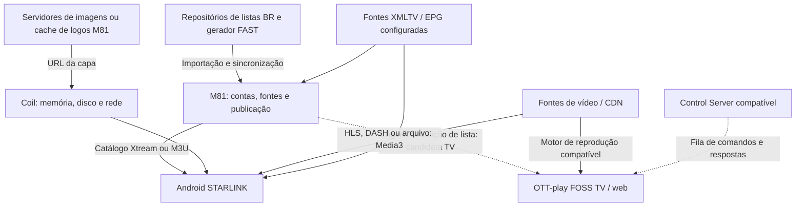

# STARLINK IPTV — comunicação, funções e melhorias

Data: 2026-10-25. Análise do Android 0.3.2-series-test, base
2b4297174ac5c6308bbcb58e03c688790609b049; painel nas referências documentadas
em PROJETO_ATUAL.md, em especial rootcause-runtime-20261024 e foss-tv-m81-20261024.
É uma análise do código/configuração; não uma medição dos serviços em execução.

## Como os dados circulam

Linhas tracejadas não afirmam instalação ativa: a integração TV é uma candidata
no código e os contratos de controlador são demonstrados nos testes FOSS.
O fork pessoal do servidor EPG não foi comprovado como a fonte XMLTV configurada.

### Android → painel → fonte de vídeo

1. StarlinkConfig.kt fixa o host M81 e a URL da M3U.
2. SaveSource autentica a conta Xtream e cadastra também a M3U gerenciada.
3. selectedSourceId decide qual catálogo é carregado; não há prova de mesclagem
   automática das duas fontes. NativeRepository.cached lê o SQLite local;
   refresh/providers.load consulta a rede quando pedido ou sem catálogo salvo.
4. Xtream usa player_api.php para categorias/live/VOD/séries. Detalhes de séries
   e filmes são consultados separadamente. M3U é interpretada pelo adapter/core.
5. Ao reproduzir um filme Xtream, ProviderRepository.resolve consulta os detalhes
   necessários ao container/URL. PlayerViewModel chama prepare/play do Media3.
6. No caminho Xtream do M81, a URL /live, /movie ou /series autentica e devolve
   redirect 307 para a fonte. Não concluir que o vídeo inteiro passa pelo painel.
   Para Pluto existem manifestos/sessões próprios; no modo de entrega direta
   documentado, segmentos seguem da CDN para o aparelho.

### Capas

A URL vem do campo logo do MediaEntry. Grade, início e detalhes usam Coil/AsyncImage.
O ImageLoader é comum aos tipos, com cache Coil. As abas filtram o catálogo já
carregado no cliente. Não existe um loader exclusivo de capas das séries nessa
versão. A diferença percebida pode estar nos links/origens, bytes/decodificação,
reuso de cache e concorrência, mas a causa no telefone ainda não foi medida.

O painel também pode publicar /channel-logo/<id>.png; quando o arquivo cacheado
não existe, esse endpoint retorna SVG fallback. O loader nativo não instala um
decodificador SVG específico. Verificar respostas reais antes de atribuir falha
ou lentidão a isso; fallback sem imagem não é a mesma coisa que download lento.

### TV FOSS → M81

A branch foss-tv-m81-20261024 faz checkout de sempaio/ottplay-foss no commit
5018806dc9b77928e6302362a701c7b896cac1a0. O launcher autentica por
/app/auth/login e lê /api/v1/tv-m3u/source?platform=... com sessão e device ID.
Aplica source_url ao provedor M3U do FOSS e um guard consulta revisão/revogação.
É integração preparada; não foi demonstrada instalação física nesta análise.

## Função de cada componente

| Componente | Função e comunicação demonstrada | Benefício principal |
|---|---|---|
| Painel M81 | Autentica, organiza/aprova fontes, publica catálogo e entrega Xtream/M3U. | Catálogo coerente e controle central de acesso/publicação. |
| ottplay-android | Base importada do Android STARLINK em native/. Native/core adapta os protocolos; Media3 reproduz vídeo; Coil carrega imagens. | Experiência nativa e ponto principal para melhorar o celular. |
| ottplay-foss | Player web/TV e contratos de provedores/controle; base do build TV preparado. | Suporte a outras plataformas e reutilização de recursos FOSS. |
| app-m3u-generator | Busca metadados FAST e gera M3U/EPG no GitHub. M81 referencia BuddyChewChew; fork sempaio existe. | Atualização do catálogo FAST, não aceleração automática das capas. |
| Repositórios BR | Fornecem arquivos de entrada ao importador. Os presets atuais apontam a Ramys/Iptv-Brasil-2026. O repo sempaio/Iptv-Brasil-2025 contém listas, mas seu consumo direto não foi localizado. | Conteúdo/metadados; não são o player nem o servidor de imagens necessariamente. |
| ottplay-control-server | Distribui comandos aos players FOSS por conexões de saída e recebe resultados. Há testes contra o upstream. | Administração remota/diagnóstico em consumidores compatíveis; não acelera mídia por si só. |
| ottplay-foss-server-epg | Serviço EPG conforme README; consumidor específico não localizado. M81/Android recebem fontes XMLTV configuradas. | Pode padronizar associação/programação se houver necessidade e configuração confirmada. |
| harden-runner | Ferramenta de proteção/auditoria dos jobs GitHub Actions, chamada pelo upstream step-security nos workflows. | Segurança das builds; não melhora o tempo de reprodução ou capas. |
| ottplay-core compartilhado | JAR compilado fixado por receipt, com parsing/contratos usados por adapters. | Regras consistentes entre clientes; atualizações exigem receipt e regressões compatíveis. |

## Quatro recomendações — revisão aprofundada de 2026-10-25

Esta revisão usa o código da versão do cliente e fontes oficiais. Ela substitui
as recomendações genéricas anteriores. Não foi criada uma nova versão do APK nem
alterado o comportamento do cache/reprodução para realizar esta pesquisa.

| Item | O que já existe | Conclusão após pesquisa | Prioridade |
|---|---|---|---|
| Capas | Coil 2.7.0 com memória + disco e AsyncImage; catálogo SQLite local | A hipótese de capas já salvas é compatível com a implementação. Confirmar origem no mesmo app; não criar outro cache. | Alta: confirmar e depois corrigir somente o gargalo encontrado. |
| Detalhes de filmes | get_vod_info ao abrir detalhes e novamente ao resolver o Play Xtream | Há dois caminhos de chamada concretos para a mesma informação. Reutilização curta/contextual é uma candidata focalizada. | Alta entre otimizações funcionais; ganho ainda não medido. |
| Início de vídeo | Media3/ExoPlayer já oferece eventos de carregamento/renderização | Usar AnalyticsListener para separar espera da API e do player; não acrescentar outro motor nem alterar buffer às cegas. | Alta para localizar a lentidão da reprodução. |
| Atualização de catálogo | SQLite no cliente, gzip transparente no OkHttp, gzip/ETag na referência M81 | Não propor “ativar gzip”: já vem pelo OkHttp. A oportunidade restante é revalidação condicional autenticada em refresh. | Condicional: não acelera imagem já local ou simplesmente trocar de aba. |

### 1. Capas — a hipótese de cache local tem fundamento

**Confirmado no cliente:** OttplayApplication implementa ImageLoaderFactory e usa
ImageLoader.Builder sem desativar caches. Na tag **Coil 2.7.0**, ImageLoader.Builder
cria por padrão MemoryCache e SingletonDiskCache. A documentação dessa mesma tag
recomenda um ImageLoader compartilhado, precisamente como o app já faz. Portanto,
OkHttpClient sem `.cache(...)` NÃO significa que as imagens estejam sem cache:
Coil 2 tem cache em disco próprio.

Na inicialização, PlayerViewModel chama load(selected, refresh=false).
NativeRepository lê o catálogo do SQLite; só chama refresh se solicitado ou se
não houver entradas salvas. Esse catálogo contém links/metadados, não o arquivo
da capa. O arquivo/bitmap é responsabilidade do Coil. São dois caches distintos.
Isso explica como a grade pode reaparecer e capas carregarem mesmo sem consultar
a API de catálogo naquele momento. Ainda não prova a origem em cada telefone.

**Memória, disco e rede precisam ser distinguidos:**
- MEMORY_CACHE: bitmap reutilizado em memória.
- DISK: arquivo reutilizado do cache em disco sem precisar da rede nesse caminho.
- NETWORK: houve passagem pelo caminho de rede; NÃO equivale necessariamente a
  baixar novamente todos os bytes. HttpUriFetcher 2.7.0 pode validar por ETag,
  receber 304, manter os bytes locais e retornar DataSource.NETWORK.
- CANCELLED/ERROR não são imagens carregadas. O tempo do listener inclui fila,
  busca e decodificação; não é exclusivamente tempo de download.

O fetcher respeita Cache-Control por padrão. Uma imagem em disco pode estar
expirada e exigir validação; no-store pode impedir gravação. Memória e disco
não têm necessariamente a mesma política de validade. A chave de disco padrão
é a URL completa: mudanças de query/assinatura podem impedir reuso, ainda que o
arquivo aparente ser igual. Não retirar tokens ou parâmetros indiscriminadamente.

**Como confirmar sem destruir a evidência:** no app original, fechar o processo,
ativar modo avião e reabrir as mesmas telas. Imagens novas nunca visitadas e já
visitadas devem ser distinguidas. Sucesso offline após encerramento do processo
é evidência de persistência local, mas o diagnóstico identifica a origem com
mais precisão. Não limpar dados/cache nem desinstalar o original. O APK Capas
Teste tem armazenamento próprio e não inspeciona os arquivos privados do Séries
Teste já instalado: suas medições valem para a candidata, não retroativamente.

**O que poderia melhorar depois:**
- AsyncImage já resolve o tamanho visual e o pipeline pode amostrar o bitmap;
  isso reduz decodificação/memória, mas não necessariamente os bytes baixados.
- Só reduzir bytes solicitando miniatura suportada pela CDN/API ou servindo uma
  derivada do cache do painel. TMDB documenta base_url + file_size + file_path;
  selecionar tamanhos suportados e adequados aos pixels/densidade da tela, sem
  aplicar substituição arbitrária a outros hosts.
- Comparar cache frio/quente, tamanho exibido, quantidade de bytes, hit/miss e
  respostas HTTP das mesmas classes de imagem. Não adicionar prefetch maciço:
  a grade já é virtualizada e pedidos fora da tela podem competir com vídeo.
- Não desabilitar globalmente respectCacheHeaders nem adicionar um segundo cache
  OkHttp ao ImageLoader Coil 2 para tentar “forçar rapidez”. A própria documentação
  Coil 2 desaconselha esse segundo cache de disco.

### 2. Filme Xtream — consulta duplicada antes da reprodução

O encadeamento foi reconferido em todos os consumidores:
1. PlayerViewModel.OpenMovie → ProviderRepository.loadMovieInfo → XtreamProvider.vod.
2. MovieDialog recebe o entry detalhado e dispara AppAction.Play(entry).
3. PlayerViewModel.play → NativeRepository.stream → ProviderRepository.resolve.
4. resolve chama XtreamProvider.vod novamente para filme Xtream, mesmo recebendo
   o entry do diálogo; vod executa get_vod_info sem cache próprio.

Isso é uma duplicação concreta no fluxo normal detalhes → Assistir, não apenas
uma busca textual por funções parecidas. Seu custo depende da latência da API.
Ainda não foi medido em milissegundos no aparelho nem executado um experimento de
requestCount nesta pesquisa. Não atribuir a ela a lentidão de canais ou capas.
M3U não segue esse get_vod_info; série abre get_series_info e episódios têm outro
fluxo. O registro correto da fonte selecionada é necessário.

**Candidata recomendada:** um resultado de detalhe bem-sucedido reutilizável,
limitado em tamanho/tempo e contexto, em vez de simplesmente remover a segunda
consulta. Conta/fonte/configuração, identidade do item e versão local do catálogo
precisam coincidir; troca de conta/fonte, refresh e expiração invalidam o resultado.
Uma resposta anterior não pode se aplicar a outro item ou recuperar uma conta
removida. Falhas não devem ser convertidas em detalhe válido. URLs temporárias
exigem atenção ao vencimento e nova resolução quando necessário.

A extensão de container retornada em movie_data é usada para compor a URL;
remover todos os pedidos de detalhe pode quebrar arquivos MKV/MP4. A referência
M81 atualmente devolve get_vod_info como um objeto de detalhe, fora do cache de
representações de listagens: ETag de catálogo não resolve sozinho esta duplicação.

**Verificação necessária antes da implementação:** MockWebServer contando duas
consultas na referência e uma na candidata, mesmo resultado/URL/headers; casos de
conta/fonte/catalog refresh/TTL distintos e detalhes inválidos/404. Depois medir
clique em Assistir → primeiro quadro, preservando codecs e comportamento de erros.

### 3. Reprodução — usar o diagnóstico que o Media3 já oferece

PlaybackService é o dono do ExoPlayer; é ali que um AnalyticsListener pode ser
registrado. PlayerViewModel controla a resolução anterior a setMediaItem/prepare,
portanto apenas medir BUFFERING no player perde parte da espera real.

O diagnóstico adequado contém marcas monotônicas por solicitação de reprodução:
- T0: clique em Assistir/troca de canal;
- T1: detalhe/resolução concluídos;
- T2: setMediaItem/prepare;
- carregamento: tipo manifesto/mídia, duração e bytes nos eventos correspondentes;
- T3: primeiro onRenderedFirstFrame desse pedido, além de READY e falhas.

STATE_READY não é prova de imagem visível. onRenderedFirstFrame pode ocorrer
novamente por mudança de superfície/renderer; contar somente a primeira ocorrência
pertinente ao pedido e tratar cancelamentos/trocas por geração. Vídeo e áudio
sozinho precisam de métricas apropriadas, não presumir primeiro quadro para áudio.

Isso distingue rede do painel, redirect/fonte, download, preparação e decoder.
PlaybackStatsListener também fornece estatísticas, mas seu histórico completo tem
custo de memória: manter só eventos/contadores necessários. Usar listener restrito;
um EventLogger bruto pode registrar endereços e não deve ser exportado sem filtro.

**Decisão após medir:** só ajustar buffer, conexão, pré-carregamento ou formato
quando a etapa responsável estiver comprovada. Não instalar outro player, relay
no M81 ou transcodificação como primeira resposta à demora. Não há ganho estimado
porcentual justificável sem essas medições.

### 4. Catálogo — gzip já está presente; ETag ajuda principalmente no refresh

**Confirmado no artefato-fonte exato do OkHttp 5.4.0:** BridgeInterceptor adiciona
Accept-Encoding: gzip quando o pedido não define Accept-Encoding nem Range e faz
descompressão transparente. ProviderHttp usa esse cliente sem substituir esses
headers por padrão. Logo, não é necessário “ativar gzip” no caminho comum. Se
alguma configuração fornecer os próprios headers, ela precisa de verificação
separada; inserir Accept-Encoding manualmente pode desligar a descompressão
transparente que já existia.

**O que falta no cliente para revalidar catálogo:**
- ProviderHttp.defaultClient não instala um cache HTTP de respostas de catálogo.
- HttpPayload devolve bytes, URL final e Content-Type, sem expor ETag/Last-Modified.
- Não há envio de If-None-Match pelo fluxo comum. Uma resposta 304 recebida por
  ProviderHttp é tratada como erro por estar fora de 2xx.
- CatalogDatabase guarda catálogo interpretado e updated_ms, não todos os corpos
  HTTP com seus validadores por ação/endpoint.

O helper HTTP do M81 de referência negocia gzip, emite ETag e permite 304. As rotas
Xtream autenticam antes de construir/retornar essas representações. O header
`private, no-cache, must-revalidate` permite armazenar privadamente, exigindo
revalidação; no-cache não significa no-store. Isso não confirma que a imagem
operacional do servidor seja idêntica à branch pesquisada.

**Projeto correto para ETag:** armazenar validator associado ao corpo/resultado
compatível, fonte/conta, endpoint, ação e variante de representação. Em 304,
reutilizar somente a representação correspondente. Sem corpo local compatível,
refazer pedido sem condição; não interpretar 304 vazio como catálogo vazio.
Autenticação e revogação precisam continuar verificadas. Não usar cache público
compartilhado entre contas nem manter credenciais em chaves/logs exportados.

O ganho é reduzir bytes e eventualmente parsing/escrita no refresh sem mudança;
SQL/autenticação e tempo de rede podem continuar existindo. Exibir o catálogo
salvo e trocar abas já não exige atualização remota neste app. Portanto essa
recomendação tem prioridade inferior para o sintoma de capas de séries já salvas.

## Fontes primárias e arquivos confrontados

- [Coil 2.7.0 — ImageLoaders e caches](https://github.com/coil-kt/coil/blob/2.7.0/docs/image_loaders.md).
- [Coil 2.7.0 — defaults do builder](https://github.com/coil-kt/coil/blob/2.7.0/coil-base/src/main/java/coil/ImageLoader.kt).
- [Coil 2.7.0 — HttpUriFetcher, 304 e DataSource](https://github.com/coil-kt/coil/blob/2.7.0/coil-base/src/main/java/coil/fetch/HttpUriFetcher.kt).
- [Coil 2.7.0 — CacheStrategy](https://github.com/coil-kt/coil/blob/2.7.0/coil-base/src/main/java/coil/network/CacheStrategy.kt).
- [Migração oficial Coil 2: cache próprio, sem segundo cache OkHttp](https://coil-kt.github.io/coil/upgrading_to_coil2/).
- [TMDB: montagem de URLs e tamanhos de imagens](https://developer.themoviedb.org/docs/image-basics).
- [Media3: AnalyticsListener e PlaybackStatsListener](https://developer.android.com/media/media3/exoplayer/analytics).
- [Media3: referência dos eventos](https://developer.android.com/reference/androidx/media3/exoplayer/analytics/AnalyticsListener).
- [OkHttp JVM 5.4.0: fontes do artefato usado](https://repo.maven.apache.org/maven2/com/squareup/okhttp3/okhttp-jvm/5.4.0/okhttp-jvm-5.4.0-sources.jar), arquivo commonJvmAndroid/okhttp3/internal/http/BridgeInterceptor.kt.
- [RFC 9111: cache HTTP](https://www.rfc-editor.org/rfc/rfc9111.html).
- Cliente: OttplayApplication, PlayerViewModel, MovieDialog, NativeRepository,
  CatalogDatabase, ProviderRepository, ProviderHttp, XtreamProvider e PlaybackService.
- Painel rootcause-runtime-20261024: app/services/http_delivery.py,
  app/routers/xtream_api.py e suas rotas autenticadas.

## Resultado e limites desta revisão

A conclusão mais forte para capas é que o mecanismo para salvá-las no celular
já existe. A confirmação do estado específico do telefone continua pendente do
relatório/teste no mesmo app. A candidata funcional mais focalizada é reaproveitar
get_vod_info no fluxo de filme Xtream; ela não foi implementada nesta pesquisa.
Gzip não é uma funcionalidade nova necessária. ETag deve ser considerado para
refresh; diagnóstico Media3 usa APIs já presentes.

Foram inspecionados fontes da versão das bibliotecas, documentação oficial e
caminhos do projeto; o JAR-fonte exato do OkHttp foi baixado e aberto. `git diff
--check` valida a alteração documental. Não houve novos testes de execução, benchmark,
instalação de APK, alteração de buffer/cache/reprodução nem implantação. Os 196
testes do APK anterior continuam evidência daquela build, não desta revisão.
