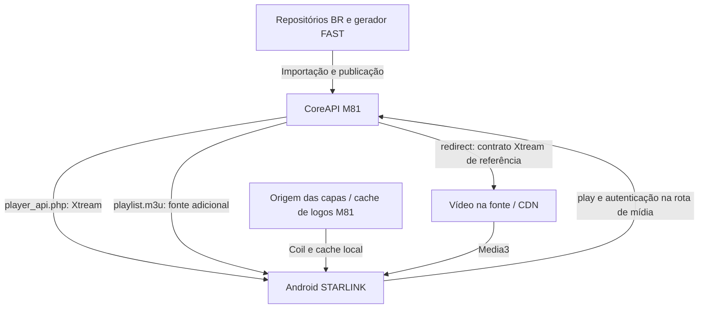

# STARLINK IPTV — arquitetura e estado consolidado das candidatas Android

Atualizado em **2026-10-26**, por consulta ao GitHub. Repositório:
[sempaio/ottplay-foss-android](https://github.com/sempaio/ottplay-foss-android).
Este documento substitui a análise de 25/10 que tratava a reutilização VOD como
proposta não implementada. Distingue código, build, testes, artefato e uso real.

**Base desta revisão documental:** `starlink/vod-performance-20261025`, commit
`0ca37a184ceb3a1456d1d45cb26b56dbde86a3ae`, a candidata mais recente entre as
referências solicitadas. A branch de documentação deriva desse commit e preserva
integralmente o código. Não houve merge, substituição da main, instalação de APK,
deploy da CoreAPI, alteração de configuração operacional ou execução de testes de
mídia nesta tarefa. Os resultados abaixo são evidências das execuções citadas.

## 1. Branches e PR #4: o que realmente diverge

| Referência | HEAD consultado | Conteúdo e relação |
|---|---|---|
| `main` | `9d3b859a67e1d325735ffd09fd59181a14a32324` | Apenas README.md; não contém native/, workflows ou este documento. Não representa o APK em uso. |
| `starlink/fix-series-formats-20261024` | `2b4297174ac5c6308bbcb58e03c688790609b049` | Android 0.3.2-series-test: normalização de episódios e retenção de listas válidas de episódios. Sem diagnóstico de capas e sem reutilização VOD. |
| `starlink/artwork-diagnostics-20261025` | `6d8370ee8741f64206c4e2e0450ca782b69ab26e` | Descende de series, com dez commits adicionais; inclui diagnóstico Coil, identificação do cliente/fonte, variante artworkTest e documentação. Não contém a otimização VOD. |
| `starlink/vod-performance-20261025` | `0ca37a184ceb3a1456d1d45cb26b56dbde86a3ae` | Descende de artwork, com cinco commits adicionais; muda somente quatro arquivos em relação a essa base: ProviderRepository, NativeRepository, StarlinkXtreamTest e workflow VOD. |
| [PR #4](https://github.com/sempaio/ottplay-foss-android/pull/4) | head `0ca37a18`, base `6d8370ee` | Aberto, não draft e não merged na consulta; propõe VOD → artwork, **não VOD → main**. Não equivale a uma atualização aprovada/distribuída. |

A ancestralidade consultada é linear: main → series → artwork → VOD. Entre main
e series existem 1.404 commits alcançáveis adicionais e uma importação grande do
projeto; isso não é um diff pequeno de Android. A contagem é de história Git,
não de alterações originais STARLINK. Não copiar árvores ou fazer main apontar à
candidata para “resolver” a divergência. Revisão documental tem VOD como base.

O blob deste documento era **idêntico** em artwork e VOD
(`28d5be6002e98ace2c4873952c9c005dee8b9857`), embora o código VOD tivesse mudado.
Essa é a origem demonstrada de parte das afirmações desatualizadas.

## 2. Afirmações corrigidas após os últimos commits

| Afirmação anterior | Estado consolidado |
|---|---|
| A análise usa somente series 2b429717 como base atual. | Series é a referência de origem; esta revisão usa VOD 0ca37a18 e compara explicitamente as quatro branches. |
| get_vod_info é sempre repetido ao tocar em Assistir. | Continua sendo o fallback. Na candidata VOD há reuso contextual de um detalhe enriquecido recente, evitando a segunda chamada quando elegível. |
| Reutilização de detalhe é uma candidata ainda não implementada. | Implementada nos commits 1fb426e1/82ff797b e proposta no PR #4; não merged. |
| Não houve experimento de requestCount. | StarlinkXtreamTest agora testa requestCount=1 em detalhe → play e nova consulta no segundo play; esses testes foram executados na CI VOD. |
| 196 testes descrevem a última candidata Android. | 196 é a evidência artwork. VOD tem 73 core + 125 app = 198, na execução identificada abaixo. |
| Existir código de diagnóstico na branch significa que o APK performance mostra o diagnóstico. | O workflow VOD compila seriesTest; ARTWORK_DIAGNOSTICS fica false. O código do diagnóstico permanece na árvore, mas sua UI/coleta está habilitada somente em artworkTest. |
| Um arquivo em dist/ de uma branch nova contém necessariamente seu código novo. | Os APKs versionados em dist/ não mudaram no PR #4. O novo APK VOD está no artefato da execução Actions, não nesses arquivos antigos. |

## 3. O que já está implementado

### Séries

- `normalizeXtreamEpisodeRows`, em XtreamProvider, adapta formatos de episódios
  explícitos sem inventar temporadas, URLs ou associações.
- `SeriesEpisodeCache` retém em memória listas de episódios bem-sucedidas por
  fonte/série; resposta vazia válida remove o anterior, falha não fabrica lista.
- Limpeza em logout/edição/exclusão de fontes e proteção contra aplicar resultado
  a outra série/fonte. É cache de **episódios**, não de imagens.

### Capas e identificação do cliente

- Coil 2.7.0 e ImageLoaderFactory compartilhado, com cache padrão em memória e
  disco, já faziam parte do cliente. Catálogo local em SQLite é outro mecanismo.
- ArtworkDiagnostics/CatalogArtwork registram tipo, tela, domínio/rota genérica,
  origem Coil e duração; relatório limitado a 300 resultados, sem URLs completas,
  títulos, credenciais ou mensagens brutas de exceção.
- A variante artworkTest expõe Mais → Diagnóstico das capas, com identificação da
  versão, SOURCE_REVISION, fonte selecionada e contagens locais. Registro é local,
  sem upload automático; há cópia voluntária do relatório.
- Os dados privados de artworkTest não são os do APK seriesTest. A candidata de
  diagnóstico não inspeciona retroativamente o cache do aplicativo anterior.
- NETWORK pode incluir validação HTTP 304 e reuso de bytes já no disco; não prova
  download integral. O relatório atual não separa status HTTP/bytes nesse caso.

### Reutilização VOD — implementada apenas na candidata/PR #4

Em ProviderRepository, `recentMovieDetail` guarda **no máximo um** detalhe em
memória. É elegível por menos de 30 segundos, medidos com System.nanoTime, e
consumido uma única vez pelo play correspondente. Há comparação da SourceConfig
completa, ID/sourceId/providerId e URL original ou enriquecida do item.

`loadMovieInfo` só guarda um resultado diferente do entry original. Uma resposta
bem-sucedida sem enriquecimento pode portanto não gerar reuso; não descrever isso
como cache de todo 200. Erros/endpoint não suportado não são convertidos em detalhe
válido. Se não houver detalhe elegível, resolve chama XtreamProvider.vod normalmente.
Container/URL retornados pelo provedor continuam sendo respeitados.

Invalidação explícita está em ProviderRepository.load e NativeRepository.save,
remove e refresh. O estado não é persistido nem um cache global de contas.

Testes novos comprovam reuso imediato/consumo único, isolamento ao trocar senha
da SourceConfig e invalidação explícita, preservando credenciais na ordem dos
pedidos. **Não demonstram** expiração temporal por relógio simulado, todas as
interleavings de refresh/edição com busca concorrente, nem ganho em aparelho.
Esses limites permanecem itens de revisão; não são correções adicionais desta tarefa.

## 4. O que foi compilado/testado e em qual commit

| Linha | Execução e código | Evidência e limite |
|---|---|---|
| Séries | [40076339230](https://github.com/sempaio/ottplay-foss-android/actions/runs/40076339230), `157e77d7b2b9041235d75bc78a6b104074e86121` | Workflow de validação passou com core:test, app:testLayoutUnitTest, lintLayout e assembleSeriesTest. A subárvore native/ desse commit é idêntica à de 2b429717; o HEAD posterior também publica o artefato. Não é evidência de performance física. |
| Capas | [40237509163](https://github.com/sempaio/ottplay-foss-android/actions/runs/40237509163), `12ac2cd69863115bfd3e66107b57d75c085b8298` | 71 core + 125 app = **196** aprovados; zero falhas/skips, lintArtworkTest com zero erros/21 avisos; assembleArtworkTest e assinatura/pacote verificados. native/ é idêntica à do HEAD artwork 6d8370ee. |
| VOD | [40242597595](https://github.com/sempaio/ottplay-foss-android/actions/runs/40242597595), `0ca37a184ceb3a1456d1d45cb26b56dbde86a3ae` | **73 core + 125 app = 198** aprovados; zero falhas/skips; lintSeriesTest com zero erros/21 avisos; assembleSeriesTest e apksigner/aapt passaram. O HEAD da candidata é o próprio SHA testado. |

Comando do workflow VOD: `:core:test :app:testLayoutUnitTest :app:lintSeriesTest
:app:assembleSeriesTest`. Testes da camada app são da variante layout; o APK
produzido e o lint são seriesTest. Não anunciar isso como testes instrumentados
executados dentro do APK performance nem como validação em telefone/TV físicos.

Os relatórios VOD foram baixados do artefato **STARLINK-PERFORMANCE-TEST-REPORTS**
(ID 12617820546). Contagens vieram dos índices HTML, não de uma soma presumida.
Há avisos de depreciação Gradle/AGP e LocalClipboardManager, além dos 21 avisos de
lint; build bem-sucedido não significa ausência de avisos.

### Artefatos e identidade: código da branch não é o APK de dist/

| Artefato | Origem efetiva | Identidade e disponibilidade |
|---|---|---|
| `dist/STARLINK-IPTV-SERIES-TESTE.apk` | Baseline series, não VOD | `br.starlink.iptv.series`, 0.3.2-series-test/código 10; SHA256 `9439283324ff750220c77370def11e5ce64c1bbffaefbdee7ecef6a15f236fbe`. Igual nas três branches candidatas. |
| `dist/STARLINK-IPTV-CAPAS-TESTE.apk` | Build artwork 12ac2cd6 | `br.starlink.iptv.artwork`, 0.3.2-artwork-test/código 10; SHA256 `2340d84d584a201e39a70f4711204e752cd561ace229b55e09a37fac66dd703c`. Igual em artwork e VOD; **não inclui** o reuso VOD posterior. Receipt JSON acompanha esse build antigo. |
| `STARLINK-IPTV-PERFORMANCE-TESTE.apk` em Actions | Build VOD 0ca37a18 | [Artefato ID 12617790673](https://github.com/sempaio/ottplay-foss-android/actions/runs/40242597595/artifacts/12617790673), nome STARLINK-IPTV-PERFORMANCE-TESTE; pacote `br.starlink.iptv.series`, 0.3.2-series-test/código 10. Não foi copiado para dist/ pelo PR #4. |

O APK performance tem 22.971.648 bytes e SHA256
`d66a0e7591b9b0f7e2582debc6e14ea159f9053a4cdc1528e1f45d668a80e7ab`.
O ZIP foi lido e o SHA conferido contra seu SHA256SUMS nesta revisão; isso não
constitui instalação. O artefato está sujeito à retenção de 30 dias do workflow.

O build performance e o baseline series compartilham pacote/versão. Um nome de
arquivo diferente **não** permite instalação lado a lado; chaves debug de jobs
separados também não têm identidade estável demonstrada. Não presumir atualização
compatível ou sugerir desinstalação para contornar assinatura. Nenhuma instalação
ou nova versão foi gerada nesta tarefa documental.

## 5. Quality Gate: falhas restantes do PR #4

[Execução 40242652992](https://github.com/sempaio/ottplay-foss-android/actions/runs/40242652992),
HEAD do PR `0ca37a18`, terminou **failure**, embora a CI VOD específica tenha passado.
Foram consultados os 38 jobs da execução, incluindo os que não cabem na primeira
página da API. As duas falhas de origem e sua propagação são:

| Job/etapa | Evidência nos logs | Estado e encaminhamento pendente |
|---|---|---|
| [check-0 / Lint — Biome lint](https://github.com/sempaio/ottplay-foss-android/actions/runs/40242652992/job/121317767482) | `biome check . && npm run lint:correctness`: 823 arquivos, 20 erros, quatro diagnósticos omitidos pelo limite de exibição. Quatro segmentos HLS segment00.ts…segment03.ts são tratados como texto e falham UTF-8; também há diagnósticos de formatação em fixtures JSON e HTML nativos. | Corrigir o escopo de lint para os binários e revisar a formatação dos arquivos pertinentes em tarefa separada. Não apagar mídia/fixtures ou alterar código nesta revisão. Como o primeiro comando falha, lint:correctness não chegou a executar nessa etapa. |
| [check-3 / dependency-review — Dependency Review](https://github.com/sempaio/ottplay-foss-android/actions/runs/40242652992/job/121317767454) | “Dependency review is not supported on this repository. Please ensure that Dependency graph is enabled”. | Verificar configuração/suporte e Dependency graph do repositório. É falha de disponibilidade/configuração da análise, **não** resultado que demonstre uma vulnerabilidade específica. Não desativar a verificação para declarar aprovação. |
| [CI gate — Require every validation workflow](https://github.com/sempaio/ottplay-foss-android/actions/runs/40242652992/job/121323612923) | `check-0` e `check-3`: actual=failure, expected=success. | Consequência das duas falhas anteriores, não um terceiro defeito independente do cache VOD. |

Nos logs visíveis do lint também aparecem, por exemplo,
`native/app/src/test/resources/android-selections-before-core.json`,
`epg-refresh-before-core.json`, `native/core/src/test/resources/guide-before-core.json`,
`native-import-before-core.json`, `stalker-before-core.json` e
`native/docs/site/index.html`. A saída é truncada: essa lista não enumera todos os
20 erros. Texto “HTTP 503” que aparece dentro de diff de fixture JSON nesse log
**não é sondagem da CoreAPI em execução**.

Passaram, entre outros, Change scope, contratos de configuração/release,
Typecheck, Frontend Tests, Rust Core and Server Tests, Remote control and
diagnostics integration, análises CodeQL, Android native plugins e o Build web.
Jobs condicionais skipped não equivalem a testes executados. Esses jobs FOSS
não substituem os testes do native/app Kotlin do workflow Android específico.

Esta tarefa documenta as falhas: não altera workflows, habilita configurações do
GitHub, corrige lint ou afrouxa o gate. O PR #4 continua sem aprovação integral.
O resultado de um futuro PR documental deve ser lido separado desta execução.

## 6. Integração com a CoreAPI M81

### Ligação comprovada no Android atual

- `StarlinkConfig.kt`: base `https://panel.taila5c5c2.ts.net` e M3U
  `/app/starlink-iptv/playlist.m3u`. Login do cliente nativo usa autenticação
  Xtream, não o launcher web TV.
- SaveSource autentica e adiciona a M3U gerenciada se ausente. `selectedSourceId`
  escolhe uma fonte; não foi implementada mesclagem automática dos catálogos.
- ProviderRepository/XtreamProvider consultam conta, categorias, live/VOD/séries,
  get_series_info/get_vod_info. SQLite guarda catálogo interpretado e metadados;
  a leitura local não prova que uma fonte foi sincronizada no servidor agora.
- O reuso VOD muda o cliente, não o schema ou as rotas do M81. Resolve mantém
  fallback e o acesso à URL de mídia; não torna credenciais dispensáveis.

### O que o GitHub do painel permite afirmar

Na consulta, `sempaio/painel-m81-iptv-cloud` tem:
- main `3635440e055351479a168ba35437dff36343fb7c`;
- `codex/rootcause-runtime-20261024` em `4dfa39686b3aa1c2fcd7b0860c3c1607ab61f192`;
- `starlink/foss-tv-m81-20261024` em `6fa8e00ce9bebe88f51c5e0c656bd721c14b4d30`.

As referências de backend descrevem publicação editorial, caches de catálogo,
gzip/ETag, autenticação e redirect 307 no Xtream. Os presets BR04/BR05 apontam
a Ramys/Iptv-Brasil-2026 e a Pluto usa metadados de BuddyChewChew/app-m3u-generator.
Não confundir esses caminhos com o fork do proprietário apenas por nome parecido.

A integração TV FOSS preparada é outra linha: launcher com /app/auth/login e
/api/v1/tv-m3u/source?platform=..., fonte atribuída e guard de revisão. O workflow
fixa sempaio/ottplay-foss em 5018806dc9b77928e6302362a701c7b896cac1a0. Não é prova
de que essa variante esteja instalada numa TV ou dentro do APK Kotlin atual.

**Não verificado nesta tarefa:** imagem/revisão efetivamente executada da CoreAPI,
publicação/fontes atualmente ativas, disponibilidade pública, conteúdo do catálogo
salvo no telefone, vídeo/áudio reais ou ganho de latência. O 503 anotado em 25/10
é histórico da sessão após reboot informado; não foi repetido nem tratado como
estado atual em 26/10. Nenhum acesso/escrita ao runtime operacional foi necessário.

## 7. Estado das quatro recomendações e pendências

| Item | Estado atual | Pendência |
|---|---|---|
| Capas | Cache Coil existente e diagnóstico implementado/compilado em artworkTest. Hipótese de séries já salvas é compatível com o código. | Relatório no aparelho/cache relevante; bytes/status para distinguir download completo de validação 304. Não criar cache paralelo ou limpar o original por suposição. |
| Detalhes VOD | Reuso de um detalhe, TTL de 30s, consumo único e invalidação implementados e testados no PR #4. | Revisão/Quality Gate completo, testes temporais/concorrência pertinentes e medição A/B em aparelho. Não afirmar latência melhor já comprovada. |
| Início do vídeo | Media3 oferece AnalyticsListener; esse diagnóstico por etapas ainda não foi implementado no cliente. | Medir clique/resolução/prepare/primeiro quadro, diferenciando READY e renderização; filtrar dados sensíveis. Não alterar buffer sem evidência. |
| Refresh do catálogo | SQLite local + gzip transparente do OkHttp já existem; backend de referência suporta ETag. | ProviderHttp ainda não oferece revalidação condicional com corpo associado e isolamento por conta/ação. 304 fora de um cache compatível ainda é erro. Isso não acelera diretamente uma capa local. |

Continuam pendentes: conciliar/revisar a cadeia de branches sem substituir main;
resolver as falhas gerais da CI; decidir qual variante/artefato será distribuído
após aprovação e provar sua assinatura/procedência; validar login, categorias,
séries, filmes, canais, atualização/revogação e primeiro quadro com a CoreAPI real.
As atualizações de FOSS/Control Server/EPG são decisões por consumidor e versão;
Plex TV FAST não demonstra uso de biblioteca Plex Media Server do PR upstream #871.

## 8. Evidências e manutenção do documento

- [PR #4 e diff de quatro arquivos](https://github.com/sempaio/ottplay-foss-android/pull/4/files).
- [Código VOD exato](https://github.com/sempaio/ottplay-foss-android/tree/0ca37a184ceb3a1456d1d45cb26b56dbde86a3ae/native).
- [Workflow VOD desse commit](https://github.com/sempaio/ottplay-foss-android/blob/0ca37a184ceb3a1456d1d45cb26b56dbde86a3ae/.github/workflows/starlink-vod-performance-20261025.yml).
- [Build VOD aprovado](https://github.com/sempaio/ottplay-foss-android/actions/runs/40242597595) e [Quality Gate reprovado](https://github.com/sempaio/ottplay-foss-android/actions/runs/40242652992).
- [Receipt do APK de capas anterior](https://github.com/sempaio/ottplay-foss-android/blob/6d8370ee8741f64206c4e2e0450ca782b69ab26e/dist/STARLINK-IPTV-CAPAS-TESTE.json).
- [Coil 2.7.0: cache/loader](https://github.com/coil-kt/coil/blob/2.7.0/docs/image_loaders.md) e [tratamento de rede/304](https://github.com/coil-kt/coil/blob/2.7.0/coil-base/src/main/java/coil/fetch/HttpUriFetcher.kt).
- [Media3 Analytics](https://developer.android.com/media/media3/exoplayer/analytics).
- [Fontes OkHttp 5.4.0](https://repo.maven.apache.org/maven2/com/squareup/okhttp3/okhttp-jvm/5.4.0/okhttp-jvm-5.4.0-sources.jar): BridgeInterceptor fornece gzip transparente no caminho padrão.
- [Mapa do projeto](../PROJETO_ATUAL.md) e [diagnóstico de capas](DIAGNOSTICO_CAPAS_032.md): contexto complementar, com esta consolidação como referência de estado das candidatas em 26/10.

Em próximas revisões, registrar SHA da branch, SHA efetivamente compilado,
variante/pacote/assinatura, hash do artefato e ID/status dos workflows. Não trocar
“implementado” por “instalado”, “build passou” por “Quality Gate passou”, nem
“MockWebServer passou” por “CoreAPI operacional homologada”.
