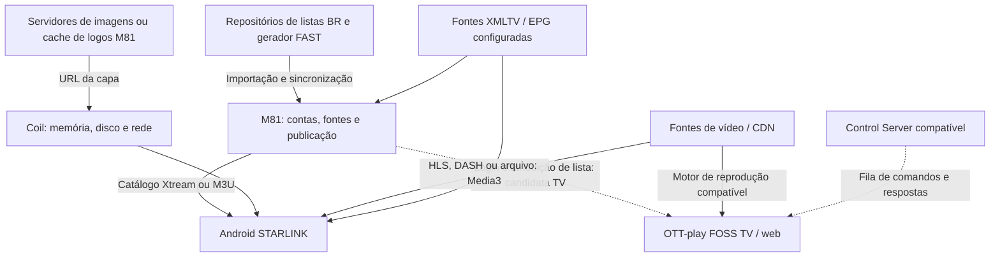

# STARLINK IPTV — comunicação, funções e melhorias

Data: 2026-10-25. Análise do Android 0.3.2-series-test, base
2b4297174ac5c6308bbcb58e03c688790609b049; painel nas referências documentadas
em PROJETO_ATUAL.md, em especial rootcause-runtime-20261024 e foss-tv-m81-20261024.
É uma análise do código/configuração; não uma medição dos serviços em execução.

## Como os dados circulam

Linhas tracejadas não afirmam instalação ativa: a integração TV é uma candidata
no código e os contratos de controlador são demonstrados nos testes FOSS.
O fork pessoal do servidor EPG não foi comprovado como a fonte XMLTV configurada.

### Android → painel → fonte de vídeo

1. StarlinkConfig.kt fixa o host M81 e a URL da M3U.
2. SaveSource autentica a conta Xtream e cadastra também a M3U gerenciada.
3. selectedSourceId decide qual catálogo é carregado; não há prova de mesclagem
   automática das duas fontes. NativeRepository.cached lê o SQLite local;
   refresh/providers.load consulta a rede quando pedido ou sem catálogo salvo.
4. Xtream usa player_api.php para categorias/live/VOD/séries. Detalhes de séries
   e filmes são consultados separadamente. M3U é interpretada pelo adapter/core.
5. Ao reproduzir um filme Xtream, ProviderRepository.resolve consulta os detalhes
   necessários ao container/URL. PlayerViewModel chama prepare/play do Media3.
6. No caminho Xtream do M81, a URL /live, /movie ou /series autentica e devolve
   redirect 307 para a fonte. Não concluir que o vídeo inteiro passa pelo painel.
   Para Pluto existem manifestos/sessões próprios; no modo de entrega direta
   documentado, segmentos seguem da CDN para o aparelho.

### Capas

A URL vem do campo logo do MediaEntry. Grade, início e detalhes usam Coil/AsyncImage.
O ImageLoader é comum aos tipos, com cache Coil. As abas filtram o catálogo já
carregado no cliente. Não existe um loader exclusivo de capas das séries nessa
versão. A diferença percebida pode estar nos links/origens, bytes/decodificação,
reuso de cache e concorrência, mas a causa no telefone ainda não foi medida.

O painel também pode publicar /channel-logo/<id>.png; quando o arquivo cacheado
não existe, esse endpoint retorna SVG fallback. O loader nativo não instala um
decodificador SVG específico. Verificar respostas reais antes de atribuir falha
ou lentidão a isso; fallback sem imagem não é a mesma coisa que download lento.

### TV FOSS → M81

A branch foss-tv-m81-20261024 faz checkout de sempaio/ottplay-foss no commit
5018806dc9b77928e6302362a701c7b896cac1a0. O launcher autentica por
/app/auth/login e lê /api/v1/tv-m3u/source?platform=... com sessão e device ID.
Aplica source_url ao provedor M3U do FOSS e um guard consulta revisão/revogação.
É integração preparada; não foi demonstrada instalação física nesta análise.

## Função de cada componente

| Componente | Função e comunicação demonstrada | Benefício principal |
|---|---|---|
| Painel M81 | Autentica, organiza/aprova fontes, publica catálogo e entrega Xtream/M3U. | Catálogo coerente e controle central de acesso/publicação. |
| ottplay-android | Base importada do Android STARLINK em native/. Native/core adapta os protocolos; Media3 reproduz vídeo; Coil carrega imagens. | Experiência nativa e ponto principal para melhorar o celular. |
| ottplay-foss | Player web/TV e contratos de provedores/controle; base do build TV preparado. | Suporte a outras plataformas e reutilização de recursos FOSS. |
| app-m3u-generator | Busca metadados FAST e gera M3U/EPG no GitHub. M81 referencia BuddyChewChew; fork sempaio existe. | Atualização do catálogo FAST, não aceleração automática das capas. |
| Repositórios BR | Fornecem arquivos de entrada ao importador. Os presets atuais apontam a Ramys/Iptv-Brasil-2026. O repo sempaio/Iptv-Brasil-2025 contém listas, mas seu consumo direto não foi localizado. | Conteúdo/metadados; não são o player nem o servidor de imagens necessariamente. |
| ottplay-control-server | Distribui comandos aos players FOSS por conexões de saída e recebe resultados. Há testes contra o upstream. | Administração remota/diagnóstico em consumidores compatíveis; não acelera mídia por si só. |
| ottplay-foss-server-epg | Serviço EPG conforme README; consumidor específico não localizado. M81/Android recebem fontes XMLTV configuradas. | Pode padronizar associação/programação se houver necessidade e configuração confirmada. |
| harden-runner | Ferramenta de proteção/auditoria dos jobs GitHub Actions, chamada pelo upstream step-security nos workflows. | Segurança das builds; não melhora o tempo de reprodução ou capas. |
| ottplay-core compartilhado | JAR compilado fixado por receipt, com parsing/contratos usados por adapters. | Regras consistentes entre clientes; atualizações exigem receipt e regressões compatíveis. |

## Melhorias priorizadas

### 1. Fechar o diagnóstico de capas com dados do aparelho

Já entregue: APK isolado Capas Teste com origem Coil, host/rota genérica e tempo,
mais versão/revisão/fonte selecionada e contagens locais. Comparar a mesma tela,
carga fria e quente, séries/filmes/live. O app de diagnóstico tem cache próprio;
não afirmar que inspeciona o cache do APK antigo. Não mudar caches/fontes com base
apenas em uma imagem da interface ou no código genérico do Coil.

Se o problema for imagem grande: produzir miniaturas proporcionais ao card, via
API/CDN que suporte redimensionamento ou derivadas limitadas do cache do painel.
Não reescrever URLs arbitrárias nem trocar artes por semelhança de nome.
Se o problema for rota local lenta/arquivo ausente: corrigir a entrega/fallback e
os headers/cache correspondentes, preservando a identidade da publicação.
Se for concorrência: avaliar prefetch pequeno próximo à área visível e limites;
não baixar milhares de capas antecipadamente. Já existe virtualização da grade.

Critério: comparar tempo até a capa estar pronta, bytes, erros e memória em listas
e aparelhos equivalentes. Não prometer um ganho antes desse teste.

### 2. Evitar consulta duplicada de detalhes ao iniciar filmes Xtream

Evidência estática concreta:
- PlayerViewModel.OpenMovie → providers.loadMovieInfo → XtreamProvider.vod → get_vod_info.
- MovieDialog usa o entry detalhado ao disparar Play.
- PlayerViewModel.play → NativeRepository.stream → ProviderRepository.resolve
  chama XtreamProvider.vod de novo para qualquer filme Xtream.

O fluxo detalhes → Assistir pode portanto fazer duas consultas à mesma informação.
Uma candidata pode compartilhar a resposta válida por fonte/conta/item e revisão
do catálogo, com prazo curto e limite de entradas; invalidar ao editar/remover
fonte, trocar conta, atualizar catálogo ou expirar. Falhas não devem ser retidas
como sucesso nem a URL/credencial antiga reutilizada após troca de contexto.

Benefício esperado: eliminar uma ida de rede antes do prepare do filme. Não
corrige canais, capas ou tempo de decodificação por si só. Ainda não implementado
nem medido. Não retirar get_vod_info indiscriminadamente: a extensão real importa.
Validar requestCount em MockWebServer, troca de contas/revisão/TTL, erros e URL
final; depois medir tempo até o primeiro quadro no dispositivo.

### 3. Medir as etapas da reprodução antes de mexer em buffer

Separar clique → detalhe/resolução → autenticação/redirect → manifesto → primeiro
segmento → primeiro quadro Media3. As partes podem ter gargalos diferentes.
Restringir logs a tempos/status e identificadores locais não sensíveis.
Não reduzir buffer/timeout global por suposição: pode trocar demora inicial por
travamentos. Não inserir relay de vídeo no painel como otimização genérica.

### 4. Tornar atualizações grandes de catálogo mais econômicas

O backend de referência já reutiliza representações por publicação, gzip/ETag e
cache de resumos/detalhes. Confirmar a imagem implantada antes de reaplicar isso.
O Android possui SQLite local, mas ProviderHttp não implementa revalidação ETag:
refresh aceita corpos 2xx e trata 304 como erro. Uma evolução condicional precisa
associar o ETag ao corpo correto e à fonte/conta, e usar o corpo salvo em 304.
Não apenas aceitar 304 vazio ou remover autenticação. Prioridade depende da
medição de bytes/tempo do refresh; abrir uma aba já usa o catálogo local.

### 5. Evoluir controle remoto e EPG quando o consumidor estiver identificado

Control Server pode centralizar estado/diagnóstico para players que suportem
seu contrato. O Android nativo não ganha automaticamente esses comandos só por
outro componente FOSS suportá-los; requer adapter e autorização próprios.
EPG deve ter atualização em segundo plano e cache por revisão/fonte. O Android
já possui EpgRefreshWorker: medir antes de criar um segundo agendador/servidor.

PR #868: manutenção do player clássico, prioridade baixa para desempenho.
PR #871: fila de biblioteca Plex Media Server limitada/negociada em 500 vídeos;
útil somente ao fluxo que usa esse recurso, com controlador/cliente compatíveis.
Plex TV FAST presente no gerador M3U não estabelece esse requisito.

## Ordem sugerida e limites

1. Relatório das capas no Android.
2. Candidata focalizada para reutilizar get_vod_info no fluxo detalhe → Assistir.
3. Tempos de início de vídeo e de atualização de catálogo.
4. Selecionar PRs por componente/versão efetivamente consumidos.

Nesta entrega foram lidos fontes, manifestos e workflows e documentadas as
recomendações. Não houve alteração de reprodução, cache funcional, fonte
operacional, banco, serviço ou implantação. Não é uma nova execução dos testes
do APK, nem teste de TV/celular físico. Evidência anterior do APK de diagnóstico
está em seu receipt e no documento específico.
