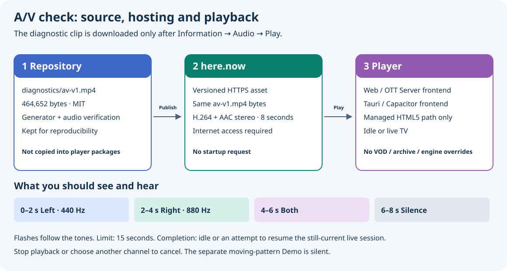

# Manual audio/video check

[Русский](audio-video-check.ru.md) · [Stream recovery](playback-stream-policy.md) · [Fixture specification](../diagnostics/README.md)

Use **player menu → Information → Audio → Play** to check the picture and sound
with a known eight-second clip. This is the audible A/V check; the onboarding
moving-pattern demo is silent.

## Start the check

1. Set the television, speakers or headphones to a comfortable volume. The
   check uses the player's current volume and temporarily unmutes its video;
   it does not raise the television's system volume.
2. Open the player menu, select **Information**, then **Audio**, then **Play**.
   Opening the menu alone does not download or play the clip.
3. Watch the screen and listen for the sequence below. To finish early, use
   **Information → Audio → Stop**.

The check uses the managed core HTML5 playback path while the player is idle,
or while live TV is playing or paused. It refuses an active VOD/archive request,
a live request that is still loading, and standby. It is also unavailable when
a device adapter replaces the core engine, including **PC2/Video.js** and native
engine overrides; using an HTML5 video element alone does not make an adapter
eligible. A refusal does not replace existing playback. Stop the current request
first if you want to test from idle; this does not enable the check on those
adapters. Menu labels follow the selected interface language.

## What you should see and hear

The background is a moving test pattern. Brief white markers flash across the
upper left or right half in step with quiet, approximately 150 ms sound pulses:

- **0–2 seconds:** a 440 Hz pulse in the left channel at each second, with the
  left marker flashing.
- **2–4 seconds:** an 880 Hz pulse in the right channel, with the right marker.
- **4–6 seconds:** both channels pulse, with both markers.
- **6–8 seconds:** the pattern continues moving without sound. This silence is
  intentional.

A mono television or a downmix may reproduce both channels from one speaker.
Check the physical screen and audio output yourself. The player does not
measure speaker output or produce an automatic A/V pass/fail verdict.

## Where the clip comes from

The player uses this absolute HTTPS address:

[`https://mantra-basin-76mq.here.now/diagnostics/av-v1.mp4`](https://mantra-basin-76mq.here.now/diagnostics/av-v1.mp4)

It requests the clip only when you choose **Play**, never as a startup preload.
The file is **464,652 bytes**, with H.264 baseline video at 640×360 / 25 fps and
AAC stereo audio. It is excluded from the Web, OTTPlay Server, Tauri, Capacitor
and container packages. The [source file](../diagnostics/av-v1.mp4), generator
and verifier remain in the repository; they are not an offline fallback in the
installed player.

Internet access and a working HTTPS connection to that host are required.
There is no bundled fallback or alternate diagnostic URL. Opening the link
above in a browser can help check file availability, but does not exercise the
player's decoder ownership or return-to-channel behavior. The hosting service
receives normal connection information; see the
[privacy details](privacy-policy.md#optional-hosted-audio-video-check).

## How playback returns

The check uses the main decoder, temporarily replacing the live picture. It
finishes at the end of the clip, after **Audio → Stop**, or when a media error
occurs. A **15-second safety deadline starts when the check is accepted** and
also covers loading; a slow download may therefore end before all eight
seconds play.

On those paths, the player attempts to restore the captured live request at
the live edge, including its paused state, only if that request still belongs
to the current source and no replacement playback has taken over. The live URL
is resolved afresh; its restoration still depends on the provider and network.
An idle check returns to idle.

The ordinary playback **Stop** command, standby, or selecting another channel
cancels the check without restarting the captured channel. Changing the source
or its session also prevents stale restoration. The check restores its temporary
unmute on exit; if you mute it while it runs, that mute remains effective.
It does not change the saved engine preference, write test seconds into channel
history, or publish a false channel completion or test metadata to the OS.

## If the result is unexpected

- **The check cannot start:** confirm that the player is idle or on an already
  playing/paused live channel using the managed core HTML5 path (without a
  device engine override). An unsupported state
  or a media error can display **“Stream could not be played”**.
- **Nothing loads, or the check closes early:** check internet access and the
  direct HTTPS link. A network error or the deadline is not evidence that the
  decoder or speakers are broken. Restore connectivity before choosing Play
  again.
- **Picture but no sound:** the last two seconds are deliberately silent.
  During the first six seconds, check player mute/volume, the television's
  volume and selected audio output, and the speakers/headphones connection.
- **Only one physical speaker plays:** first check whether the television uses
  mono output or downmixing before treating it as a channel-routing failure.

This is a short check of a known MP4 through the managed core HTML5
picture/audio path. It does not establish that a provider stream, HLS/DASH, DRM, multichannel
audio or higher-resolution playback will work, and it does not measure network
capacity or synchronization latency. Quality ceilings and live backup-stream
settings do not alter this diagnostic clip.

The ownership and cleanup behavior is covered by
[`tests/test_media_backend.cjs`](../tests/test_media_backend.cjs) and
[`tests/test_port_engine_lifecycle.cjs`](../tests/test_port_engine_lifecycle.cjs).
Automated decoding and lifecycle checks do not substitute for watching and
listening on the actual device; this guide claims no new physical-device result.
