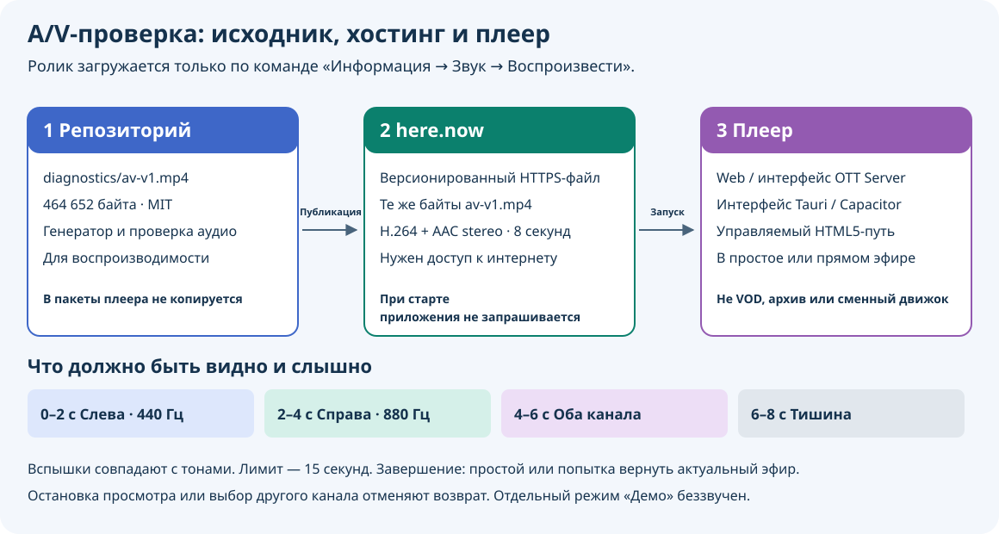

# Ручная проверка изображения и звука

[English](audio-video-check.md) · [Восстановление потока](playback-stream-policy.ru.md) · [Описание тестового файла](../diagnostics/README.md)

Откройте **меню плеера → Информация → Звук → Воспроизвести**, чтобы проверить
изображение и звук на известном восьмисекундном ролике. Это A/V-проверка со
звуком; демонстрация с движущейся таблицей при первом запуске беззвучна.

## Как запустить

1. Установите комфортную громкость телевизора, колонок или наушников. Проверка
   использует текущую громкость плеера и временно снимает его mute; системную
   громкость телевизора она не повышает.
2. Откройте меню плеера и выберите **Информация → Звук → Воспроизвести**.
   Само открытие меню не загружает и не воспроизводит ролик.
3. Наблюдайте за экраном и слушайте последовательность ниже. Для досрочного
   завершения выберите **Информация → Звук → Остановить**.

Проверка использует основной управляемый HTML5-видеотракт, когда плеер ничего
не воспроизводит либо прямой эфир уже запущен или поставлен на паузу. Она откажет
при активном VOD/архиве, ещё загружающемся эфире и режиме ожидания. Проверка также
недоступна, когда адаптер устройства подменяет основной движок: это относится
к **PC2/Video.js** и нативным движкам. Само использование HTML5-видео ещё не
означает поддержку проверки адаптером. При отказе текущее воспроизведение не
заменяется. Чтобы проверить из состояния покоя, сначала остановите текущий
запрос; это не включает проверку на указанных адаптерах. Русские названия
соответствуют русскому языку интерфейса; на английском путь называется
**Information → Audio → Play**, остановка — **Audio → Stop**.

## Что должно быть видно и слышно

На фоне движется тестовая таблица. Короткие белые маркеры вспыхивают в верхней
левой или правой половине одновременно с тихими звуковыми импульсами длиной
около 150 мс:

- **0–2 секунды:** в начале каждой секунды звучит левый канал, 440 Гц;
  вспыхивает левый маркер.
- **2–4 секунды:** звучит правый канал, 880 Гц; вспыхивает правый маркер.
- **4–6 секунд:** звучат оба канала и вспыхивают оба маркера.
- **6–8 секунд:** таблица продолжает двигаться без звука. Это предусмотренная
  тишина.

Монофонический телевизор или сведение каналов может воспроизводить обе фазы
одним динамиком. Смотрите на реальный экран и слушайте реальный аудиовыход:
плеер не измеряет звук динамиков и не выдаёт автоматический вердикт об успешной
A/V-проверке.

## Где находится ролик

Плеер использует абсолютный HTTPS-адрес:

[`https://mantra-basin-76mq.here.now/diagnostics/av-v1.mp4`](https://mantra-basin-76mq.here.now/diagnostics/av-v1.mp4)

Запрос отправляется только после выбора **Воспроизвести**. Предзагрузки при
старте плеера нет. Размер файла — **464 652 байта**; видео — H.264 baseline,
640×360 / 25 кадров/с, звук — AAC stereo. Ролик исключён из пакетов Web,
OTTPlay Server, Tauri, Capacitor и контейнеров. [Исходный файл](../diagnostics/av-v1.mp4),
генератор и проверяющий скрипт остаются в репозитории; установленный плеер не
использует их как локальную офлайн-копию.

Нужны интернет и рабочее HTTPS-соединение с этим хостом. Встроенного запасного
ролика и альтернативного адреса диагностики нет. Прямая ссылка выше позволяет
проверить доступность файла в браузере, но не проверяет управление декодером
и возврат к каналу внутри плеера. Хостинг получает обычные сведения о соединении;
подробнее — в [описании приватности](privacy-policy.md#optional-hosted-audio-video-check).

## Как плеер возвращается к просмотру

Ролик использует основной декодер и временно заменяет изображение прямого эфира.
Проверка завершается в конце ролика, после **Звук → Остановить** либо при ошибке
медиа. **Предельные 15 секунд отсчитываются от принятого запуска проверки**
и включают загрузку: при медленном соединении она может завершиться до того,
как проиграются все восемь секунд.

В этих случаях плеер пытается восстановить исходный запрос прямого эфира
у актуальной точки, сохраняя паузу, если она была включена. Возврат возможен,
только если запрос ещё относится к текущему источнику и другое воспроизведение
не заняло его место. Ссылка эфира разрешается заново; успешный возврат по-прежнему
зависит от провайдера и сети. Проверка из состояния покоя возвращает плеер
в состояние покоя.

Обычная команда остановки воспроизведения, режим ожидания или выбор другого
канала отменяют проверку без возобновления прежнего канала. Смена источника
или его сеанса также исключает возврат к устаревшему запросу. При выходе
временное снятие mute отменяется; если вы выключили звук во время проверки,
он остаётся выключенным. Проверка не меняет сохранённый движок, не записывает
секунды ролика в историю канала и не передаёт в ОС ложное завершение канала
или метаданные тестового просмотра.

## Если результат неожиданный

- **Проверка не запускается:** убедитесь, что плеер ничего не воспроизводит
  либо уже показывает/держит на паузе прямой эфир через основной управляемый
  HTML5-тракт без подмены движка адаптером устройства.
  При неподдерживаемом состоянии или ошибке медиа может появиться сообщение
  **«Не удалось воспроизвести поток»**.
- **Ролик не загружается или рано закрывается:** проверьте интернет и прямую
  HTTPS-ссылку. Сетевая ошибка или предельное время не доказывают неисправность
  декодера либо динамиков. Восстановите соединение перед повторным запуском.
- **Изображение есть, звука нет:** последние две секунды специально беззвучны.
  В первые шесть секунд проверьте mute/громкость плеера, громкость и выбранный
  аудиовыход телевизора, подключение колонок или наушников.
- **Звучит один физический динамик:** сначала проверьте, не использует ли
  телевизор монофонический выход или сведение каналов.

Это короткая проверка известного MP4 через основной управляемый HTML5-тракт изображения
и звука. Она не подтверждает работу потока провайдера, HLS/DASH, DRM,
многоканального звука или видео большего разрешения, не измеряет пропускную
способность сети и задержку синхронизации. Ограничения качества и резервные
потоки прямого эфира не изменяют этот диагностический ролик.

Владение декодером и завершение проверки покрыты тестами
[`tests/test_media_backend.cjs`](../tests/test_media_backend.cjs) и
[`tests/test_port_engine_lifecycle.cjs`](../tests/test_port_engine_lifecycle.cjs).
Автоматические проверки декодирования и жизненного цикла не заменяют наблюдение
за реальным устройством; эта инструкция не заявляет новых физических испытаний.
