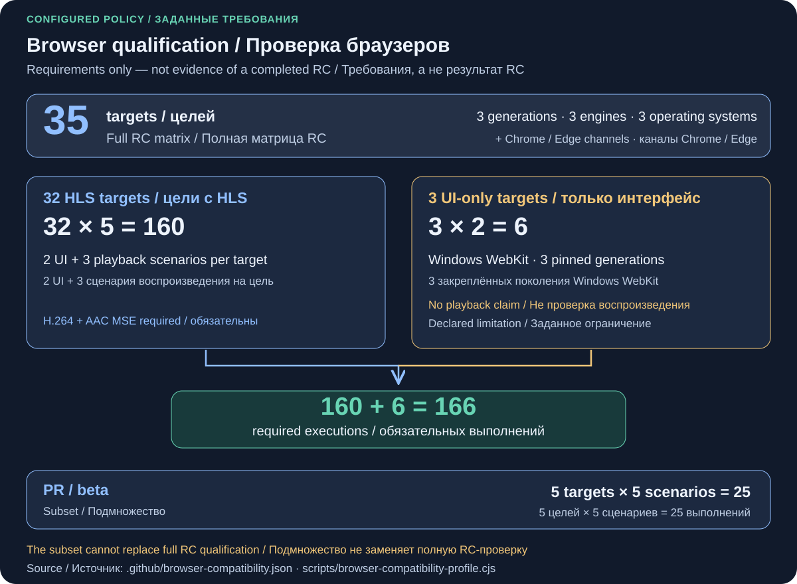
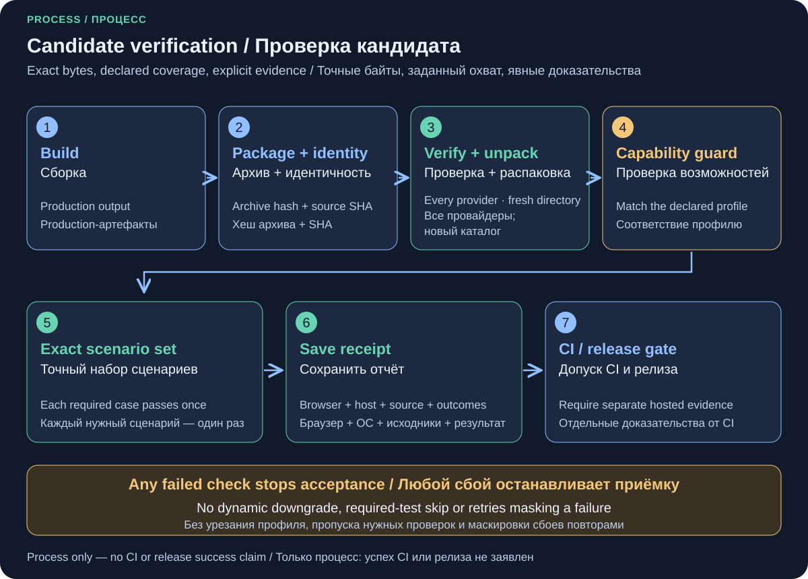
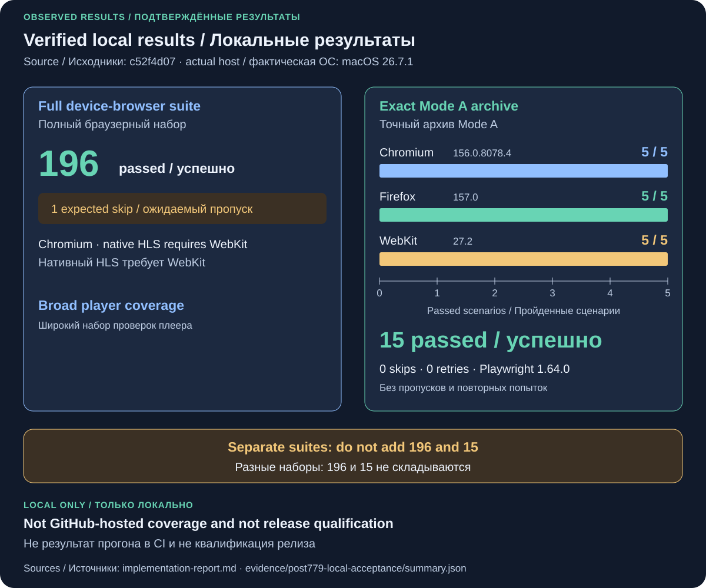

# Поколения браузеров и операционные системы

[English](browser-compatibility.md) · [Результаты измерений](implementation-report.ru.md#интеграция-браузерной-приёмки)

Существующие проверки устройств, медиадвижков, ES5 и worker, нативного интерфейса
и native HLS на Apple остаются обязательными. Общий TypeScript workflow также
проверяет точный архив Mode A сценариями Plex: загрузка и перезагрузка на двух
языках, сохранение пропорций HLS.js и Video.js при смене видео и перезагрузке,
естественное завершение эпизода HLS.js в строгом kiosk-режиме. Медиасценарии
используют настоящее декодирование; все сценарии — настоящий DOM и ввод.
Локальными тестовыми данными заменены только ответы Plex и источник медиа.

Для PR, nightly и беты нужны пять целей: актуальные Chromium, Firefox и WebKit
на Linux, Chromium на Windows и WebKit на macOS. Квалификация RC требует всех
35 объявленных целей: три точных поколения Playwright/браузеров на Linux,
Windows и macOS, установленные стабильные Chrome/Edge на этих трёх системах
и beta Chrome/Edge на Linux. Фактические версии записываются при запуске.
Firefox из Playwright содержит изменения Playwright и не подтверждает работу
обычного Firefox ESR; WebKit не равнозначен Safari. Матрица не заменяет проверки
на физических телевизорах и в нативных оболочках.

Из **35 целей 32 проверяют HLS**, а три Windows WebKit — только интерфейс.
Последние обязаны пройти оба локализованных сценария загрузки и перезагрузки;
в их сборке WebKit отсутствуют MediaSource и native HLS. Это явно обозначенное
ограничение, а не успешная проверка воспроизведения. Три точных идентификатора
перечислены в `scripts/browser-compatibility-profile.cjs`. Проверка возможностей
должна подтвердить ограничение до запуска UI-сценариев. Если появится MSE,
включая ManagedMediaSource, или native HLS, приёмка завершится ошибкой до
обновления профиля. Остальные цели требуют MSE для H.264 и AAC и все пять
сценариев; потеря возможности не сокращает набор тестов автоматически.

Полный RC требует **166 успешных выполнений**: 32 × 5 + 3 × 2, с отчётами всех
35 целей. Подмножество для PR/nightly/беты — пять целей и 25 выполнений.
Каждый отчёт сохраняет точный набор сценариев, возможности браузера и результат
проверки HLS либо явную причину отсутствия такой проверки. Это требования,
а не утверждение о завершённом RC. Ограничение Windows подтверждается
[конфигурацией сборки WebKit](https://github.com/WebKit/WebKit/blob/56453fdfe0b0ca6258c23e6453b34f70b885d13f/Source/cmake/OptionsWin.cmake#L75),
используемой Playwright 1.64, и проверкой закреплённого браузера при запуске.

Оба пути скачивают артефакт по точному идентификатору из текущего запуска сборки.
До раздачи распакованных файлов проверяются контрольная сумма архива, исходный
коммит, хеши плеера и провайдеров, типы файлов и пути. Для релиза дополнительно
проверяется зафиксированный отчёт сборки. Браузерные задания не пересобирают
тестируемый код и устанавливают только production-зависимости. Сервер требует
полный состав провайдеров; TypeScript загружается только для настоящей сборки,
а не для чтения списка файлов. Ошибочные, пропущенные, устаревшие или отсутствующие
результаты не проходят общий gate. Для каждой цели сохраняются traces,
фактическая версия окружения и хеш кандидата.

Семь файлов состава матрицы и lock-файлов генерирует
`venus-os-ci-toolkit/scripts/prepare_browser_compatibility.py`. У приложения
и исторических браузеров отдельные lock-файлы. По умолчанию используются
GitHub-hosted runners; общий workflow сохраняет выбор подготовленного резерва
Linux, а Windows/macOS требуют соответствующую ОС.

Общий итог релиза проверяет каждую выбранную цель, SHA исходников, запуск,
номер попытки, канал и точный идентификатор артефакта. Результаты пяти целей
беты не заменяют RC. Стабильный выпуск использует принятые байты RC. После
ошибки нужно повторить всю квалификацию: отчёты прошлой попытки не дополняют новую.

## От исходного кода до принятого кандидата

1. Собрать проверенный исходный код и упаковать полученные файлы Mode A.
   Сохранить контрольную сумму архива и идентификатор исходников.
2. До распаковки проверить размер, безопасные пути, типы файлов, версию/коммит
   и полный состав хешей плеера и провайдеров. При квалификации релиза также
   проверить зафиксированный отчёт сборки.
3. Определить фактическую версию браузера и его медиавозможности. Выбрать
   объявленный профиль; несовпадение возможностей завершает проверку ошибкой.
4. Выполнить точный набор сценариев на распакованных файлах без пересборки.
   Каждый сценарий должен пройти один раз, без пропусков и повторных попыток.
5. Сохранить окружение, возможности, хеш кандидата и результаты сценариев.
   Общий gate сверяет цели, запуск, попытку и исходный коммит. Согласование
   релиза и аппаратная приёмка остаются отдельными условиями.

## Подтверждённые локальные результаты

На исходниках `c52f4d07` полный набор в Chromium дал 196 успешных проверок
и один ожидаемый пропуск native HLS. Отдельно один и тот же архив Mode A прошёл
по пять сценариев в Chromium 156.0.8078.4, Firefox 157.0 и WebKit 27.2:
15 успешных проверок без пропусков и повторных попыток. Это разные наборы;
их сумма не является процентом покрытия и не доказывает прохождение 35 целей CI.

[Сохранённые отчёты](evidence/post779-local-acceptance/summary.json) указывают
фактическую macOS 26.7.1, отличают её от метки профиля `macos-15` и не подтверждают
квалификацию релиза. Для повторения на Mac установите зависимости по lock-файлу
и браузеры Playwright 1.64.0, соберите текущий исходный код и выполните
[сохранённый сценарий](evidence/post779-local-acceptance/reproduce.sh), передав
каталог репозитория аргументом. Он упаковывает готовую сборку, проверяет кандидата,
определяет версии браузеров и сохраняет новые отчёты в `.compatibility/`.
Нужен свободный порт 4189; существующий каталог `browser-candidate-web`
не перезаписывается. Между сборкой и запуском сценария исходный код не должен
меняться. Состояние CI и проверки реальных устройств отдельно отражены
в [отчёте о реализации](implementation-report.ru.md).
