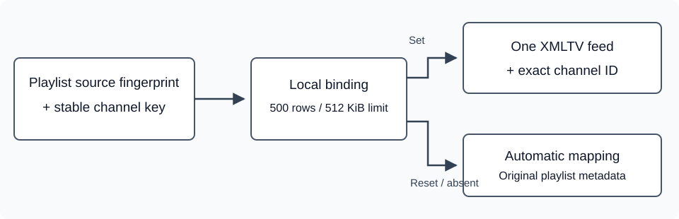

# Ручная привязка XMLTV и доступность управления

[English](guide-binding-accessibility.md) · [Архитектура EPG](guide-architecture.md)

## Исправление программы канала без редактирования плейлиста

Запустите нужный канал M3U и откройте **Информация → EPG**. Укажите адрес источника программы и **XMLTV ID** — точное значение `<channel id="…">` в XMLTV, а не отображаемое название. **Установить** сохраняет привязку и перезагружает плейлист. **Автоматически** удаляет ручную привязку этого канала и возвращает сопоставление из плейлиста. Перемещение стрелками ничего не сохраняет и не сбрасывает. Выход назад не меняет сохранённую привязку.

Редактор работает в размещённой браузерной сборке и оболочках с нативным XMLTV: Tauri и Capacitor. Он не заменяет программу, которой управляет провайдер, прямые JSON-источники `=source` или внешний сервер-компаньон. Обычный старый браузер с удалённым сервером продолжает использовать прежний протокол сопоставления. Первая версия принимает точный ID; поиска по полному списку каналов XMLTV пока нет.



Запись содержит отпечаток источника плейлиста, устойчивый ключ канала, адрес XMLTV и его ID. Переименование отображаемого названия и перестановка строк не меняют привязку, пока идентичность канала прежняя. Замена адреса плейлиста или учётной записи выбирает другое пространство настроек. У старых записей M3U без `itemId` используется существующий идентификатор, вычисленный из адреса потока; замена этого адреса меняет идентичность.

Название канала и адрес воспроизведения сохраняются. Программа ищется в одном указанном источнике без подбора похожего названия: отсутствующий ID не подменяется программой соседнего канала. Часовой сдвиг, автоматически выведенный из названия, к точной привязке не применяется; явный `tvg-shift` плейлиста сохраняет действие. Выбирайте XMLTV ID нужной региональной версии. Ошибки CORS или HTTP-источника на HTTPS-странице остаются видны в обычной диагностике EPG.

На источник допускается до 500 привязок и 512 КиБ. Документ разбирается один раз при загрузке плейлиста, а не для каждого канала. Перед записью проверяется исходное значение, после записи — фактически сохранённое. Запоздавший редактор не может изменить новый источник. Настройка локальная: синхронизации между устройствами здесь нет. Адреса источников иногда содержат секреты подписки, поэтому не публикуйте экспорт хранилища.

## Доступность классического интерфейса

- Основной список сообщает экранному диктору название, выбранный элемент, общее количество и абсолютную позицию. В последовательность Tab входит только выбранная видимая строка. Стрелки обновляют и подсветку, и семантическое состояние. Фокус уже активного списка сохраняется при переходе между страницами.
- Обычные информационные окна, подтверждения, редактор и информационные панели объявлены модальными и получают локализованные названия. Tab и Shift+Tab остаются внутри переднего окна. После закрытия вложенного окна фокус возвращается к видимому родительскому элементу; отложенное открытие закрытого окна не перехватывает фокус.
- Текст информационного окна и подтверждения связан с его описанием. Временные уведомления объявляются через ненавязчивую область статуса.
- Новые подписи используют существующие языковые каталоги. XMLTV и ID — обозначения протокола; названия каналов и серверов остаются метаданными источника.

Маршрутизация кнопок пульта и совместимость с ES5 сохранены. Проверки DOM не являются полной сертификацией WCAG: поведение VoiceOver/TalkBack, фокуса и браузеров телевизоров требует проверки на устройствах.

## Проверка

```sh
node tests/test_classic_accessibility.cjs
node tests/test_guide_bindings.cjs
node tests/test_screen_ownership.cjs
node tests/test_guide_integration.cjs
node tests/test_m3u_provider_driver.cjs
node tests/test_localization_catalog.cjs
npm run typecheck
```

На объединённой ветке также нужны обычная сборка, проверка ES5 и размера. В браузере проверьте длинный список с переходом между страницами, вложенное подтверждение, замену источника во время редактирования, правильный и отсутствующий ID, удаление привязки и ошибку загрузки XMLTV. Запоминание дорожек нативного Android-приложения реализовано отдельно и не зависит от этих элементов классического интерфейса.
