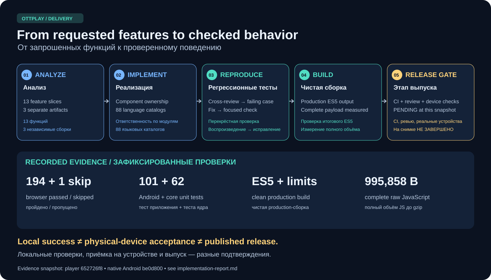

# From feature list to verified behavior

[Русский](implementation-report.ru.md) · [Feature contracts](roadmap-delivery.md) · [Size evidence](roadmap-size.md)

This report records the implementation and hardening process, not a release
announcement. The measured player snapshot is `652726f8`; the separately built
native Android snapshot is `be0d800`. CI, merge and release promotion remain
separate gates. Later documentation or test-only commits do not turn a local
check into proof that an installed device has been updated. Gate states below
belong to those historical snapshots; they are not a live release tracker.
See [GitHub Releases](https://github.com/open-ott-play/ottplay-foss/releases)
for published builds.

## How the work was checked

The initial request was split into 13 usable feature slices across the classic
player, control service/CLI and independent native Android application.
Ownership was assigned by component so simultaneous changes could be reviewed
and integrated without replacing another component's work. New UI reused
existing translated labels or added catalog entries across all 88 languages;
full engineering guides were written in English and Russian.

Implementation was followed by independent cross-review and executable
regressions. A reported problem was checked against the actual callback,
decoder, storage or focus path before changing code. Test failures were separated
into behavior regressions and obsolete test selectors. For example, switching
classic rows from `button` to `option` required updating selectors; it did not
justify weakening the expected click behavior.

Clean production builds then checked the emitted ES5 artifacts and the full
JavaScript cost, including optional provider modules. Targeted browser tests used
the shipped loader, bundle and device adapters. Native Android received a
separate Gradle test, lint and package run. PR checks and review threads are
checked again after pushing; passing a local build is not a substitute.

## What changed during review

- **HLS parsing and retries:** parsing failures initially shared the generic
  network classification. They now get at most one same-URL reconnect, inside
  the two-transient-retry budget; new decoders and backup URLs do not reset it.
  A terminal auth/DRM failure also cancels an already queued transient retry.
- **Native Auto fallback:** native-error handling could retire the request while
  Auto already owned a fallback. The existing owner now retains that transition;
  cancellation still invalidates its delayed callbacks.
- **Modal Enter:** automatically focusing the first Cancel button turned Enter
  in a Plex waiting dialog into cancellation. Dialogs now start with focus on
  the dialog itself. Tab reaches their buttons explicitly; ordinary information
  and confirmation dialogs retain Enter and Escape/Back behavior.
- **PC pointer selection:** mouse focus changed selection before the click
  handler, turning the first click into activation. Pointer-induced focus no
  longer pre-selects the row. PC still selects, then activates; LG retains its
  one-click behavior. Keyboard focus still follows selection.
- **Android tracks:** an unlabelled current-item selection could be erased by
  its own Auto acknowledgement or a subtitle preference update, or leak into
  another item with an equal `TrackGroup`. It now survives delayed writes only
  for its current item. Semantic preferences use language/role/label; the
  ViewModel owns persistence so closing the pane does not cancel the write.

The 13 delivered slices are: A/V sample; resumable Local/Home setup; bounded
recovery; quality ceilings; Android track preferences; scoped control keys;
XMLTV bindings; Xtream movies/series; classic accessibility; durable command
outcomes; explicit handoff; backup streams; recoverable settings batches.
The [feature guide](roadmap-delivery.md) defines each scope and limitation.

## Evidence and remaining gates

For `652726f8`, the five focused browser scenarios passed: LG webOS pointer
navigation, LG NetCast pointer navigation, PC two-click behavior, dialog keyboard
semantics, and Plex collection/resolution/cancel/retry. TypeScript, the
accessibility unit fixture, scoped lint, ES5 and bundle-budget checks passed.
The complete browser run against this build finished with **194 passed and
one skipped**: native HLS requires WebKit, while this run used Chromium.
Hosted CI and the agreed merge sequence remain separate gates.

The remaining `test:port` and `test:unified` chain was completed in resumed
segments after correcting isolated test fixtures. Each failed target was rerun
successfully, and the remaining commands finished successfully; this is not a
claim of one uninterrupted `npm test` run. The exact nine-command Android bridge
CI step also passed locally.

For Android `be0d800`, **101 app tests and 62 shared-core tests** passed locally,
as did debug/release lint, Debug/Release/Full APK assembly, the release bundle and
androidTest APK compilation. Compilation of the instrumented-test APK is not
execution on a device. The three confirmed review findings were answered and
resolved in [Android PR 68](https://github.com/open-ott-play/ottplay-android/pull/68).
That PR passed its checks and merged as `5b644b94`; post-merge CI is tracked
separately. The diagram leaves the overall player CI/release gate pending.

The complete web JavaScript total changed from **964,459 / 305,344** raw/gzip
bytes to **995,858 / 315,207**: **+31,399 / +9,863 bytes** (about 3.26% / 3.23%).
The feature candidate was 995,587 / 315,103; subsequent hardening added 271 / 104.
The final main entry in that snapshot is 875,197 / 270,425. See the
[baseline measurement](evidence/roadmap-size-20261015.json),
[final artifact measurement](evidence/roadmap-final-size-20261015.json) and
[measurement method](roadmap-size.md).

These are historical JavaScript byte costs, **not measured speed improvements**.
Totals exclude media engines, dictionaries, CSS, images and video. The player
packages for that snapshot separately carried the 464,652-byte A/V clip.
After the [hosting change](audio-video-check.md), `diagnostics/av-v1.mp4` remains
in the repository with its generator and verifier for reproducibility, but is
excluded from Web/OTTPlay Server, Tauri, Capacitor and Docker packages. The player
fetches it from here.now only for the explicit A/V check, which requires internet;
startup playback does not fetch it. Removing 464,652 raw media bytes does not
establish the size saving in compressed installers or change the historical
JavaScript measurements. Startup time, frame pacing, memory use,
screen-reader experience, real HDMI audio and provider behavior require their
own measurements on target devices. No new physical-device result or beta
release is asserted by this report. The [physical acceptance list](roadmap-delivery.md#physical-acceptance-before-promotion)
and [release strategy](../RELEASING.md) remain the promotion criteria.

## Post-beta integration and review

After the publication of beta.4, source `39287792` was integrated into this
branch. Runtime revision `9663b681` also fixes live-edge restoration under HLS
quality limits and makes a damaged settings journal recoverable before normal
startup. The recovery screen blocks partial account hydration, supports retry
and a confirmed reset, preserves unrelated cookies, and prevents old cookie
settings from returning after reset. See the
[recovery process](settings-recovery.md) and its SVG diagram.

Reproducing both sources with Node 26.8.2, Rollup 4.64.5 and Terser 5.51.2 gives
**964,876 / 305,452** raw/gzip bytes for the beta.4 source and
**1,000,388 / 316,600** for the integration: **+35,512 / +11,148 bytes**
(3.68% / 3.65%). These totals include all optional providers: seven in the
baseline and eight in the integration. The new entry is 879,533 / 271,761.
This is a separate comparison from the earlier frozen graphs above.

Both local production builds regenerate five tracked runtime files and omit
their clean-source revision claim. The reports record this limitation rather
than identifying these local files as published release artifacts:
[baseline](evidence/post-beta-baseline-size-20261015.json) and
[integration](evidence/post-beta-candidate-size-20261015.json).
The integration build and ES5/native checks pass. Six targeted browser checks
also pass: journal recovery/reset, dialog keyboard behavior, LG webOS and
NetCast pointer input, PC two-click selection, and the Plex owned wait.

## Browser-gate integration

Source `c52f4d07` incorporates PR 779 from main `1ecbc0e7`. Both branches'
test commands, recovery checks and Plex dialog assertions are preserved.
TypeScript, lint, documentation, packaging/linker contracts, the production
build and full compiled-bundle checks pass. All 27 emitted player/provider
JavaScript files remain byte-identical to the measured artifacts above.
The full device-browser suite on that build finishes with **196 passed and
one expected Chromium skip** for the native-HLS case requiring WebKit.

The exact packaged Mode A archive was unpacked only after checking its source,
checksum and bundle/provider inventory. Chromium 156.0.8078.4, Firefox 157.0
and WebKit 27.2 each passed all five profile scenarios without skips or retries:
**15 local passes** with Playwright 1.64.0. The actual host was macOS 26.7.1,
not the `macos-15` runner named in the selected profiles. Receipts explicitly
record that distinction and are **not hosted-matrix or release qualification**.
See the [local summary](evidence/post779-local-acceptance/summary.json) and
[reproduction recipe](evidence/post779-local-acceptance/reproduce.sh), which
expects an existing production build and refuses to replace an extracted
candidate directory.

The [browser policy](browser-compatibility.md) requires five hosted targets
and 25 scenario executions for PR/beta checks; the complete RC has 35 targets
and 166 executions. These are configured requirements, not measured coverage.

The separate [beta pipeline](https://github.com/open-ott-play/ottplay-foss/actions/runs/38856793467)
for main `1ecbc0e7` completed successfully. It does
not include this PR. The integration still requires its own successful hosted
CI and review, followed by release coordination; the local results above do
not claim that these delivery gates have passed.

## Delivery

- [Player, documentation and i18n — PR 781](https://github.com/open-ott-play/ottplay-foss/pull/781).
- [Control server and CLI — PR 106](https://github.com/open-ott-play/ottplay-control-server/pull/106).
- [Android track preferences — PR 68](https://github.com/open-ott-play/ottplay-android/pull/68).

These PRs carry the current CI and merge state. The player change follows the
agreed current Plex fixes and their beta release as a separate delivery wave.
