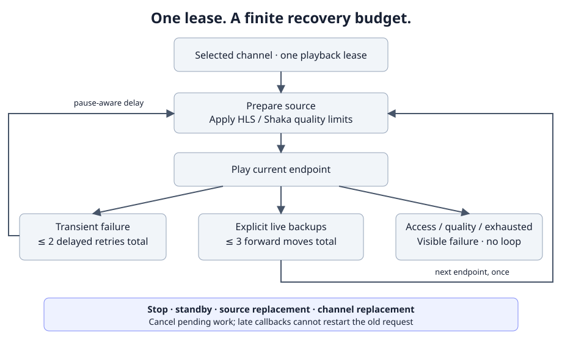

# Ограничение качества и восстановление прямого эфира

[English](playback-stream-policy.md) · [Владение декодером](device-media-backend.md)

Управляемый HTML5/HLS/Shaka-плеер сохраняет один сеанс воспроизведения при
восстановлении после ошибки. Для канала прямого эфира можно задать до трёх
резервных адресов. Автоматического поиска или подмены канала по названию нет.

## Ограничение качества

В **Настройках → Настройках интерфейса** выберите **Максимальную высоту видео
(HLS/Shaka)** и/или **Максимальный битрейт потока (HLS/Shaka)**. Оба ограничения
действуют одновременно. **Автоматически** снимает соответствующее ограничение.
Доступны 360/480/720/1080/2160 пикселей и 1/2/4/8/16 Мбит/с. Настройки сохраняются
локально через обычную форму с сохранением и отменой; применяются при следующем
запуске воспроизведения, в том числе при восстановлении после ошибки.

Это верхняя граница выбора, а не перекодирование: единственный вариант 1080p
не превращается в 720p. Если подходящего варианта нет, появляется сообщение
**Ни один поток не соответствует ограничениям качества**, и повторы прекращаются.
Неизвестная высота или битрейт не считаются доказательством соответствия.

HLS отфильтровывает варианты до загрузки видеосегментов. Современный hls.js
удаляет неподходящие варианты; старые версии без `removeLevel` могут использовать
только непрерывный подходящий префикс списка и иногда отклоняют поток, имеющий
подходящие варианты далее в списке. Shaka использует `maxHeight`/`maxBandwidth`.
Адаптация качества продолжается среди оставшихся вариантов.

Ограничения относятся к управляемым движкам HLS и Shaka. Обычный HTML5,
нативные декодеры и старые TV/STB-движки не предоставляют те же возможности.
Режим Auto может выбрать нативное воспроизведение; настройка не принуждает его
к MSE. При ошибке ограниченного HLS-потока плеер не обходит ограничение переходом
на нативный декодер. Аппаратный тест производительности и транскодер не добавлены.

## Резервные адреса

1. Включите нужный канал прямого эфира.
2. Откройте **Информация → Резервные потоки**.
3. Выберите позицию 1, 2 или 3 и введите полный HTTP/HTTPS-адрес.
4. Для занятой позиции доступны **Редактировать** и **Удалить**. Заново включите
   канал, чтобы применить новый список.

Адреса привязаны к хранилищу текущего провайдера и точной паре
`sourceId`/`channelId`. Смена источника или канала делает открытый редактор
неактивным. Конкурирующее изменение той же позиции не перезаписывается.
Первым остаётся обычный адрес канала; пустые позиции и повторы пропускаются.
Поддерживается не более 256 каналов и 256 КиБ конфигурации.

Не принимаются адреса с логином/паролем перед именем сервера, пробелами,
управляющими символами, обратной косой чертой или некорректным портом.
Токены провайдера в параметрах URL возможны: это локальная конфигурация
источника, а не способ публично распространять доступ.

Резервирование действует **только в прямом эфире**. Архив и VOD не получают
адрес прямого эфира вместо записи. Эквивалентность и право доступа к резервному
эфиру обеспечивает владелец настройки. Совпадение названий недостаточно.
Идентификатор канала, избранное и привязка EPG при замене адреса не меняются.

## Поведение после ошибки

- На запрос приходится **не более двух повторов текущего адреса суммарно** и
  по одному переходу вперёд на каждый из трёх резервов: максимум пять
  пересозданий декодера после первого запуска. Успешный манифест и новый
  декодер не обнуляют этот бюджет. Внутренние ограниченные попытки HLS
  выполняются перед внешним восстановлением.
- Ошибка разбора манифеста или уровня HLS допускает один повтор текущего
  адреса на запрос в пределах общего лимита двух повторов. Новый декодер
  или резервный адрес не обнуляет этот предел.
- Сетевые ошибки без статуса, HTTP 408/429 и 5xx могут повторяться. Прочие 4xx
  могут перейти на резерв, но не повторяют текущий адрес. **401/403 и ошибка
  входа прекращают запрос**, без обхода авторизации через резервные адреса.
- Ошибка декодирования может перейти на резерв. Невыполнимые ограничения
  качества завершают запрос. Возврата по кругу к первому адресу нет.
- Задержки составляют 0,5 с, 1 с, 1,5 с, далее максимум 2 с. Дубли ошибок
  не создают параллельных таймеров.
- Пауза снимает таймер, сохраняя ожидающую попытку; продолжение запускает его
  снова. Стоп, сон, смена канала или источника отменяют устаревшие действия.
  После окончательного отказа нужно явно выбрать канал заново.
- Ошибки загрузки и критические события Shaka обрабатываются одинаково;
  ошибки отмены игнорируются. Новый декодер ждёт завершения удаления Shaka.
- При повторе заново разрешается непрозрачная ссылка Stalker и выполняется
  подготовка защищённого источника. Истёкший локальный iOS-адрес не используется.
  Позиция VOD/архива снимается до удаления декодера; резерв прямого эфира
  начинается с актуальной точки эфира.

Новый параллельный наблюдатель за застывшими кадрами не добавлен. Существующие
проверки kiosk, Auto/native и HLS остаются; молчаливое зависание, которое они
не обнаружили, требует отдельной диагностики.

## Проверка

`window.__ottStreamPolicy.snapshot()` содержит движок, ограничения, доступность,
число попыток, индекс адреса и состояние, без URL и данных входа. Нулевой индекс
означает обычный адрес, последующие — непустые уникальные резервы. Это диагностический
интерфейс, не стабильный протокол удалённого управления.

Команды проверок приведены в [английской версии](playback-stream-policy.md#verification-and-observability).
Проверяются порядок вариантов HLS, отсутствующие метаданные, конфликты редактора,
дубли ошибок, конечный бюджет, авторизация, отмена, удаление Shaka и позиция VOD.
Пять новых элементов интерфейса переведены во всех 88 языковых пакетах.
Автопроверка структуры переводов не заменяет редактуру носителями языка.
Физическое воспроизведение на TV/D1 и особенности конкретных провайдеров
требуют аппаратной проверки. [Исходник диаграммы](diagrams/stream-recovery.mmd).
