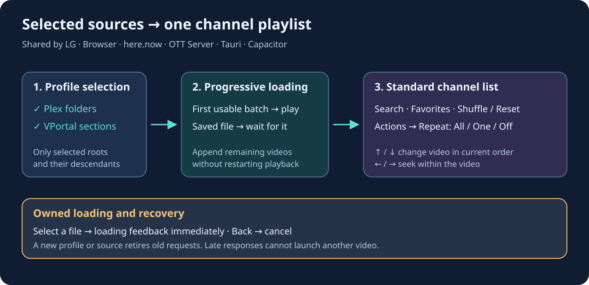
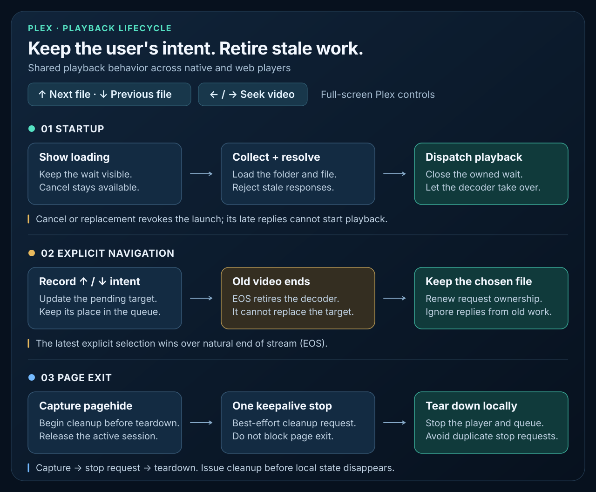
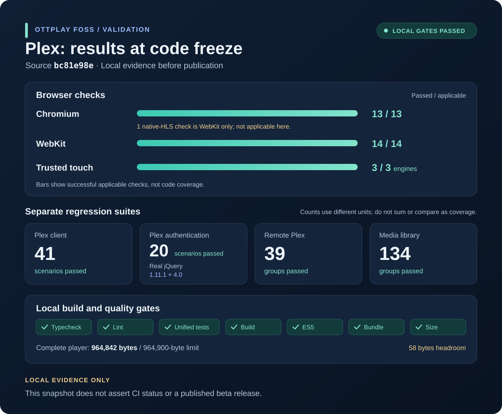

# Plex on each player

Choose **Plex** in the provider list, then **Sign in with Plex**. The official Plex sign-in page opens in a browser. On a TV, open `plex.tv/link` on a phone or computer and enter the displayed code. Choose an available Plex server after signing in; the player checks its connection and opens folder selection. **Back** cancels sign-in or server connection.

For a manual connection, enter the Plex server address (for example `http://192.168.1.25:32400`) and its access token, then choose **Save and open library**. The token is masked in the settings screen. Prefer an HTTPS Plex endpoint for an HTTPS browser player: access to local HTTP endpoints depends on the browser's local-network permissions and mixed-content policy. Native players can use the transport supported by their build. The Play distribution retains its HTTPS policy.

Plex uses the same channel list as Local videos. In **Plex settings → Folders**, select the libraries or folders this profile should include, choose **Ok** in the picker, then save the profile. Only the selected roots and their descendants are scanned. Overlapping selections do not duplicate a video. Existing profiles without a selection open the folder picker; they never silently import the whole server.



The player connects under the standard animated loading dialog and reports processed entries and available videos. It starts when the first usable batch arrives; if a saved video is selected, it waits for that video or the end of the scan. Remaining items arrive in the background without restarting the current video. Cancelling, changing source or changing profile retires the previous load. A stalled scan ends with an error rather than holding the loading screen indefinitely.

**OK** opens the ordinary channel list. Search, favorites, order changes and **Actions → Shuffle / Reset order** work on this list. There is no separate Random button or folder tree during normal playback. Folder selection belongs to the profile editor.

**Actions → Repeat** cycles through **All**, **One** and **Off**. All wraps the selected channel group, One repeats its current video, and Off stops after the final video. The Play key changes this setting while Actions is open. Changing the order or receiving another batch affects subsequent file transitions without restarting the current file.

The standard playback footer uses the playing video's folder or collection as
its channel title. The current programme row shows the video title and the local
clock time when playback started (`HH:mm:ss`). The next row shows the actual next
item in the current order and a nominal start time: current start plus full video
duration. Pause, seek and buffering do not reset the current start clock. Unknown
duration leaves the next time blank; no successor leaves the next row blank.
The same layout applies to Local videos and VPortal in browser/server, Tauri and
Capacitor builds.

Selecting a video opens the standard loading dialog immediately while its playable URL is resolved. **Back** cancels and returns to the list. Late replies cannot launch a cancelled selection. The decoder's normal buffering indicator follows stream preparation.

During full-screen Plex playback, **Left/Right** seek backward/forward by ten seconds and **Up/Down** play the previous/next file in the current list. Dedicated volume keys still adjust volume. Open lists and dialogs retain their own navigation. Explicit remote Plex queues keep their own requested order and completion policy.

The standard channel selection and per-file watch position are saved independently of expiring media URLs. Reopening resolves the selected video again through Plex. Startup resumes its saved position automatically; choosing a file manually offers the existing Continue watching prompt. Arrow navigation and natural completion start the next file at zero. Older Plex profiles can restore their unfinished last video from the same server’s media journal after folder selection. Parental admission still applies.

The same implementation is built for the browser, here.now, OTT Server, LG/webOS, Tauri and Capacitor. Updating only one installed instance does not update the others. The separate native Compose Android application does not currently expose a Plex/VPortal provider.

The **Playback** setting offers:

- **Automatic** — original files when the current device reports support; compatible HLS when conversion is needed.
- **Original file** — direct playback, using the device's own decoder.
- **Compatible HLS** — Plex prepares a stream for the player. Conversion speed depends on the Plex server and source format.

When the device supports HEVC through Media Source Extensions, compatible HLS uses fragmented MP4, preserves HEVC video at its source resolution and requests AAC audio. For HEVC/Opus files this avoids unnecessary video encoding on the NAS while adapting audio for WebKit.

The selected server address, its access token and playback preference are stored in the current device's provider profile as `plexcfg`. Account sign-in also saves that server's identity and connection candidates. Each time the provider opens, it checks which connection is reachable, so a laptop can move between home Wi-Fi and the internet without signing in again. Browsing history stays associated with the same server and server credential. Editing the address or token manually clears these account connection candidates.

Remote control can update the selected Plex provider through the `provider_settings` request with `{"provider":"plex","settings":{"server":"https://plex.example:32400","token":"YOUR_SERVER_TOKEN"}}`. First setup requires the server and token together. Later requests may update either field; the omitted credential and playback preference are preserved. Provider restrictions and the player's parental settings lock still apply. Tokens must contain no whitespace or control characters and must be at most 1024 characters. Server URLs must use HTTP or HTTPS, with no embedded credentials, query, fragment, or parent-directory path segments.

A successful response contains only the field names, `provider: "plex"`, and `saved: true`; it never includes the token or server address and does not claim that connection succeeded. Saving retires the old library and reloads the provider. Changing either credential clears account connection candidates; other providers' settings remain untouched.

Account sign-in tokens remain in memory during server discovery. No environment variables, central player-server configuration or NAS deployment are required. A settings backup containing this profile also contains its server credential.

## Ordered queues from the command server

An updated player and controller support an explicit list of Plex `ratingKey` IDs:

```sh
ott l plex preview 78777 78776 78775
ott l plex play 78777 78776 78775
ott l plex queue
ott l plex next
ott l plex prev
ott l plex stop
```

To select a complete Plex library without entering individual media IDs:

```sh
ott l plex libraries
ott l plex library --preview "Tom and Jerry"
ott l plex shuffle "Tom and Jerry"
ott l plex library --shuffle id:16
ott l plex shuffle "Кукутики"
```

These commands use the player's saved Plex connection. `id:16` selects library
section 16; it is not a media ratingKey. A plain numeric name remains a library
name. Selection first checks normalized exact titles, then a unique partial
match. Ambiguous names fail without changing playback; use `plex libraries`
and an explicit section ID to disambiguate.

Movie libraries collect movies, and TV libraries collect episodes across their
shows and seasons. The player reads every inventory and media page before
starting playback, accepts at most 1,000 library entries and 500 videos, and
rejects duplicate, incomplete or changing results. Music libraries and physical
filesystem folder traversal are not supported by this command. A failed lookup
or collection leaves existing playback intact. Preview collects and validates
metadata without starting a decoder. Shuffle makes one permutation of the
complete result; subsequent episodes retain that order.

Library queues validate each video's file metadata while reading the complete
catalog. They reuse those records instead of asking Plex for the same metadata
again in one large request. The first video is still resolved separately before
playback starts. A missing or invalid file entry rejects the whole queue rather
than silently skipping a video.

On older players, `One or more Plex items are unavailable or not playable` can
also mean that this redundant metadata request timed out. The message alone
does not prove that the library or its files are missing. Reload an updated
player and check the library without starting playback:

```sh
ott -t 45 l plex library --shuffle --preview "Кукутики"
```

Library commands require the separately advertised `plex_library` v1 capability.
Existing `plex play ID...` and `plex preview ID...` remain available on older
players. Library discovery shares the queue's cancellation, source and runtime
checks: Stop, replacement playback, changed settings or request expiry cannot
be undone by a late library response. List and preview cannot replace a pending
play operation. The operation journal records library play only. These commands
do not enable kiosk, change repeat settings or rewrite the Plex connection.

The player uses its existing saved Plex profile even while a TV provider such as
M3U is selected. It checks the server and all requested metadata, then resolves
the first stream before handing playback over. The selected TV provider and
saved credentials remain unchanged. A failed preparation leaves existing
playback and any previously accepted queue intact. `preview` checks ordered
metadata without starting playback or replacing a queue. If another remote
request is preparing playback, preview waits behind it. It does not test
physical decoder compatibility.

`play` starts the first ID at zero, ignores saved resume positions, and plays the
IDs exactly in the supplied order. `plex play --shuffle ID...` shuffles the
complete input once in the CLI. Without kiosk, completion of the last item stops
playback. Manual next/previous at a boundary returns an
error without stopping the current item. The completed queue remains available
for status and previous. `ott l next` and `ott l prev` use that accepted queue
until `plex stop` clears it. A failed first queue request does not take over TV
channel navigation. Stop only stops video still owned by the queue, so clearing
an old queue cannot stop a TV channel selected afterwards.

Status distinguishes `preparing`, `playing`, `paused`, `ended`, `error`, and
`idle`; its index is zero-based. Requests contain 1–500 positive decimal IDs
without leading zeros. Responses contain IDs, bounded titles and static errors,
never stream URLs or credentials. Commands target the discovered player runtime;
a reload creates a new runtime and clears this in-memory queue. Disconnecting
remote control cancels a pending launch, but an already accepted queue continues
autonomously through natural completion. A CLI timeout does not prove whether
playback started: inspect status before issuing another play request. The player
processes remote requests serially, so a status or preview command queued during
slow preparation waits for that bounded request to finish.

After restarting the player, use `ott l` to check that it is ready before
starting or stepping a queue. Playback requests are refused while the initial
provider load is incomplete; preview, status and stop remain available. An old
archive-resume prompt cannot override a newer playback command.

`playing` confirms the managed video decoder's state, not that its picture is
visible above every window or overlay. When diagnosing a TV, check the physical
screen as well as status. Decoder errors remove the `playing` state until
playback is confirmed again; they never count as natural completion or skip to
the next film.

If preview reports missing configuration, save a Plex profile on that player.
If it reports connection failure, check that the saved endpoint is reachable
from the player, rather than only from the CLI machine. HTTPS browser players
can still be blocked by mixed-content, CORS or local-network policies; the queue
does not bypass those restrictions or invent a proxy. Native platforms use their
existing Plex transport. Kiosk restrictions still apply when playback is
committed. Ordinary films work with the default parental settings; items
explicitly marked adult require local parental access before starting the queue.
A refused handoff restores the prior media runtime, including its natural-end
continuation, rather than publishing a replacement queue that never started.
Successful playback closes the channel/media list and cancels its stale TV
preview, without restoring PiP. It does not discard an open unsaved settings or
input dialog; close or finish that local draft to uncover the full video.

To retain and loop the queue across application restarts, select the Plex provider,
start the required queue, then enable kiosk:

```sh
ott f10 provider plex
ott f10 plex play --shuffle 78777 78776 78775
ott f10 kiosk on --strict
ott f10 kiosk status
```

Kiosk repeats the same complete shuffled order and stores provider requests,
source identity, cursor and position without retaining expiring stream URLs.
After a page reload, use `kiosk status` for the durable queue; the separate remote
queue controller is in-memory. Use `kiosk off` before replacing the queue or
updating the application. Strict mode blocks local navigation and playback
controls while allowing the information footer for five seconds. On the active
core player, tapping or dragging its timeline seeks within the current episode;
other controls remain locked. This support
is shared by browser/hosted, server, Tauri, and Capacitor Android/iOS builds.

If Plex cannot connect while kiosk is locked, the player keeps the saved kiosk
policy and does not open Plex settings or a modal connection-error dialog.
Inspect `ott f10 kiosk status` for recovery progress. To repair the connection
or edit settings, explicitly unlock the player first:

```sh
ott f10 kiosk off
ott f10 restart
ott f10
ott f10 plex preview 78777 78776 78775
ott f10 plex play 78777 78776 78775
ott f10 plex status
```

Wait for the restarted player to reconnect and finish loading its provider
before starting playback. If necessary, repair its saved Plex connection while
unlocked. `preview` checks server access; confirm actual playback before enabling
`ott f10 kiosk on --strict` again. On older builds that already opened Plex
settings under a strict lock, `ott f10 kiosk off` restores local navigation;
restarting alone retains that lock.

The wire contract is `plex_queue` with `op`, exact `runtime`, and `ids` for
`play`/`preview`. `capabilities.plex_queue` advertises version 1, supported
operations and `max_items: 500`. The CLI respects older players that still
advertise a smaller maximum. The shared examples and bounds are in
[`contracts/plex-queue-v1.json`](../contracts/plex-queue-v1.json).

For access away from home, the selected Plex server must have a reachable remote connection. Plex may impose account or subscription requirements for remote personal-media playback; see [Plex remote playback requirements](https://support.plex.tv/articles/requirements-for-remote-playback-of-personal-media/).

## Loading, navigation and shutdown



A loading screen belongs to the request that opened it. During startup, the
player scans the profile’s selected roots and resolves a fresh stream for the
saved video (or the first available video on a new profile). It can start before
other selected folders finish loading. Replacing that screen cancels pending work; a late result cannot start a video
behind a newer dialog. Cancellation preserves the saved playback position.

During a full-screen file change, repeated **Up/Down** presses update the pending
destination. If the old video ends meanwhile, the player carries that exact
destination into the new playback generation. Responses from the previous
request are ignored. Navigation performed during cancellation also wins over
the old request. **Left/Right** remain seek controls for the current video.

Folder scanning continues after a full 200-row page even when Plex omits
`totalSize`. A known total or an empty page finishes that traversal; a server-capped short
page without a total still advances. Cursor and catalog bounds remain enforced. The normal playlist receives incremental batches.
An explicit remote Plex queue still requires its complete validated collection
before playback, preserving the requested order and all-or-nothing admission.

Account connection probes accept both JSON and XML from Plex Media Server.
They verify the server identity before sending its token. The cloud account
API keeps its JSON contract. The provider and account modules exchange the
parser through their published API so the same behavior survives bundle
isolation and minification.

On page exit, the Plex client releases its session during the capture phase of
`pagehide`, before queue and player cleanup. This lets the final stop use a
keepalive request. Repeated cleanup does not send a second stop; disposing the
client removes the same capture listener.

## Reliability review process and results

The October 2026 review used separate provider, player and release audits.
Each accepted fix started with a reproduced failure, then received a regression
test and independent review. Browser runs exercised the shipped bundle as well
as the source-level checks. This caught an isolated-module parser error and the
WebKit shutdown ordering issue before release.



This is a local verification snapshot for code commit
[`bc81e98e`](https://github.com/open-ott-play/ottplay-foss/commit/bc81e98ebdabd113fdbe6ec7c18ad85316fc4a6e),
reviewed in [PR #780](https://github.com/open-ott-play/ottplay-foss/pull/780):

- Chromium passed 13 Plex browser scenarios. The native-HLS case applies to
  WebKit and is excluded from the Chromium count.
- WebKit passed all 14 Plex browser scenarios, including native HLS, remote
  queue completion, and saved-favorite replay after reload.
- The loading-screen touch scenario passed separately in Chromium, Firefox
  and WebKit using trusted browser input.
- Plex client checks passed 41 scenarios; authentication passed 20 scenarios
  using real jQuery 1.11.1 and 4.0 transports and isolated provider modules.
  Remote queues passed 39 behavior groups; the media library passed 134 groups.
- Unified tests, TypeScript, lint, production build, emitted-bundle checks,
  ES5 grammar and size checks passed. The complete web player measured
  964,842 bytes against the unchanged 964,900-byte limit.

Scenario and group counts describe the named suites; they are not a percentage
of code coverage or a count of unique assertions. Browser evidence does not
replace physical TV/decoder acceptance. These results record local validation;
publication also requires the repository's CI and release gates.

The delivery sequence is: reproduce and review the fix, validate the built
player, merge the approved PR, then publish the verified platform packages.
Beta uses the compact validation path. RC adds the full qualification and
fuzzing requirements described in the [release workflow](release-workflow.md).
The release manifest binds the published files to their source and checksums.

To repeat the focused checks:

```sh
node tests/test_plex_client.cjs
node tests/test_plex_auth.cjs
node tests/test_media_library.cjs
node tests/test_plex_provider.cjs
node tests/test_remote_plex.cjs
npm run typecheck
npm run lint
npm run test:unified
npm run build
npm run check:bundle
npm run check:size
npx playwright test tests/browser/plex-provider.spec.cjs tests/browser/remote-plex.spec.cjs --browser=chromium --workers=2
npx playwright test tests/browser/plex-provider.spec.cjs tests/browser/remote-plex.spec.cjs --browser=webkit --workers=2
npx playwright test tests/browser/plex-provider.spec.cjs --browser=all --grep 'Plex file selection' --workers=2
```

The provider tests also cover local profile isolation, masked token editing,
authenticated readiness, stale connection callbacks, server choice and
cancellation after switching providers. Install the Playwright browsers required
by the selected commands before running browser acceptance.
