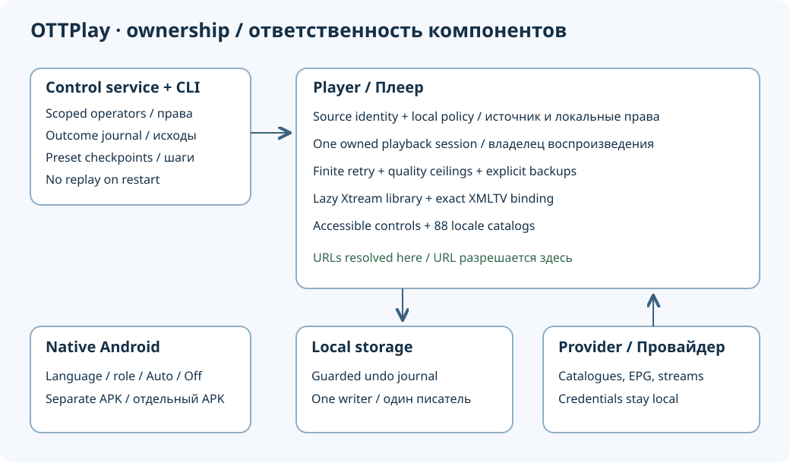

# Reliability and media improvements

[Русский](roadmap-delivery.ru.md) · [Wiki](wiki/Home.md) · [Architecture](architecture.md)

This guide describes the implementation at the source revision of this page, not
the capabilities of an older installed release. Player, control service/CLI and native Android app
are separate artifacts. Updating one does not update the others.



See the [measured byte cost and comparison chart](roadmap-size.md); execution
speed and device playback are separate acceptance checks.

## What is implemented

1. **A known audio/video sample.** [Information → Audio](audio-video-check.md)
   streams an eight-second clip from here.now (internet required) with left/right
   tones and matching flashes. It is fetched only after **Play**, never at startup;
   the media file is not included in player packages.
   It borrows the main HTML5 decoder only while idle or watching live TV. It does
   not write viewing history. [Fixture specification](../diagnostics/README.md).
2. **Resumable Local/Home setup.** The control CLI can plan, apply, resume and
   verify a preset. It compares saved settings before retrying an uncertain write.
   [Control workflow](https://github.com/open-ott-play/ottplay-control-server/blob/9b28c08eefca3948c78336e7e16a45e6fc492e31/docs/reliable-control.md).
3. **Bounded playback recovery.** HLS/Shaka transient failures share a finite
   recovery policy. Authentication and unsupported DRM are terminal. Stop,
   channel change and source replacement cancel stale work.
4. **Saved quality limits.** Maximum height and bitrate constrain adaptive
   selection; a native fallback must not silently bypass an active ceiling.
5. **Native Android track preferences.** The independent Android app remembers
   language/role/label intent, including Auto and subtitles Off, instead of
   carrying a track index from another stream.
6. **Scoped command operators.** The controller can grant a credential exact
   devices/actions without handing out the administrator credential.
7. **Explicit XMLTV bindings.** A playlist-scoped channel can bind to a specific
   feed and XMLTV ID. [Guide bindings and accessibility](guide-binding-accessibility.md).
8. **Xtream movies and series.** The media library lazily fetches the selected
   catalogue, then a series' episodes. [Library contract](xtream-media.md).
9. **Accessible classic controls.** Channel lists expose selection semantics;
   modal dialogs keep and restore keyboard focus; notices have a live region.
10. **Durable command outcomes.** An optional bounded controller journal retains
    deduplication and outcome metadata. A restart never blindly replays commands.
11. **Explicit device handoff.** Live/archive references move to a player with
    the same configured source. The target resolves its own URL. [Contract](remote-handoff.md).
12. **Explicit backup streams.** Live channels can use configured alternatives
    within the same finite recovery policy. [Limits, recovery and backups](playback-stream-policy.md).
13. **Recoverable settings batches.** Native localStorage uses an undo journal
    for supported multi-key writes. [Storage guarantees](settings-recovery.md).

## Language and compatibility coverage

The player ships 88 translation catalogs. The seven new quality/media labels
are translated in every catalog; other new menus reuse existing translated
labels. Catalog checks cover key parity, placeholders and reviewed exceptions.
English and Russian engineering guides explain the same implementation limits.
[Localized entry points](readme/README.md) are quick-start guides, not claims
that every historical engineering document has 88 full translations.

Classic output remains ES5 syntax. This does not mean every device supports
every codec, Web API, storage guarantee or native integration. The A/V preview
is restricted to the main managed HTML5 path; device engine overrides such as
PC2/Video.js and native engines are excluded. Explicit guide bindings use the hosted
or native XMLTV implementation; optional external companion protocols may not
support them. Device-specific acceptance still requires the actual device.

## Reproduce the checks

```sh
npm ci
npm run typecheck
npm run test:localization
npm test
npm run build:server
npm run check:es5
npm run check:size
python3 scripts/check-av-diagnostic.py diagnostics/av-v1.mp4
```

The media verifier needs FFmpeg/FFprobe. It decodes both audio channels and checks
their energy, separation and silence; existence of an AAC track alone is not
evidence of audible content. The regular JavaScript tests exercise cancellation,
failed writes, restart recovery, source changes and invalid inputs. Final bundle
checks include optional provider families, not only the main entry.

In the controller run `go test -race ./...`, `go vet ./...` and
`python3 -m unittest discover -s tests`. In native Android run the track preference
and settings backup unit tests and assemble the debug APK. Each repository's CI
is authoritative for the corresponding commit, not for a later changed tree.

## Physical acceptance before promotion

- On a target TV, run the A/V check and confirm left/right audio, visible flashes,
  Stop and return to live TV. Decoder tests do not prove HDMI sound or smoothness.
- Exercise allowed/denied streams, a failed backup and channel change during a
  pending retry. Confirm the selected quality limit on the actual backend.
- Test list/dialog focus with a keyboard, remote and available screen reader.
- Bind two similar channel names to distinct XMLTV IDs and verify programme data.
- Interrupt a test preset application, restart the controller, resume and verify.
  Hand off to both a matching and mismatching configured source.
- On native Android, switch streams with different track ordering, restart the
  app and confirm explicit Auto/Off and preferred-language behavior.

Successful dispatch, saved settings, decoded samples and passing unit tests are
different evidence. Release promotion must retain that distinction; see the
[release strategy](../RELEASING.md).
