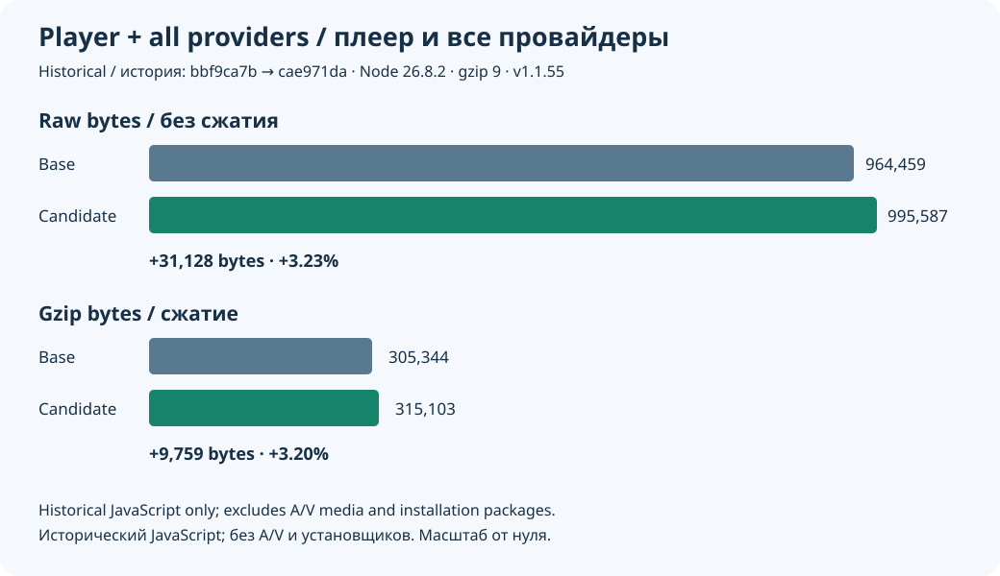
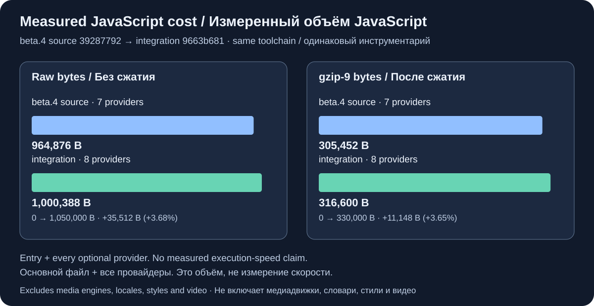

# Measured JavaScript cost

[Русский](roadmap-size.ru.md) · [Feature guide](roadmap-delivery.md) · [Raw evidence](evidence/roadmap-size-20261015.json)

This page preserves the JavaScript measurements from the source snapshots below.
They do not measure the current revision, installation packages or network traffic.

In the initial comparison, the main entry plus every optional provider family
grew by **31,128 raw bytes / 9,759 gzip bytes**: about **3.23% / 3.20%**. It is a feature-cost
increase, not a claimed size or execution-speed improvement. Xtream remains lazy;
moving it out of the entry does not remove it from the total.

The measurement compares clean source archives `bbf9ca7b` and `cae971da`, both
version 1.1.55, with Node 26.8.2, TypeScript 5.9.3, Terser 5.51.2 and zlib 1.2.12.
It uses the production ES5 assembler, optimizer, name policy and correct clean
source identity. Gzip level 9 is applied separately to each emitted asset.

- Web entry: 848,092 / 262,392 → 874,926 / 270,321 raw/gzip bytes.
- Web entry + all providers: 964,459 / 305,344 → 995,587 / 315,103.
- Native entry: 848,050 / 262,460 → 874,884 / 270,372.
- Native entry + all providers: 964,417 / 305,412 → 995,545 / 315,154.
- Optional M3U grows 184 raw / 82 gzip bytes; new Xtream is 4,110 / 1,748.
  The other six optional families are byte-identical.

Before the clip moved to here.now, changing its URL to the rooted local path
added one raw JavaScript byte in this historical sequence. That is not a
measurement of the later hosted URL. The bounded HLS parse-retry
fix adds 37 raw / 36 gzip bytes in an isolated same-snapshot comparison
([evidence](evidence/parse-recovery-size-20261015.json)). The native Auto handoff ownership fix adds another 101 raw / 39 gzip bytes
([evidence](evidence/auto-recovery-size-20261015.json)). The resulting full raw
total before the accessibility regression fixes is 995,726 bytes; build identity and gzip bytes can change in the final commit. Final `build/reports/classic-bundle.json` and
`npm run check:size` remain the authority for the exact delivered revision.
The subsequent clean build `652726f8`, including pointer/dialog focus fixes,
measures **995,858 raw / 315,207 gzip bytes** for the complete web player
([final artifact evidence](evidence/roadmap-final-size-20261015.json)). Its entry
is 875,197 / 270,425; native totals are 995,816 / 315,259.
The caps for that snapshot retained the previous native/Node/release-suffix allowance:
875,300 raw / 271,600 gzip for the entry; 996,100 / 316,400 for entry + providers.

## Post-beta integration

The later comparison reproduces beta.4 source `39287792` against runtime
`9663b681`, including Plex integration and damaged-settings recovery, using the
same Node 26.8.2, Rollup 4.64.5 and Terser 5.51.2:

- Web entry: 848,315 / 262,443 → 879,533 / 271,761 raw/gzip bytes.
- Web entry + all providers: 964,876 / 305,452 → 1,000,388 / 316,600.
- Native entry + all providers: 964,834 / 305,520 → 1,000,346 / 316,654.
- Complete web payload increase: **35,512 / 11,148 bytes (3.68% / 3.65%)**.

The baseline counts seven provider families; the integration counts eight,
including lazy Xtream. That snapshot's entry caps were 879,900 / 273,000;
total caps were 1,000,800 / 317,800, preserving room for native, Node and release identity.
Both local production builds regenerate five tracked runtime files and omit
the clean-source revision claim. These are reproduced local artifacts, not
the published beta binaries. Tool versions, hashes and that limitation are
recorded in the [baseline evidence](evidence/post-beta-baseline-size-20261015.json)
and [integration evidence](evidence/post-beta-candidate-size-20261015.json).
The [implementation report](implementation-report.md#post-beta-integration-and-review)
explains the fixes and validation.

**Scope:** these JavaScript totals exclude external media engines, language
dictionaries, CSS, images and video. The historical player packages also carried
a **464,652-byte A/V clip**, outside the totals above. Its current delivery is
separate from those measurements:

- **Repository:** `diagnostics/av-v1.mp4` remains with its generator and verifier
  for reproducibility. Keeping a source file does not include it in a package.
- **Packages:** Web/OTTPlay Server, Tauri, Capacitor and Docker exclude the clip.
  This removes 464,652 raw media-asset bytes, not a measured 464,652-byte reduction
  in a compressed installer. Archive format and other build changes affect that size.
- **Network:** the player fetches the clip from here.now only when the user starts
  the [A/V check](audio-video-check.md). The check requires internet access; the
  clip is not fetched for startup playback.

The historical JavaScript measurements above remain unchanged. Measuring the
hosted URL's effect on JavaScript or a current installer requires a new comparison.
The 88 localized README files are repository documentation, not player payload.
No startup-time, frame-rate, memory or catalogue-scale performance claim follows
from this byte comparison. Those require separate measurements on target devices.
