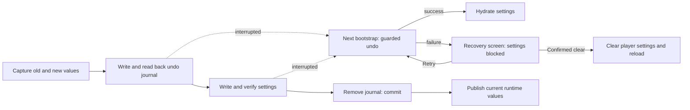

# Recoverable multi-key settings

[Русский](settings-recovery.ru.md) · [Improvements](roadmap-delivery.md)

Supported localStorage batches use `ottplaySettingsJournalV1`, an internal undo
journal excluded from export, cloud payloads and ordinary setting enumeration.
Before mutating settings, the writer records each key's rollback/new string
(or null), reads the journal back, writes and verifies the batch, then removes
the journal as its commit point. Runtime changes publish only while the captured
settings owner remains current. Unrelated keys are not cleared by an import.

Parental PIN migration keeps the exact original value in memory for conflict
checks, but writes only its protected replacement as the rollback value. A failed
import or interrupted recovery must not restore a readable legacy PIN. The journal
format remains version 1. See [PIN migration and limitations](parental-pin-storage.md)
before updating or restoring older settings.

Bootstrap recovers before hydrating settings. It restores an old value only
while the stored value still equals this batch's new value, preserving a later
foreign edit. It validates the journal and ownership throughout recovery.
A failed or corrupt journal opens a recovery screen before the player starts.
No partial account settings or stale cookie fallback values are loaded, and
ordinary setting writes remain blocked. **Retry** repeats the guarded recovery
and reloads only after success. **Clear settings** requires a second explicit
confirmation; Cancel/Back leaves data intact. It clears origin localStorage and
the recorded player cookies at their root path. Foreign cookies are left alone.
A persistent reset marker and empty fallback allowlist prevent unrecorded legacy
cookies from reviving settings, including when localStorage becomes unavailable;
new fallback writes enter the allowlist. The journal barrier is removed only
after the reset policy and deletion are verified. Failure keeps the recovery
screen and barrier. Keyboard Tab/arrows/Enter and
device remote keys work before normal UI initialization. Nothing is reset
automatically, and the screen never prints journal contents. If needed, preserve
the original storage privately for diagnosis before choosing Clear settings.
Journal limits: 16,000 entries and 2 MiB serialized text.

**Guarantee boundary:** one writer, one supported native localStorage backing
store. Browsers provide no atomic compare-and-swap across tabs. Do not run
concurrent imports in multiple windows; this is not a multi-tab transaction or
database. Power-loss durability is limited by the browser/OS storage itself.
Cookie/session/custom device adapters keep guarded best-effort rollback; they
do not gain persistent journaling. There is no distributed transaction with
the remote controller or another player.

The journal temporarily contains old/new setting values, potentially including
provider credentials, in the same origin storage that already holds them.
It is not telemetry and must not be copied into public bug reports. Quota failure
while preparing the journal stops before writes. Do not remove a pending journal
just to hide a failed import; that discards its recovery information.

Run `node tests/test_settings_journal.cjs`, `node tests/test_settings_store.cjs`,
`node tests/test_local_settings_backup.cjs` and
`node tests/test_cloud_settings_session.cjs`. Tests restart from snapshots of
interrupted writes, interrupt recovery itself, preserve foreign values and
exercise quota/corruption/reentrancy failures. Recovery tests also cover
quarantined reads/writes, the actual early startup guard, retry after a temporary
storage failure, explicit reset confirmation, keyboard/remote input, interrupted
resets, rejected cookie deletion, foreign path-scoped cookies, and native/cookie
fallbacks after a reset. The early HTML language loader follows the same reset
allowlist.
