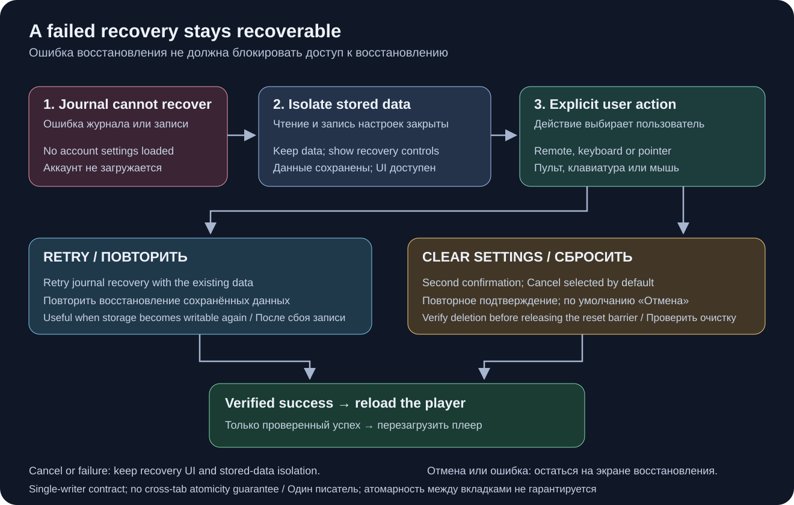

# Восстановление пакетных настроек

[English](settings-recovery.md) · [Улучшения](roadmap-delivery.ru.md)

Поддерживаемые пакетные записи localStorage используют внутренний журнал отката
`ottplaySettingsJournalV1`. Он исключён из экспорта, облачных пакетов и обычного
перечисления настроек. До изменений записываются и перечитываются значения для
отката и новые значения ключей (строка или null), затем сохраняется и проверяется
пакет. Удаление журнала — точка фиксации. Значения публикуются в runtime только
при сохранении владельца операции. Импорт не очищает посторонние ключи.

При миграции родительского PIN точное исходное значение остаётся в памяти для
проверки конфликтов, а в журнал как значение для отката записывается только его
защищённая замена. Ошибка импорта или прерванное восстановление не должны вернуть
старый PIN открытым текстом. Формат журнала остаётся версии 1. Перед обновлением
или восстановлением старых настроек прочитайте
[описание миграции PIN и её ограничений](parental-pin-storage.md).

При запуске восстановление выполняется до чтения настроек приложением. Старое
значение возвращается только если текущее всё ещё равно записанному этим
пакетом: позднее постороннее изменение сохраняется. Проверяются структура
и владение журналом. Ошибка или повреждение журнала открывает экран
восстановления до запуска плеера. Частично изменённые настройки и устаревшие
cookie не загружаются; обычная запись настроек заблокирована. **Повторить**
снова выполняет защищённое восстановление и перезагружает страницу только после
успеха. **Очистить настройки** требует второго явного подтверждения;
отмена/назад оставляет данные нетронутыми. Очищается localStorage origin плеера
и учтённые cookie плеера на корневом пути. Чужие cookie сохраняются. Постоянный
маркер сброса и пустой список разрешённых резервных ключей не позволяют старым
неучтённым cookie вернуть настройки, даже если localStorage позже недоступен.
Новые резервные записи включаются в разрешённый список. Журнал удаляется только
после проверки удаления и сохранения правил сброса; при отказе экран и журнал
остаются. Tab, стрелки, Enter и клавиши пульта
работают до инициализации основного интерфейса. Автоматического сброса нет;
содержимое журнала на экран не выводится. При необходимости до очистки
сохраните исходное хранилище приватно для диагностики.
Пределы: 16 000 записей и 2 МиБ текста журнала.
[Диаграмма](settings-recovery.md).

**Граница гарантий:** один писатель и поддерживаемый native localStorage.
Браузер не предоставляет атомарного compare-and-swap между вкладками. Не
импортируйте настройки одновременно в нескольких окнах; это не межвкладочная
транзакция или база данных. Устойчивость к пропаданию питания ограничена самим
хранилищем браузера/ОС. Cookie/session и собственные адаптеры устройств сохраняют
защищённый откат best-effort без долговечного журнала. Транзакции между сервером
управления и несколькими плеерами нет.

Журнал временно содержит старые/новые настройки, возможно с реквизитами
провайдеров, в том же хранилище origin, где они уже находились. Это не телеметрия;
не публикуйте журнал в отчётах об ошибке. Нехватка квоты при подготовке
останавливает операцию до записи настроек. Не удаляйте незавершённый журнал ради
скрытия ошибки: это уничтожает сведения для восстановления.

Проверки: `node tests/test_settings_journal.cjs`,
`node tests/test_settings_store.cjs`, `node tests/test_local_settings_backup.cjs`,
`node tests/test_cloud_settings_session.cjs`. Проверяются перезапуск на каждом
шаге, прерывание самого отката, чужие изменения, квота, повреждения и повторный
вход в операции. Дополнительно проверяются блокировка чтения/записи, ранний
выход из настоящей функции запуска, повтор после временного отказа хранилища,
явное подтверждение сброса, клавиатура/пульт, прерывание сброса и отказ удаления
cookie, чужие cookie на вложенном пути и переход между native/cookie хранилищами
после сброса. Ранний выбор языка в HTML соблюдает тот же разрешённый список.
