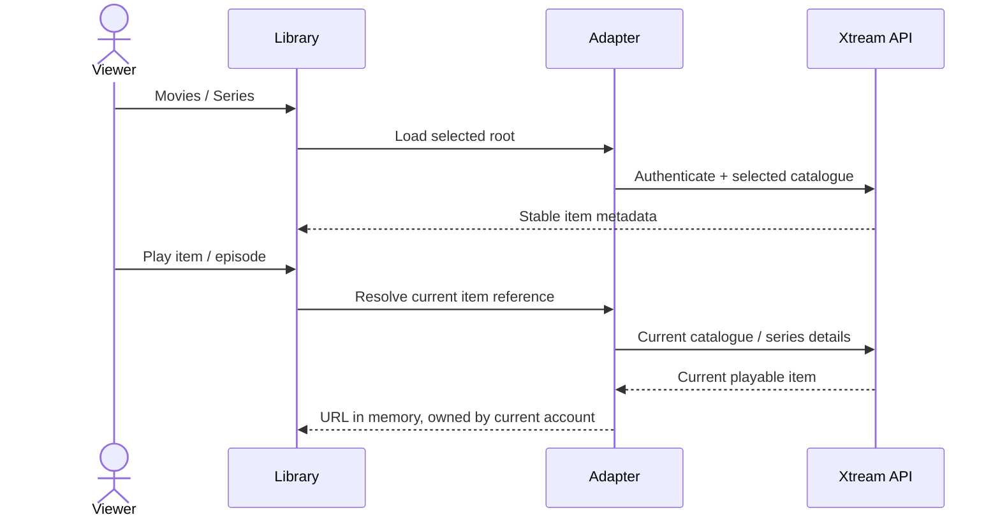

# Xtream movies and series

[Русский](xtream-media.ru.md) · [Improvements](roadmap-delivery.md)

Configure the Xtream provider and load its live catalogue, then open Media
Library. **Movies** and **Series** are separate lazy roots: opening the library
does not download both catalogues. Opening a series loads its episode details.
The existing shared-core Xtream parser creates identities and stream URLs;
the classic adapter only handles presentation and request lifetime.

Each selection resolves its stable request again against the current account.
Saved items omit the authenticated stream URL. A removed item cannot be revived
from the adapter's prior resolved row. Replacing credentials/provider or closing
the owner cancels outstanding work; stale responses cannot populate the next
account's screen. Provider-supplied names and artwork remain provider data.

The provider must allow the client's requests (CORS or the configured native
transport), and the device must support the returned media. This is not an
offline catalogue, cross-account migration, DRM bypass or new transcoder.
Catalogue freshness costs a request on selection. Errors are reported through
the existing localized library error; unavailable results do not start playback.

Run `node tests/test_xtream_media.cjs` for lazy roots, encoded credentials,
secret-free saved requests, removed items and source cancellation, and
`node tests/test_provider_drivers.cjs` for the actual provider lifecycle.
