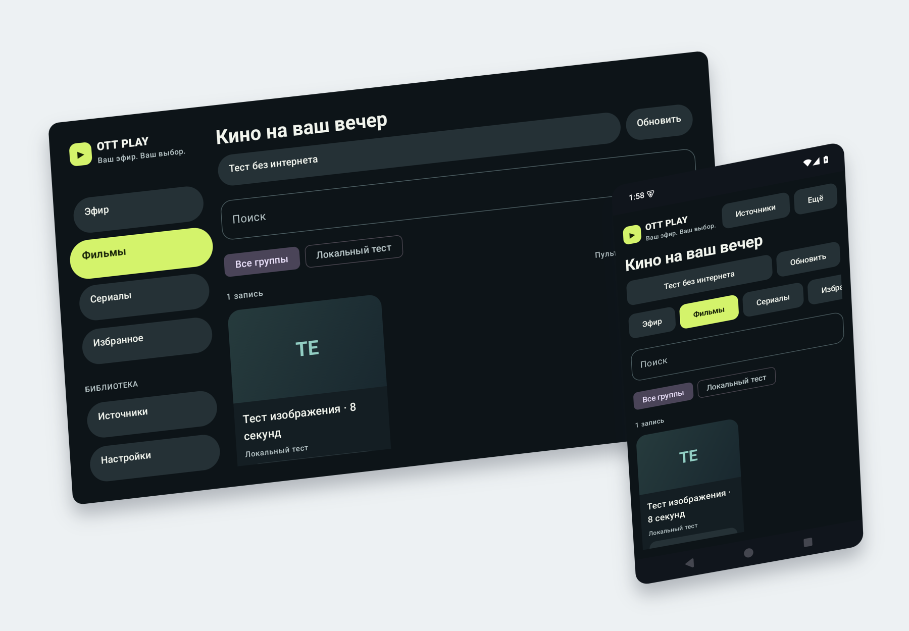

# OTT-play Native for Android

[](docs/screenshots/README.md)

*Android TV and phone captures from version 0.2.1 (build 3, 13 September 2026),
showing the offline synthetic demo in Russian. These illustrate the interface
and predate the current preview. [Original screenshots and regeneration](docs/screenshots/README.md).*

[](https://www.bestpractices.dev/projects/15592)

A standalone Android app for personal IPTV playlists, movies, and series. The interface uses Kotlin and Jetpack Compose; playback runs through Android Media3 / ExoPlayer. The app supports touch controls and Android TV remotes. The interface follows Android language preferences and falls back to English. Settings → Language can select a different language or return to System default; all 20 languages shipped by this Android app are included offline.

This is a separate product with application ID `play.ott.foss.nativeapp`. It can be installed alongside `ottplay-foss`. Signed previews use the separate ID `play.ott.foss.nativeapp.preview`, with a stable signing identity configured independently from production. Neither running nor building the app requires the JavaScript player, WebView, Capacitor, or Node.js. The current project version is `0.2.1`; implementing a feature does not establish compatibility with every TV, codec, or provider service.

## Getting started

1. Download the APK from [signed preview v0.2.1-preview.5](https://github.com/open-ott-play/ottplay-android/releases/tag/v0.2.1-preview.5) and install it on Android 8.0 / API 26 or later. See the [migration guide](docs/MIGRATION.md#installing-the-signed-02-preview) to transfer settings from an earlier installation.
2. Choose the demo option. The APK includes an eight-second synthetic video that works offline without an account. Its audio track is silent.
3. Add your M3U playlist, select a local M3U file, or enter your Xtream or Stalker account details.
4. Open a channel, movie, or episode. Programme listings can be loaded from the source's or playlist's XMLTV URL.

The linked preview includes the 20-language interface and is built from commit `b34fd3ff8741eac40db78a81864d34771d6b3156`. Later changes on `main` are not included in that APK. Android 4.x / KitKat devices are below the native app's minimum API level; keep their existing player and data instead of trying to replace it with this APK.

The app does not provide a subscription, a built-in commercial catalog, or permission to access sources. Use URLs and accounts you are authorized to access.

## Implemented features

- **M3U:** HTTPS downloads (HTTP is available in the separate full build) and selected-file imports, groups, names, logos, `tvg-id`, XMLTV, and standard HTTP headers. An HLS manifest is treated as one stream. Catch-up supports `default`, `append`, Flussonic, and recognized time placeholders; a fallback archive duration in hours can be set when the playlist has no catch-up tags.
- **Xtream:** separate APIs for live TV, movies, series, and episodes, plus the older combined `player_api.php` response containing `live_streams` and `categories`. Catch-up uses server time. Unsupported optional sections returning HTTP 404/405/501 are reported explicitly; authentication, network, and server errors are not treated as successful empty catalogs.
- **Stalker:** classic MAG handshake, profile, paginated channel lists, and `create_link`. The JSON-RPC protocol uses an explicitly configured endpoint ending in `/api/`. For endpoint configuration, see the [migration guide](docs/MIGRATION.md).
- **Interface:** Compose layouts for touch and TV, search, groups, favorites, movies, seasons and episodes, programme listings, and available catch-up playback. TV receives focus at launch and restores it when returning from the player. The native player menu selects available audio tracks, subtitles, speed, and scaling; the remote's Menu key opens it.
- **Track preferences:** [Guide](docs/TRACK-PREFERENCES.md) · [На русском](docs/TRACK-PREFERENCES.ru.md). Explicit audio/subtitle selections retain language and role across channels and restarts, including settings backups. Subtitle Off stays off; Auto restores platform selection. If the requested subtitles are missing, they remain off until that language returns. Unlabelled tracks with no language or role remain a selection for the current stream only. Numeric track indexes are never saved.
- **Playback:** a Media3 `MediaSessionService`, system media-session controls, phone background playback, and explicit stop. System PiP is available on supported phones. Android TV pauses when leaving the app and does not offer video PiP. It displays the current stream, not a second channel playing simultaneously. The service saves movie positions on pause, seek, item changes, and every five seconds, including while the screen is closed; completed movies restart from the beginning.
- **Data:** a local SQLite catalog and EPG. Source settings, saved stream URLs, and EPG URLs use AES-GCM encryption with an Android Keystore key. Source data is excluded from Android backup. Selected sources can be exported and imported as JSON.
- **EPG refresh:** WorkManager requests periodic work every six hours on an unmetered network. Android may defer execution; the interval is not a guaranteed schedule. Channel-list refresh is a separate action in the app.

## Compatibility boundaries

The app supports personal M3U playlists, Xtream accounts, and the two Stalker protocols described above. Provider-specific activation, account management and undocumented portal APIs are outside these contracts. See [PROVIDER-COMPATIBILITY.md](docs/PROVIDER-COMPATIBILITY.md) for source configuration requirements.

Supported Kodi license properties become native Media3 configurations for Widevine, PlayReady, and ClearKey. License URLs and headers are isolated from stream requests; unknown license transformations are rejected explicitly. Compatibility depends on the device's DRM module, container, provider license, and decoders. Unit tests do not establish acceptance for paid services or hardware DRM. The precise contract is documented in [docs/DRM.md](docs/DRM.md).

Release and preview enforce HTTPS for remote sources, provider APIs, artwork, EPG, media segments and DRM, including redirects. A separate `full` build (`play.ott.foss.nativeapp.full`) permits HTTP for legacy personal sources; HTTP does not encrypt transmitted data. Debug also permits HTTP for local test fixtures. Settings exports are plain JSON containing source URLs and credentials. Treat an export as a file containing passwords. Local-storage encryption does not encrypt exported files.

The offline privacy policy is available before setup and in settings. The [public privacy policy](https://astral-oasis-sbqd.here.now/) and [Play submission pack](docs/PLAY-CONSOLE-SUBMISSION.md) document current data flows and remaining Console steps. Google Play submission and content rights require separate preparation. The signed preview was published through a dedicated workflow that verifies the version, certificate, and complete phone/TV test matrix. The certificate and future release procedure are documented in [docs/RELEASING.md](docs/RELEASING.md); the current release assets include `release-manifest.json` and `SHA256SUMS` with exact source and artifact identities. The [historical publication report](docs/validation/native-0.2-preview-release-results.json) applies only to v0.2.0-preview.2. Store approval and Android TV certification are not claimed.

## Building

Install JDK 17 and the Android SDK with `platforms;android-37.0`, `build-tools;36.0.0`, and `platform-tools`. The minimum Android API remains 26 and the target API remains 36. The Gradle Wrapper is included. Set the SDK location with `ANDROID_HOME` or a local `local.properties` file; do not commit personal paths or signing keys.

OkHttp remains pinned to **5.4.0** pending a separate transport review and validation of the next version. The current compile SDK is already API 37; SDK availability is not the reason for retaining this pin. See the explicit update policy in `.github/dependabot.yml`.

The project pins Kotlin **2.4.20**, Android Gradle Plugin **9.4.1**, and Gradle **9.8.1**. The Android module uses AGP's built-in Kotlin support; the Kotlin/JVM, Compose compiler and serialization plugins remain explicitly configured. The Wrapper sets `distributionSha256Sum` from the [official Gradle 9.8.1 all checksum](https://services.gradle.org/distributions/gradle-9.8.1-all.zip.sha256) to verify the downloaded distribution.

```bash
./gradlew :core:test :app:testDebugUnitTest :app:lintDebug :app:assembleDebug
adb install -r app/build/outputs/apk/debug/app-debug.apk
```

The release build uses R8 and resource shrinking:

```bash
./gradlew :app:assembleRelease
```

`./gradlew :app:bundleRelease` also builds an AAB. Without an explicit signing configuration, the APK output is `app/build/outputs/apk/release/app-release-unsigned.apk`. It is not an installable update. Keep the same signing key for future updates to an installed app.

To run instrumentation tests, start a dedicated emulator or connect a test device:

```bash
./gradlew :app:connectedDebugAndroidTest
```

These tests exercise the app, media service, bundled-video decoding, Compose UI, Keystore, and storage. Use a test installation rather than a device with an active personal session.

## Code structure

`core/` is a Kotlin/JVM module containing source and catalog models, M3U, Xtream, Stalker, XMLTV, catch-up, cancellable HTTP requests, and legacy settings import. It has no Android UI dependency and contains no JavaScript.

`app/` contains the phone and TV Compose interface, Media3 player and media service, Android storage, Keystore, WorkManager, and file selection. Stream HTTP headers belong to each media item, so changing channels does not change the headers of an already-created media source.

## CI and validation

See [docs/VALIDATION.md](docs/VALIDATION.md) for host, device and release validation commands. Test results apply to the source revision, artifacts and devices recorded by each run.

The [Android workflow](.github/workflows/android.yml) runs core and Android unit tests, lint, and debug/release APK builds on pushes to `main`, pull requests and merge-queue commits, except when the shared classifier proves the changes are documentation-only. Such runs skip host and emulator jobs and produce no APKs. Manual runs always execute host checks. APKs are uploaded only on pushes to `main` and manual runs, and expire after one day; PRs still verify every build variant without retaining installable copies. Successful test/lint reports expire after one day; failed or cancelled job reports expire after three days. Signed release assets and their validation reports retain their separate release policy. [Dependabot](.github/dependabot.yml) maintains GitHub Actions and Gradle dependencies.

For manual workflow runs, `run_device_tests` enables two equally required jobs: phone API 35 (`google_apis`, `x86_64`, `pixel_7` profile) and Android TV API 36 (`android-tv`, `x86_64`, `tv_1080p` profile). The TV job uses a separate TV OS image; both jobs run the complete instrumentation suite and retain separate reports. Package `system-images;android-36;android-tv;x86_64`, revision 4, was verified in the stable `sdkmanager --list --channel=0` catalog. Both emulator jobs run automatically on non-documentation pushes to `main` and merge-queue commits, but not on ordinary PR updates. Manual runs enable them with `run_device_tests=true`, including on a PR branch when device validation is needed before merging. Use that manual option to qualify an exact release commit whose automatic run was documentation-only. Release publication still requires successful host, phone and TV jobs for the exact source commit; retained artifact files are not used to authorize publication. The workflow defines the validation procedure; each run's reports establish its results. Host tests, emulator tests, and physical-device experience are different levels of evidence.

Migration from the older app is described in [docs/MIGRATION.md](docs/MIGRATION.md). Validation instructions and release captures are available in [docs/VALIDATION.md](docs/VALIDATION.md) and [store](store/README.md).

Device jobs compile their APKs before booting Android and limit the remaining Gradle process to one worker and a 1536 MB heap. The Google APIs phone uses 3072 MB RAM and must sustain 30 seconds below the configured guest CPU/memory/I/O pressure thresholds within five minutes before tests start. The userdebug emulator's `su` reads those protected pressure files; the ADB daemon, app, and instrumentation retain their normal privileges. Pressure samples and system ANR reports are retained as diagnostics; a readiness timeout or failing test fails the job. The TV image retains 2048 MB RAM.

Boot readiness never injects keys into an unfinished launcher. After guest stabilization, CI dismisses the emulator keyguard through Window Manager and waits for the resolved HOME activity's window to hold focus. An ANR or crash dialog fails startup instead of being dismissed or allowed to intercept the app's UI tests. Launcher-readiness evidence and final window/input dumps are retained with each device report.

## Authoring language

Write code comments, documentation, commit messages, and pull-request text in English. Preserve UI translations, language choices, and external or provider data in their original languages.

## Shared domain core

XMLTV timestamp conversion is provided by the generated
`core/vendor/ottplay-core.jar`. SAX decoding, decompression limits and entity
rejection remain in the Android adapter. The Gradle compile task verifies the
JAR against `core/vendor/ottplay-core.manifest.json`. The artifact is compiled
from the OttPlay `shared-core` Kotlin Multiplatform source, also used by the
FOSS2 browser and Node EPG filter; do not restore an Android date parser copy.

`CatchupResolver` also delegates archive retention, identity checks, template
expansion and Flussonic selection to this JAR. Android supplies the IANA zone
database and OkHttp URL parser, then applies its existing origin-scoped headers.
The Android contract still allows the elapsed portion of a current programme;
FOSS2's completed-programme contract is an explicit profile in the same core.

`M3uParser` delegates line/metadata parsing, grouping, identity inputs, archive
metadata and directive order to the same JAR. It resolves URLs and decodes
headers/DRM with platform libraries. HLS, folded metadata, generated-name
localization and duplicate validation retain their existing contracts.

`XtreamProvider` delegates account validation, request order, catalog/series
normalization, identities, stream routes and archive eligibility to the JAR.
HTTP, JSON/URL decoding and native model/localization conversion stay here.
The core preserves embedded live responses, optional HTTP 404/405/501 sections
and the 100,000-row limit before deduplication and subsequent section requests.
Xtream adapter tests use MockWebServer for protocol and error-handling checks.

`StalkerProvider` delegates MAG and JSON-RPC request order, token/retry policy,
pagination, catalog identities and media-link interpretation to the same JAR.
The host retains OkHttp, JSON, mutexes and localized model conversion. Adapter
tests cover token reuse, one 401/403 retry, RPC formats and portal pagination
failures.

XMLTV programme validation, first-duplicate retention and channel/start ordering
also use the JAR. SAX, entity rejection and decompression/record limits remain
native. Parser fixtures cover the XMLTV output contract.

To update it, build the shared core and run its
`node scripts/distribute.cjs install-jvm /absolute/path/to/ottplay-android`, then
run `./gradlew :core:test :app:assembleDebug`. A normal Android build needs no
sibling source checkout.

Legacy settings interpretation, provider source/entry admission, favorites and
resume retention, backup validation/merge and source selection now also use this
JAR. The app's channel navigator delegates live catalog selection and stale switch
admission; the progress recorder delegates resume eligibility. DataStore, coroutines,
OkHttp/URL codecs, credential storage, Media3, DRM and OS controller trust remain
native effects. Adapter fixtures cover import and state behavior.

Canonical source: [ottplay-core/shared-core](https://github.com/open-ott-play/ottplay-core/tree/main/shared-core).
The core repository is public and its original code is MIT licensed. Pinned
consumer artifacts remain self-contained and carry source and artifact hashes;
rebuilding requires the corresponding source revision and documented toolchain.

Optional trusted-main k3s runner routing is documented in [CI runner selection](docs/CI-RUNNERS.md).

## Project maintenance

See [contribution and test requirements](CONTRIBUTING.md), the
[security reporting policy](SECURITY.md), [security design](docs/security-design.md),
the [OpenSSF evidence and remaining criteria](docs/openssf-evidence.md),
[governance](GOVERNANCE.md), [conduct policy](CODE_OF_CONDUCT.md), and
[maintenance roadmap](ROADMAP.md).
